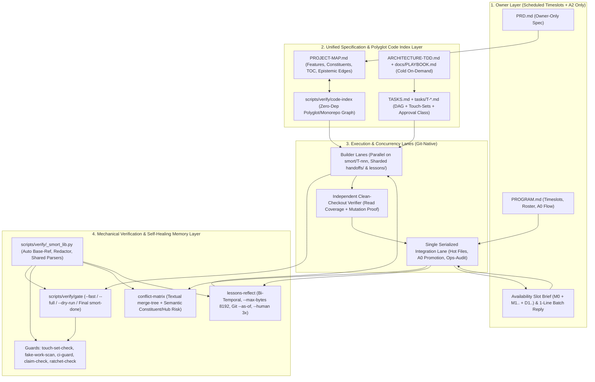
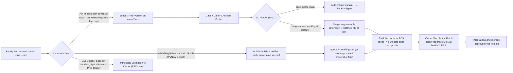

# smort

> **Single-file, zero-dependency operating system for autonomous, gated multi-agent software engineering — built to give developers their lives back.**

`smort v6` · Repo template version `2026-11-25.v10` · **28 self-extracted artifacts** (11 templates, 14 scripts/lib, 3 starter configs) · **0 third-party runtime dependencies** (Python 3 stdlib + POSIX Bash + `git`) · **No per-ticket 400-line cap** · Verified by 12-suite CI (`ubuntu-latest` + `macos-latest`) · LLM-agnostic & IDE-agnostic

Instead of babysitting coding agents all day typing *"Yes, continue development"*, agents auto-bootstrap with safe `ASSUMPTION:` defaults onto protected staging (`smort/dev`), index the codebase, derive and delegate cohesive tasks (**unbounded by line count — bounded by single scope & `touch_set`**), build red→green with negative-control proof, grade quality across 8 engineering domains, maintain bi-temporal self-healing work memory, and **continuously advance toward project completion** — leaving `main` 100% untouched and surfacing only genuine judgment calls and `main` merges (`M0` staged `smort/dev` + `M1..` `A1` PRs) at your **scheduled daily approval timeslots**.

---

## Explainer Video (`04:31` · 1080p Narrated Walkthrough)

[](https://github.com/smolboon/smort/blob/main/assets/smort_explainer.mp4)

**[Watch / Open `assets/smort_explainer.mp4`](./assets/smort_explainer.mp4)** · **[Direct Download (`17.67 MiB`, 1080p H.264 + AAC)](https://github.com/smolboon/smort/raw/main/assets/smort_explainer.mp4)** · **[Subtitles (`SRT`)](./assets/smort_explainer.srt)**

> *Note: The explainer video walks through the core `smort` architecture (`v5` 26-artifact layout). `smort v6` (`2026-11-25.v10`) expands this to **28 artifacts** by adding the Cold Playbook split (`docs/PLAYBOOK.md`), shared `_smort_lib.py` base-ref resolver, removing the 400-line per-ticket cap, hardening all verification gates, and shipping a 12-suite CI harness (`tests/verify_smort.py`).*

<details>
<summary><strong>Chapter Index (10 Chapters)</strong></summary>

| Timestamp | Chapter | Topic |
|---|---|---|
| `00:00` | **01 · Overview** | Stop Babysitting Your Coding Agents |
| `00:17` | **02 · The Problem** | Babysitting Trap vs. Unchecked Autonomy Collapse |
| `00:41` | **03 · What It Offers** | One Portable File → Zero-Dependency Repo Control Plane |
| `01:05` | **04 · Architecture** | 4-Layer Git-Native Control Plane, Source-of-Truth Precedence & Anti-Circularity |
| `01:34` | **05 · Autonomy & Slots** | `A0` / `A1` / `A2` Routing, Scheduled Owner Slots & 1-Line Batch Replies |
| `02:07` | **06 · Code & Map Index** | Unified `PROJECT-MAP` + Native Zero-Dep `code-index`, Hub Bypass & `not_shown` |
| `02:38` | **07 · Verification Gates** | Red→Green, Mechanical Shields, 3-Part Provenance Split & Clean-Checkout Verifier |
| `03:10` | **08 · Grading & Memory** | 8-Domain `T0–T3` + `k/n` Grading & Bi-Temporal Self-Healing `lessons-reflect` |
| `03:41` | **09 · Scale & Sanity** | Hot-Set & Perf Sanity Budgets, Linked Git Worktrees, `conflict-matrix` & Counted ROI |
| `04:07` | **10 · Get Started** | One-Prompt Agent Setup, `< 0.2 s` Local Self-Extractor & `github.com/smolboon/smort` |

</details>

---

## Table of Contents

- [Explainer Video (`04:31` · 1080p Narrated Walkthrough)](#explainer-video-0431--1080p-narrated-walkthrough)
1. [What Problem `smort` Solves](#1-what-problem-smort-solves)
2. [What `smort` Offers](#2-what-smort-offers)
   - [Inside `smort.md`: Complete File Map](#inside-smortmd-complete-file-map)
   - [Self-Extracted Repository Payload (28 Artifacts)](#self-extracted-repository-payload-28-artifacts)
3. [How `smort` Is Architected](#3-how-smort-is-architected)
   - [System Architecture Overview](#system-architecture-overview)
   - [Continuous `A0` / `A1` / `A2` Delivery & Timeslot Topology](#continuous-a0--a1--a2-delivery--timeslot-topology)
   - [Tiered Context Architecture (Hot Set vs. Cold On-Demand)](#tiered-context-architecture-hot-set-vs-cold-on-demand)
   - [Source-of-Truth & Rule Precedence](#source-of-truth--rule-precedence)
   - [Multi-Agent Concurrency, Solo Fast-Path & Worktree Isolation](#multi-agent-concurrency-solo-fast-path--worktree-isolation)
   - [Standardized CLI, Output & Exit-Code Contract](#standardized-cli-output--exit-code-contract)
4. [Why `smort` Is Architected the Way It Is](#4-why-smort-is-architected-the-way-it-is)
5. [How `smort` Works (End-to-End Lifecycle)](#5-how-smort-works-end-to-end-lifecycle)
6. [Features & Capabilities](#6-features--capabilities)
   - [6.1 Unified Project, Feature & Native Polyglot Code Graph Indexing](#61-unified-project-feature--native-polyglot-code-graph-indexing)
   - [6.2 Continuous Autonomy, Timeslot Governance & Attention Protection](#62-continuous-autonomy-timeslot-governance--attention-protection)
   - [6.3 Automated Task Creation, Delegation & Overlap Protection](#63-automated-task-creation-delegation--overlap-protection)
   - [6.4 Multi-Dimensional, Multi-Domain Grading (`AUDIT.md`)](#64-multi-dimensional-multi-domain-grading-auditmd)
   - [6.5 Epistemic Verification, Security & Anti-Slop Gates](#65-epistemic-verification-security--anti-slop-gates)
   - [6.6 Hot-Set Context-Tax & Performance Budgets](#66-hot-set-context-tax--performance-budgets)
   - [6.7 Bi-Temporal Self-Healing Experiential Memory](#67-bi-temporal-self-healing-experiential-memory)
   - [6.8 Shipped Scripts & Configs Reference](#68-shipped-scripts--configs-reference)
7. [How to Use `smort`](#7-how-to-use-smort)
   - [Prerequisites](#prerequisites)
   - [Quickstart: Hand `smort.md` to Any Agent](#quickstart-hand-smortmd-to-any-agent)
   - [Quickstart: Self-Extract Locally (< 0.2 s)](#quickstart-self-extract-locally--02-s)
   - [Install Paths (New Repo, Spike Branch, Existing Repo, Upgrade)](#install-paths-new-repo-spike-branch-existing-repo-upgrade)
   - [Owner Settings & Thresholds](#owner-settings--thresholds)
   - [Always-On Assistant Rules Snippet](#always-on-assistant-rules-snippet)
   - [Day-to-Day CLI Cheat Sheet](#day-to-day-cli-cheat-sheet)
   - [Owner Batch Reply Syntax](#owner-batch-reply-syntax)
   - [Running the Verification Suite Locally](#running-the-verification-suite-locally)
   - [When NOT to Use `smort`](#when-not-to-use-smort)

---

## 1. What Problem `smort` Solves

Modern AI coding agents can write thousands of lines of code per hour, yet developers routinely end up **trapped in one of two broken failure modes**:

1. **The Babysitting Loop:** Constantly answering *"Should I proceed?"*, *"Yes, continue development"*, manually resolving merge conflicts between parallel sessions, artificially chopping cohesive features into awkward 400-line fragments, repeating architecture constraints after every context compaction, and reviewing sprawling unverified diffs on ad-hoc interrupts all day.
2. **Unchecked Autonomy Collapse:** Letting agents merge freely without structural guardrails leads to silent security regressions, verifier-script tampering, circular dependencies, stale documentation, "green test theater" (tests that never failed before the fix or mock out the real code path), silent `200 OK` no-op stubs, runaway CI bills from hung workflows, bloated instruction files that exhaust startup context budgets, and LLM self-grading jitter.

| Failure Mode in Ad-Hoc Agent Workflows | How `smort` Eliminates It |
|---|---|
| Constant interrupts (*"Yes, continue?"*) | **Zero-Question Install + Approval Classes (`A0` / `A1` / `A2`) + Scheduled Timeslots:** `A0` flows continuously onto `smort/dev` from Day 0 (`main` untouched); `A1` is pre-built & verified into `awaiting-slot` and batched alongside `M0` (`smort/dev → main`) for `Morning`/`Evening` 1-line replies; `A2` interrupts only for real incidents. |
| Arbitrary line-count caps splitting cohesive features | **Scope-Bounded, Unbounded-Line Tickets (`MAX_PR_LINES = 0`):** Tickets are bounded by single cohesive goal and minimal `touch_set` rather than a 400-line ceiling; `gate-brief --max-prs 5` always admits ≥ 1 `A1` PR so cohesive large PRs never starve. |
| Agents guessing codebase structure or grepping blindly | **Unified Project Map + Native Polyglot Code Graph (`PROJECT-MAP.md` + `code-index`):** Deterministic Feature → Requirement → Constituent → Code TOC tree plus zero-dep AST/symbol/manifest blast-radius and hub analysis across Python, TS/JS, Rust, Go, Java/Kotlin, C/C++, C#, Terraform/HCL, SQL, and monorepo workspace manifests. |
| Multi-agent race conditions & merge hell | **Atomic Git CAS branch claims (`smort/T-nnn`)**, single serialized **Integration Lane** for hot files (with a **Solo Fast-Path** for single-agent repos), sharded builder files (`handoffs/`, `verify/lessons/`, `changes/`), linked worktree support, and textual + semantic `conflict-matrix`. |
| Same-session self-approval, gate tampering & fake green tests | **Strict `BASE..HEAD` Red→Green SHA verification**, negative-control/mutation proof, 3-part **Provenance Split**, immutable `scripts/verify/*` & `verify/*.json` protection, independent clean-checkout **Verifier** with logged read coverage, and explicit **Anti-Circularity** rules. |
| Context amnesia & Week-2 instruction-file bloat | **Hot/Cold Tiered Split (`AGENTS.md` ≤ 20 KB + `docs/PLAYBOOK.md` on-demand):** Enforced by `ratchet-check --verify-config --check-hot-set` (including sharded `handoffs/*.md`), keeping Week-2 worst-case Hot Set at **51.6 KB / 64 KB** (nearly 14 KB permanent headroom) with automatic `8 KB` compaction in `lessons-reflect`. |
| Unverified doc claims, silent stubs & hung CI jobs | Mechanical Day-1 gates: `claim-check` (`verify/claims.json`), block-scalar-aware `ci-guard`, `fake-work-scan` (`--staged` secrets, Python `except: pass`, Go/Java/Py/TS/Rust test deletions, slop), and comment-aware `code-index bypass`. |
| Stale lessons & repeated agent mistakes | **Bi-temporal self-healing memory (`lessons-reflect`):** SHA-256 content-addressed deduplication, 30-day decay, `≥ 2` corroboration, `human: true` 3× owner override authority, SHA-256 file-fingerprint retirement, automatic `8 KB` budget compaction, and Git-backed `--as-of` history. |
| Heavy orchestrator lock-in, binaries & telemetry | **1 single file ([`smort.md`](./smort.md))**, zero external runtime dependencies, zero databases, zero daemons, zero telemetry/phone-home — everything lives as plain Git-tracked Markdown, JSON, Python stdlib, and Bash inside your repo. |

---

## 2. What `smort` Offers

`smort` packs an entire software-engineering control plane into a single portable file: **[`smort.md`](./smort.md)**.

### Inside `smort.md`: Complete File Map

| Section in [`smort.md`](./smort.md) | Purpose |
|---|---|
| **Overview & Core Terms** | Autonomous-First Execution Law, approval classes (`A0`/`A1`/`A2`, no per-ticket line cap), roles (Owner, Builder, Integration Lane, Verifier, Merger), trusted authors, epistemic vocabulary (`ASSUMPTION:`, `unknown`, `unverifiable`). |
| **§1 START HERE: Resume Protocol** | State detection (install / upgrade / resume), Hot Set vs. Cold on-demand reads, Source-of-Truth Precedence, Anti-Circularity rule, atomic claim & continuous loop, pre-commit `--staged` scan & crash-safe handoff. |
| **§2 Core Invariants (Quick Map)** | Single-table index of all non-negotiable rules pointing to canonical clauses in `AGENTS.md` and `docs/PLAYBOOK.md`. |
| **§3 Owner Settings & Thresholds** | Zero-question auto-detect configuration table (`ASSUMPTION:` defaults for timeslots, `stage-smort-dev`, sensitive paths, maturity target, roster, caps) and aligned thresholds (`MAX_OPEN_PRS`, `MAX_SLOT_PRS`, `AUDIT_MAX_MIN`, `80%` coverage, `5%` perf budget). |
| **§4 Install, Upgrade, and Spikes** | Self-extracting Python bootstrapper (§4.1, 28 blocks) + harness allowlist, immediate `--self-test` verification, `v3–v9 → v10` upgrade guide (§4.2), zero-wait Path A greenfield + non-mergeable `spike/<slug>` escape hatch (§4.3), non-destructive zero-wait Path B existing-repo adoption (§4.4). |
| **§5 The Loop** | Role separation, Solo/Single-Agent Fast-Path (§5.1), continuous `A0`/`A1` promotion flow (§5.2), Fast Gate (`≤ 15 min`) vs. Deep Gate (§5.3), cron/manual scheduling, usage/freeze/completion stop conditions (§5.4). |
| **§6 Multi-Dimensional, Multi-Domain Grading** | 3 Completion & Autonomy dimensions × 8 Engineering Quality domains graded by discrete Maturity Tier (`T0–T3`) + deterministic checklist ratio (`k/n`) with objective merge blocks. |
| **§7 Repo Templates (`§7.1–§7.11`)** | All 11 ready-to-extract governance, playbook, architecture, task, audit, and handoff templates (fenced with `~~~~`). |
| **§8 Shipped Starter Scripts & Configs (`§8.1–§8.17`)** | Shared `_smort_lib.py`, 13 executable zero-dependency verification/coordination scripts, and 3 declarative starter JSON configs (fenced with `~~~~`). |

### Self-Extracted Repository Payload (28 Artifacts)

Running the §4.1 extractor materializes the complete control plane directly into your repository without ever overwriting existing files (collisions write to `<file>.smort-new`):

| Category | Extracted Path | Role |
|---|---|---|
| **Governance & Playbook (4)** | `AGENTS.md` | **Hot Ruleset (19.5 KB / 155 lines):** project facts, stale-prior table, hard rules `1.0–1.14`, active budgets, daily commands, security & trust boundaries, pointer to `docs/PLAYBOOK.md`, permanent Known Mistakes (`M1–M15`). |
| | `docs/PLAYBOOK.md` | **Cold Reference Manual (on-demand via `project-map --section`):** stack presets, working method (hybrid human, Reference-Coding + License Wall), full verifiability & Provenance Split PoW, QA bar, slop list, Definition of Done, PR checklist. |
| | `PROGRAM.md` | Owner availability timeslots, `A0` flow (`stage-smort-dev` / `auto-merge-main`), roster/solo fast-path, daily rhythm, reconciliation, 3-Outcome Triage, `M0`/`M1..` slot brief format, 1-line batch reply syntax, hotfix & completion protocol. |
| | `DEVELOPMENT-WORKFLOW.md` | One-page canonical map of where every artifact lives and how work flows from idea to completion. |
| **Specs, Maps & Tasks (4)** | `PRD.md` | 100% owner-owned product requirements, personas, JTBD, success/guardrail metrics, FR/NFR, MoSCoW, non-goals, compliance. |
| | `PROJECT-MAP.md` | Unified project index: Feature Index (`F-nnn`), Constituent Registry (`S*.C*`), auto-generated visual TOC tree, Epistemic Dependencies (`EXTRACTED`/`INFERRED`/`AMBIGUOUS`), External Deps/Licenses, auto-generated Build Order & Critical Path. |
| | `ARCHITECTURE-TDD.md` | Topology, durable vs. invocation state, API/boundary contracts (verified by `code-index verify-docs`), Auth & Hub Bypass boundaries, STRIDE, Zero-Trust Release Verification, testing, measured budgets, ADRs, task derivation. |
| | `TASKS.md` | Task schema (`approval: A0/A1`, `lane`, `estimate: S|M|L`, `touch_set`), atomic Git CAS claim protocol, full §5 delegation algorithm, 5 continuous task-creation triggers + 3-Outcome Triage, shrink-guarded generated index. |
| **Grading & Continuity (3)** | `AUDIT.md` | Executive completion dashboard, 8-domain scorecard (`T0–T3` + `k/n`), open findings, binary tier checklists. |
| | `AUDIT-LOG.md` | Append-only historical log of nightly multi-dimensional audits. |
| | `HANDOFF.md` | Compact crash-safe resume rollup strictly bounded to `≤ 4 KB / ≤ 60 lines` (paired with per-agent `handoffs/<agent-slug>.md`, also budget-checked). |
| **Shared Library & Scripts (14)** | `scripts/verify/_smort_lib.py` | Shared zero-dep core: auto-resolving Git base ref (`origin/smort/dev`, `origin/main`, `origin/master`, local), canonical secret redactor, YAML frontmatter & Markdown table parsers, constituent leaf resolver, worktree cache resolver, dotfile-safe glob matcher, token estimator. |
| | `scripts/verify/gate` | Master Fast/Deep gate (`--fast`, `--full`, `--dry-run`, `--emit-pow`, `SMORT_ALLOWED_IDENT`, unlimited per-ticket default + opt-in `--max-lines N`, untracked clean-tree catch, strict `BASE..HEAD` `--red-sha`, `ratchet-check --verify-config`, guaranteed final-line `smort-done`). |
| | `scripts/verify/touch-set-check` | Auto-resolves base; enforces task `touch_set`, `DO_NOT_TOUCH`, and mechanical `A0 SENSITIVE-PATH ESCALATION` blocking. |
| | `scripts/verify/fake-work-scan` | Pre-commit `--staged` or branch diff scan: `.env`, secret literals, immutable `scripts/verify/*` & `verify/*.json` guard, `A1`-aware CI/manifest guard, Python `except: pass`, slop, debug prints, TS `any`, JS/TS/Py/Rust/Go/Java test deletions, plus `--redact`. |
| | `scripts/verify/ratchet-check` | Monotonic quality ratchets + `--verify-config` schema/NaN check + hot-set budgets (including sharded `handoffs/*.md`) + perf ceilings/sanity floors + exit-4 ADR gate. |
| | `scripts/verify/tasks-index` | Validates task frontmatter & DAG, overlays live `origin/smort/T-*` branches (`--live --next`), full §5 ranking (lifecycle/freeze, `PROJECT-MAP §3` order, constituent deps, dependents unblocked, `S<M<L`, `DO_NOT_TOUCH`), `--claim-check`, `--compact`, `--json`, exit-4 shrink-guard. |
| | `scripts/verify/project-map` | Validates Feature/Constituent/Edge tables (banning confidence `0.5`, excluding `type-only` cycles), generates TOC & build order, live secret-redacted `--section` reader (covering `docs/PLAYBOOK.md` automatically), `--impact`, `--dry-run`. |
| | `scripts/verify/code-index` | Native zero-dep polyglot/monorepo AST/symbol/manifest graph (Python `ast`, TS/JS, Rust, Go, Java/Kotlin, C/C++, C#, Terraform/HCL, SQL; depth-3 workspace manifests): `build`, `query`, `affected`, `hubs`, `--cycles`, `--check-map`, comment-aware `bypass`, `verify-docs`, `--worktree shared\|isolated`. |
| | `scripts/verify/conflict-matrix` | Predictive `git merge-tree` textual conflicts (handling spaces & rename/delete) + semantic (constituent/edge/hub) risk across open branches (`--worktree shared\|isolated`, second-precision reports). |
| | `scripts/verify/gate-brief` | Generates secret-redacted 1-screen human-prose owner slot brief with batched **`M0` (`smort/dev → main`)**, `--max-prs 5` slot cap (always admitting ≥ 1 `A1` PR so cohesive large PRs never starve), accurate `smort/dev` counted ROI, and `_not_shown_`. |
| | `scripts/verify/lessons-reflect` | Bi-temporal experiential memory: sharded logging, SHA-256 dedup, 30-day decay, corroboration, `--human` 3× overrides, SHA-256 staleness retirement, automatic `--max-bytes 8192` budget compaction, and Git-backed `--as-of YYYY-MM-DD` time travel. |
| | `scripts/verify/ci-guard` | Validates `.github/workflows/*.{yml,yaml}` job-level `timeout-minutes` (`1..60`), supporting 2/4-space YAML, block scalars (`|`/`>`), expression timeouts (`--allow-expr-timeout`), reusable `uses:` exemptions, and `--self-test`. |
| | `scripts/verify/claim-check` | CommonMark-fence-aware declarative doc-claim linter reading `verify/claims.json`, with built-in `--self-test`. |
| | `scripts/verify/project-checks.sh` | Repo-specific lint/type/test/build hook (exits `2` `UNVERIFIABLE` on Day 1 until wired to real project commands). |
| **Starter Configs (3)** | `verify/ratchet.json` | Monotonic quality floors (`test_count`, `coverage_pct`, `mutation_pct`). |
| | `verify/claims.json` | Declarative doc-truth lint rules (`SMORT-NO-LOCAL-EVIDENCE`, `SMORT-NO-FALSE-CI-GREEN`). |
| | `verify/budgets.json` | Agent hot-set context-tax ceilings (`HANDOFF.md` & `handoffs/*.md`, `LESSONS.md`, combined bytes & est tokens) and performance/sanity budgets. |

---

## 3. How `smort` Is Architected

### System Architecture Overview

`smort` is structured as a **Git-native 4-layer control plane**. Every coordination primitive — task claims, code orientation, quality gates, memory, conflict detection, and owner approvals — operates directly on version-controlled files and Git refs with zero external services.



### Continuous `A0` / `A1` / `A2` Delivery & Timeslot Topology

`smort` decouples **engineering throughput** from **human calendar availability** by routing tasks strictly by risk class — without imposing an arbitrary line-count cap per ticket:



### Tiered Context Architecture (Hot Set vs. Cold On-Demand)

Every agent session — including immediately after context compaction or crash restarts — loads a slim, mechanically budgeted **Hot Set**, then pulls deep playbook, architecture, and code context strictly on demand:

| Tier | Loaded When | Files / Commands | Measured Budget & Guard |
|---|---|---|---|
| **Tier 1: Hot Set** | Every session start & post-compaction resume | `AGENTS.md` (Hot Ruleset: `19,519 B`), `PROGRAM.md` (`19,825 B`), `HANDOFF.md` (`2,124 B`) + `handoffs/<agent>.md`, `verify/LESSONS.md` (auto-compacted ≤ `8,192 B`), `AUDIT.md §1`, newest `AUDIT-LOG.md`, `tasks-index --live --next --compact` | Enforced by `ratchet-check --verify-config --budgets verify/budgets.json --check-hot-set` (`HANDOFF.md` & `handoffs/*.md` ≤ `4,096 B` / 60 lines; `LESSONS.md` ≤ `8,192 B`; total ≤ `65,536 B` / `18,000` est tokens). **Measured Day-1: `41,468 B` (`10,368` est tok, -28.3% vs v5); Week-2 worst case: `51,625 B` (`14,550` est tok — `13,911 B` permanent headroom).** |
| **Tier 2: Cold Playbook & Spec Sections** | Only for active or top candidate task | `project-map --section "<heading>"` (automatically searches `docs/PLAYBOOK.md`, `ARCHITECTURE-TDD.md`, `PROJECT-MAP.md`, `PRD.md`, etc.; live disk read, secret-redacted, non-truncatable `not_shown` footer) and `project-map --impact <S*.C*> --compact` | Keeps `docs/PLAYBOOK.md` (`17,969 B`), `ARCHITECTURE-TDD.md`, `PRD.md`, and `tasks/archive/` out of startup context |
| **Tier 3: Native Code Orientation** | Before broad grep or editing | `code-index query "<question>" --compact` and `code-index affected <file-or-symbol> --compact` | Exact `file:line` callers, inheritance, hubs, blast radius in milliseconds, with explicit `not_shown` counts outside `--budget` |

### Source-of-Truth & Rule Precedence

When instructions or documents disagree, agents resolve conflicts deterministically without stalling or guessing:

- **Rule Precedence:** `Owner Hard Rules (AGENTS.md §1.0)` **>** `AGENTS.md §1` **>** `smort.md` **>** `task prompt`
- **Fact Precedence:** `live code & observed test output` **>** `PROJECT-MAP.md` **>** `ARCHITECTURE-TDD.md` **>** `PRD.md` **>** `HANDOFF.md` **>** `verify/LESSONS.md`
- **Anti-Circularity Invariant:** An agent may **never** cite `PROJECT-MAP.md`, `TASKS.md §9`, `verify/code-index.json`, `verify/LESSONS.md`, or `HANDOFF.md` as verification evidence when auditing or modifying that artifact, the verification gate, or freshly edited code. Verification must always inspect live source files and execute real tests directly.

### Multi-Agent Concurrency, Solo Fast-Path & Worktree Isolation

`smort` scales cleanly from a single developer + one coding agent up to parallel multi-agent fleets with zero external servers:

1. **Solo / Single-Agent Fast-Path (`smort.md §5.1`):** When only one agent operates the repo (`{{AGENT_ROSTER}} = solo`), it runs Builder and Integration steps sequentially (passing `--lane integration` only on integration/audit PRs, never to bypass builder guards) and invokes a **fresh clean-context session** for independent verification labelled `verified (fresh-session, same-model)`.
2. **Atomic Git CAS Claiming:** Builders branch off the auto-resolved integration base (`origin/smort/dev` in `stage-smort-dev`, else `origin/main` or local branch) using the exact canonical branch name `smort/T-nnn`. Simultaneous duplicate claims collide atomically at `git push`.
3. **Double-Checked Overlap Lock:** Immediately after pushing, the builder runs `git fetch origin && scripts/verify/tasks-index --live --claim-check T-nnn`. If a higher-precedence overlapping task (`P0 < P1 < P2 < P3`, then lower `T-nnn`) won a same-second race, the loser deletes its remote claim and re-picks.
4. **Hot-File Serialization + Sharded Writes:** Only the serialized **Integration Lane** edits root hot files (`PROJECT-MAP.md`, `TASKS.md §9`, `AUDIT.md`, `AUDIT-LOG.md`, `HANDOFF.md`, `verify/LESSONS.md`, `verify/*.json`, `scripts/verify/*`). Parallel builders write only to task-scoped or agent-scoped files (`tasks/T-nnn-*.md`, `changes/T-nnn.md`, `handoffs/<agent-slug>.md`, `verify/lessons/T-nnn.jsonl`).
5. **Linked Git Worktrees & Committer Identity Guard:** `code-index`, `conflict-matrix`, and `lessons-reflect` all support `--worktree shared|isolated` via `_smort_lib.py`, and `gate` supports `SMORT_ALLOWED_IDENT` (via `git var`) to prevent cross-agent commit identity contamination.

### Standardized CLI, Output & Exit-Code Contract

All shipped `smort` scripts adhere to a unified machine-and-human protocol:

| Exit Code | Meaning | Used By |
|---|---|---|
| **`0`** | Pass / clean / succeeded | All scripts |
| **`1`** | Gate failure, drift, security/bypass violation, or config corruption | `gate`, `touch-set-check`, `fake-work-scan`, `ci-guard`, `claim-check`, `ratchet-check`, `project-map --check`, `code-index`, `conflict-matrix` |
| **`2`** | Usage error, invalid explicit `--base`, or `UNVERIFIABLE` (missing secret scanner / unwired `project-checks.sh`) | `_smort_lib.py`, `gate` (`reason=unverifiable` / `invalid-base`), CLI arg parsing |
| **`3`** | Ambiguous match (multiple headings/symbols match query) | `project-map --section`, `code-index` |
| **`4`** | Not found **or** `NEEDS_DECISION` non-TTY confirmation gate | `gate --dry-run` (over opt-in `--max-lines`), `ratchet-check --allow-lower` without `--decision D-nnn`, write-mode shrink-guards (`tasks-index`, `project-map`, `code-index`), missing target lookup |

- **Machine-vs-Human Output Discipline:** `--compact` emits terse `@ok` / `@no` / `@edge` / `@not_shown` lines strictly for agent-to-tool exchanges; every human-facing artifact (`gate-brief`, PR bodies, `PRD.md`, `HANDOFF.md`) is plain human prose.
- **Non-Truncatable `not_shown` Accounting:** Whenever output is capped, compacted, or filtered (`--budget`, `--max-chars`, `--max-bytes`, `--max-prs`, `--lane`, deduplication, staleness retirement), scripts emit an explicit `not_shown` summary **outside** the truncation budget.
- **Guaranteed Final-Line Terminal Summary:** `scripts/verify/gate` ALWAYS outputs one control-character-sanitized machine-parseable summary as its **very last line** (even with `--emit-pow`):
  ```text
  smort-done ok=1 exit=0 reason=pass mode=fast branch=smort/T-001 sha=a1b2c3d fails=0 unverifiable=0 wall=2s
  ```

---

## 4. Why `smort` Is Architected the Way It Is

Every major design choice in `smort` counters a specific, recurring failure mode observed in real autonomous agent workflows:

1. **Why one self-extracting Markdown file with zero third-party runtime dependencies?**
   External orchestrator frameworks break on Python/Node version drift, require MCP daemons or vector databases, fail in air-gapped CI, or phone home. Compiling all 11 templates, 14 stdlib scripts/lib, and 3 starter configs into one auditable [`smort.md`](./smort.md) file (verified `0` non-stdlib imports across all 12 Python files in CI) lets any repo bootstrap in `< 0.2 s` with zero supply-chain surface.
2. **Why remove the 400-line per-ticket cap while keeping `touch_set` & `A1` risk gating?**
   Hard line caps force agents to split cohesive features into half-wired intermediate PRs and arbitrarily escalate safe internal refactors into human review slots. Bounding tickets by single cohesive scope + minimal `touch_set`, gating `A1` strictly by risk path (not line count), and pacing owner review slots by PR count (`--max-prs 5`, always admitting ≥ 1 PR) protects review quality without fragmenting features or starving large cohesive PRs.
3. **Why split `AGENTS.md` (Hot ≤ 20 KB) from `docs/PLAYBOOK.md` (Cold on-demand)?**
   Without splitting hot rules from cold reference procedures, `AGENTS.md` (`36.7 KB` in v5) + `PROGRAM.md` (`19.1 KB`) + full `HANDOFF.md` (`4 KB`) + full `LESSONS.md` (`8 KB`) hit `68 KB` in Week 2 — blowing past the `64 KB` ceiling. Extracting presets, QA tables, slop lists, and PR checklists into `docs/PLAYBOOK.md` (discoverable via `project-map --section`) cuts `AGENTS.md` by ~47% and leaves **`13.9 KB` permanent Week-2 headroom**.
4. **Why centralize `_smort_lib.py` for Git base-ref resolution and redaction?**
   In `stage-smort-dev` (Day-0 default), `master`-branch repos, or offline local-only repos, scripts hardcoding `origin/main` produced false diffs and missed `smort/dev` ROI. One shared zero-dep module resolves `origin/smort/dev` vs `origin/main` vs `origin/master` vs local branches identically across all 6 Git scripts while failing loudly (`exit 2`) if an explicit `--base` ref is invalid.
5. **Why immutable `scripts/verify/*` + `A1`-aware config guards in `fake-work-scan`?**
   If a builder agent could modify `scripts/verify/gate` or `verify/budgets.json`, it could weaken its own verification checks to appear green. Locking `scripts/verify/*` and `verify/*.json` exclusively to `--lane integration` closes that loophole, while permitting builders on authorized `approval: A1` tasks to edit `.github/workflows/` and manifests explicitly listed in their `touch_set` eliminates unnecessary workflow friction.
6. **Why discrete Maturity Tiers (`T0–T3`) + checklist ratios (`k/n`) instead of `0–10` LLM scores?**
   Asking an LLM to score code `8.3/10` produces non-reproducible jitter across runs and models. Binary pass/fail criteria grouped into discrete tiers (`T0–T3`) with exact ratios (`k/n` passing toward the next tier) make quality regression blocks deterministic and incremental progress visible.
7. **Why build a native stdlib polyglot code graph (`code-index`) — paired with Anti-Circularity?**
   Agents burn huge token budgets grepping repos and still miss indirect callers, monorepo workspace manifests, or cross-constituent import cycles. A stdlib multi-language indexer (Python AST + TS/JS/Rust/Go/Java/Kotlin/C/C++/C#/Terraform/SQL + depth-3 manifests) provides sub-second blast-radius, hub, cycle, map-drift, doc-symbol sync, and comment-safe Hub Bypass checks with zero external packages — while Anti-Circularity ensures indexes accelerate navigation without ever replacing live source reads and real test runs.
8. **Why strict `BASE..HEAD` Red→Green SHAs, negative controls, Provenance Splits, and Clean-Checkout Verifiers?**
   Passing `--red-sha HEAD` or `--red-sha <merge-base>` would satisfy a naive ancestry check without proving a failing test preceded the fix. Requiring `--red-sha` strictly inside `BASE..HEAD` (`!= HEAD`, strictly after `merge-base`), pairing it with targeted mutation/negative-control proof, 3-part Provenance Split (`Verified` / `Assumed + Falsifier` / `Not run`), and full read-coverage logging (`lines_read/total_lines`) closes "green test theater".
9. **Why bi-temporal, auto-compacting, Git-backed experiential memory (`lessons-reflect`)?**
   Append-only agent notes bloat until they overflow startup budgets or give stale advice after refactors. SHA-256 content-addressed IDs prevent duplicate inflation; 30-day decay + `≥ 2` corroboration filters noise; `--human` gives owner overrides 3× authority; SHA-256 file fingerprints auto-retire stale notes (verified historically against Git commits during `--as-of YYYY-MM-DD` audits); and `--max-bytes 8192` guarantees `verify/LESSONS.md` never breaches hot-set budgets.

---

## 5. How `smort` Works (End-to-End Lifecycle)

```mermaid
sequenceDiagram
    participant Owner as Human Owner
    participant Builder as Builder Agent(s)
    participant Gate as scripts/verify/gate
    participant Verifier as Clean-Checkout Verifier
    participant Integ as Integration Lane

    Note over Owner,Integ: Phase 1 — Zero-Question Install & Immediate smort/dev Staging
    Builder->>Integ: Auto-detect defaults (§3), extract 28 files (§4.1), open smort/install + branch smort/dev
    Integ-->>Owner: Queue async Spec Slot (D-001 & ASSUMPTION overrides) — zero wait!

    Note over Builder,Integ: Phase 2 — Continuous Autonomous Execution (No Line Cap, Zero Chat Prompts)
    loop While ready tasks exist
        Builder->>Builder: tasks-index --live --next --compact -> atomic claim smort/T-nnn
        Builder->>Builder: Orient via code-index affected/query & project-map --section
        Builder->>Builder: Commit failing check (Red SHA in BASE..HEAD) -> cohesive build in touch_set
        Builder->>Gate: fake-work-scan --staged -> commit -> gate --fast --task T-nnn --red-sha <sha> --emit-pow
        Gate-->>Builder: Provenance Split PoW + final-line smort-done ok=1 exit=0
        Builder->>Verifier: Open PR (in-review) & immediately claim next task
        Verifier->>Gate: Clean checkout + full read-coverage + negative-control check
        Verifier-->>Integ: Label PR verified
        alt Task is A0 (Autonomous)
            Integ->>Integ: Rebase + fast gate + integrate onto smort/dev Day 0 (or main per D-001)
        else Task is A1 (Sensitive / Judgment)
            Integ->>Integ: Pre-built & verified -> queue in awaiting-slot for next Owner Timeslot
        end
    end

    Note over Owner,Integ: Phase 3 — Scheduled Owner Availability Slot
    Integ->>Integ: T-45 reconcile + conflict-matrix -> T-15 freeze -> T-10 gate-brief
    Integ->>Owner: Send 1-screen human-prose brief (M0 smort/dev + M1..Mk + D1..Dn + Counted ROI)
    Owner->>Integ: Single batch reply ("approve M0 M1 M2; hold M3; D1 A")
    Integ->>Integ: Promote smort/dev + merge approved A1 PRs to main & record ADRs

    Note over Owner,Integ: Phase 4 — Bounded Nightly Pass (<= AUDIT_MAX_MIN)
    Integ->>Integ: Deep gate + 8-domain AUDIT + lessons-reflect build (<= 8 KB) -> smort/ops-audit PR
```

1. **Zero-Question Install & Immediate Staging (`smort/install` → `smort/dev`):** Auto-detect settings (`ASSUMPTION:` defaults), extract all 28 artifacts, verify `--self-test` & hot-set budgets, draft or reverse-engineer `PRD.md`, `PROJECT-MAP.md`, and `ARCHITECTURE-TDD.md`, open `smort/install`, queue async `D-001` for the first slot, and **immediately branch `smort/dev`** (`main` stays 100% untouched) to start building without waiting in chat.
2. **Orient & Claim:** Builders run `tasks-index --live --next --lane <lane> --compact` (honoring lifecycle/freeze, `PROJECT-MAP §3` build order, constituent deps, dependents unblocked, estimate `S<M<L`, and `DO_NOT_TOUCH`), claim the top task via canonical branch `smort/T-nnn`, and confirm no claim-race conflict via `--claim-check`.
3. **Research & Build Red→Green:** Builders orient via `code-index query`/`affected` and `project-map --section` (covering `docs/PLAYBOOK.md` and design docs), apply Reference-Coding & License Wall (`docs/PLAYBOOK.md §2.9`), commit failing checks first (`Red` SHA strictly inside `BASE..HEAD`), implement cohesively inside `touch_set` (no 400-line cap), run `fake-work-scan --staged` pre-commit, prove negative-control failure, and log discoveries via `lessons-reflect log`.
4. **Mechanical Gate + Independent Verification:** `scripts/verify/gate --fast --task T-nnn --red-sha <sha> --emit-pow` auto-resolves the base ref, checks clean tree (including untracked files), runs all mechanical checks, emits a 3-part Provenance Split PoW block, and finishes with `smort-done ok=1 exit=0`. A clean-checkout **Verifier** verifies full read coverage and grants `verified`.
5. **Zero-Stall Promotion:** Verified `A0` PRs integrate immediately onto green-only `smort/dev` (or directly to `main` once `D-001` authorizes `auto-merge-main`); verified `A1` PRs wait cleanly in `awaiting-slot` while builders immediately claim the next task.
6. **Scheduled Timeslot Approval:** At `T-45`, Integration Lane reconciles and runs `conflict-matrix`; at `T-15`, pushes freeze; at `T-10`, `gate-brief` emits a 1-screen plain-prose brief featuring **`M0`** (`smort/dev → main` batched promotion), up to `--max-prs 5` `A1` PRs (never starving large cohesive PRs), `D1..` decisions, and counted ROI. You reply once, and the loop rolls on.
7. **Nightly Deep Audit & Project Completion:** A timeboxed nightly pass (`≤ {{AUDIT_MAX_MIN}}` min) runs `gate --full --lane integration`, compacts `verify/LESSONS.md` (`≤ 8 KB`), updates `AUDIT.md` + `AUDIT-LOG.md`, archives merged tasks, and updates `smort/ops-audit`. Once 100% of `Must` features are verified and all 8 domains meet `{{MATURITY_TARGET}}`, the repo automatically switches to quiet **`maintenance` mode**.

---

## 6. Features & Capabilities

### 6.1 Unified Project, Feature & Native Polyglot Code Graph Indexing
- **Single Structural Map (`PROJECT-MAP.md` + `project-map`):** Connects Features (`F-nnn`) ↔ Requirements (`FR-nnn`) ↔ Constituents (`S*.C*`) ↔ Source/Test Paths ↔ Epistemic Dependencies (`EXTRACTED`, `INFERRED (conf)` with `0.5` banned, `AMBIGUOUS`) ↔ External Deps & Licenses. Auto-generates the visual Table of Contents tree, topological build order, and critical path while excluding `type-only`/`deferred` edges from cycle errors.
- **Native Polyglot/Monorepo Code Graph (`code-index`):** Zero-dependency indexer supporting **Python (`ast`), TypeScript/JavaScript, Rust, Go, Java/Kotlin, C/C++, C#, Terraform/HCL, SQL**, user `scripts/` (excluding only `scripts/verify/*`), and **nested monorepo workspace manifests** (`pyproject.toml`, `package.json`, `Cargo.toml`, `go.mod` up to depth 3):
  - `query "<question>"` (exact full-identifier priority ranking, `--vocab` constrained vocabulary, `--hops`, `--budget`, `--compact`)
  - `affected <file-or-symbol>` (reverse blast-radius through imports, calls, and inheritance chains mapped back to Constituents and Features)
  - `hubs` (god-node in-degree ranking excluding test-only edges)
  - `--check-map --cycles` (detects real runtime import cycles, undeclared cross-constituent edges, and unlisted manifest dependencies)
  - `bypass <hub-file> --pattern <regex>` (**comment-aware** executable security scan stripping `//`, `#`, `--`, and `/* */` comments so comment mentions never cause false positives while real bypass calls are caught with exact line numbers)
  - `verify-docs --strict` (verifies backticked symbols and paths documented in `PROJECT-MAP.md` and `ARCHITECTURE-TDD.md` exist in live code)
  - `--worktree shared|isolated` + `built_at_utc` / `--no-rebuild` / `--max-age-days` staleness warnings.
- **Live Section Reader (`project-map --section`):** CommonMark-fence-aware Markdown reader automatically searching `docs/PLAYBOOK.md` and all repo docs from disk, rejecting `../` path traversal, redacting accidental secret literals, and appending a non-truncatable `not_shown` footer.

### 6.2 Continuous Autonomy, Timeslot Governance & Attention Protection
- **3-Tier Approval Model (`A0` / `A1` / `A2`):** Mechanically enforces `A1` escalation whenever an `A0` branch touches sensitive paths (`auth,billing,payment,migration,schema,infra,terraform,.github,security` — configurable via `A1_SENSITIVE_PATHS`). No arbitrary line-count threshold triggers `A1`.
- **Batched `M0` Promotion & PR-Count Slot Pacing:** `gate-brief` automatically detects commits staged on `smort/dev` ahead of `main` and surfaces **`M0: smort/dev -> main`** right alongside up to `--max-prs 5` `A1` PRs (always admitting ≥ 1 `A1` PR regardless of size so large cohesive features never starve).
- **3-Outcome Attention-Protection Triage:** Every candidate issue must resolve to (1) reproducible defect → one deduplicated task, (2) patched & verified fail→pass → one PR, or (3) unrun suspicion / cosmetic sweep → create nothing and never disturb the owner.
- **Counted Autonomous ROI:** Every slot brief reports real commits integrated/staged on `smort/dev`, real `gate-*.log` failures caught pre-slot, semantic overlap alerts, dead-end/contested lessons, and live hot-set budget utilization.

### 6.3 Automated Task Creation, Delegation & Overlap Protection
- **5 Continuous Task-Creation Triggers:** Unbuilt approved features, below-target audit findings, regressions/reverts, CVEs/license drift, and stale feature flags — all filtered through 3-Outcome Triage.
- **Full `§5` Delegation (`tasks-index --live --next`):** Overlays live remote `origin/smort/T-*` branches onto the auto-resolved integration base, checks `PROGRAM.md` lifecycle/release-freeze, enforces required `PROJECT-MAP.md §2.1` constituent dependencies and `DO_NOT_TOUCH` exclusions, and ranks candidates by `(priority, approval, PROJECT-MAP §3 build order, -dependents_unblocked, estimate S<M<L, ID)` with explicit `not_shown` counts.
- **Predictive Textual + Semantic Conflict Matrix (`conflict-matrix`):** Runs real `git merge-tree --write-tree` dry merges (accurately parsing paths containing spaces and rename/delete conflicts), loads `--worktree shared|isolated` `code-index` caches for `SEMANTIC-RISK` overlap detection, and writes second-precision reports (`YYYY-MM-DD-HHMMSS.md`).
- **Shrink-Guards Everywhere:** `tasks-index`, `project-map`, and `code-index` refuse silent deletions (exiting `4` `NEEDS_DECISION` on writes unless archived/forced).

### 6.4 Multi-Dimensional, Multi-Domain Grading (`AUDIT.md`)
Tracks **3 Completion & Autonomy Dimensions** (Feature Completion `Must`/`Should`, Verification Confidence `%`, Autonomy Health) alongside **8 Orthogonal Quality Domains**, each scored by **Maturity Tier (`T0–T3`) + deterministic checklist ratio (`k/n`)**:

| # | Domain | What It Grades |
|---|---|---|
| 1 | **Correctness & Soundness** | Red→green + negative-control tests, durable vs. invocation state, deterministic tie-breaking, `NEVER_MOCK` boundaries, E2E journeys, flake rate |
| 2 | **Architecture & Dependencies** | `PROJECT-MAP.md` TOC/leaf-ownership/cycles/layers/epistemic edges, `code-index --check-map` & `verify-docs`, contracts, Reference-Coding license wall, unused deps |
| 3 | **Security & Safety** | Immutable `scripts/verify/*`, `--staged` & gate secret scans, authz allow+deny & authz-before-existence, credential-origin separation, async spawn guard audit, comment-aware `code-index bypass`, fail-closed stubs, CVEs, STRIDE, `<untrusted_source>` framing |
| 4 | **Performance & Footprint** | `verify/budgets.json` ceilings + paired correctness sanity floors, hot-set context-tax budget (incl. sharded `handoffs/` & auto-compacted `LESSONS.md`), RAM/heap/leak soak, bundle/binary size, cold start |
| 5 | **Code Quality & Anti-Slop** | Lint, strict types, format, clones/dead code, `fake-work-scan` (incl. Python `except: pass`), prose-for-humans copy discipline, doc & symbol accuracy |
| 6 | **Verifiability & Rigor** | Strict `BASE..HEAD` Red SHA, Provenance Split PoW + Evidence Table + mutation proof, `claim-check`, `ci-guard`, independent verifier w/ full read coverage & anti-circularity, ratchets (`--verify-config`), telemetry correctness |
| 7 | **Operational Readiness & UX** | Clean-clone `smoke.sh`, Zero-Trust Release Verification (declared matrix, non-zero on skip), operational recipe negative controls, exit-4 confirmations, observability, timeouts/fuzzing, UI states & WCAG 2.2 AA |
| 8 | **Delivery & Coordination** | Cohesive single-scope PRs (no arbitrary line cap), touch-set compliance, atomic claims, linked worktree safety (`--worktree`, `SMORT_ALLOWED_IDENT`), 3-Outcome Triage, textual + semantic conflict rate, bi-temporal `LESSONS.md`, bounded `HANDOFF.md` |

### 6.5 Epistemic Verification, Security & Anti-Slop Gates
- **Prompt-Injection Trust Boundary:** External PR comments, issues, and web fetches outside `{{TRUSTED_AUTHORS}}` are strictly untrusted data wrapped in `<untrusted_source sha256=...>` blocks with sentinel neutralization; bot messages never count as owner approval.
- **Hardened Secret, Tamper & Slop Defense (`fake-work-scan`):** Supports `--staged` (pre-commit) and branch diff scans; blocks `.env` commits, vendor API keys, PEM keys, JWTs, credentialed URLs, immutable `scripts/verify/*` & `verify/*.json` edits outside `--lane integration`, unauthorized CI/linter/manifest edits (permitting authorized `A1` builder tasks when listed in `touch_set`), empty JS/TS `catch {}` and single/multi-line Python `except: pass`, debug prints, slop placeholders, TypeScript `any`, and net test deletions across Python, JS/TS, Rust, Go, and Java/Kotlin. Includes `--redact` stream filter.
- **Executable Doc-Claim Guard (`claim-check`):** Verifies prose against declarative rules in `verify/claims.json` (ignoring fenced code blocks), blocking machine-local paths (`/tmp/`, `/Users/`, `C:\`) cited as evidence and fabricated passing-CI claims when CI did not execute.
- **Hardened CI Hung-Job Guard (`ci-guard`):** Guarantees every non-reusable job in `.github/workflows/*.{yml,yaml}` declares `timeout-minutes` within `1..60`, supporting 2-space and 4-space YAML, block scalars (`|`/`>` heredocs), and optional `--allow-expr-timeout` for `${{ ... }}` expressions.

### 6.6 Hot-Set Context-Tax & Performance Budgets
- `ratchet-check --verify-config --budgets verify/budgets.json --check-hot-set` validates `verify/ratchet.json` and `verify/budgets.json` schemas and gates exact UTF-8 byte sizes, line counts, and estimated token budgets for `HANDOFF.md`, **every sharded `handoffs/*.md` file**, `verify/LESSONS.md`, combined hot-set files, and an optional `tool_catalog_path`.
- `ratchet-check --budgets verify/budgets.json --measure key=val --baseline base.json` enforces upper ceilings (`max_*`), lower correctness sanity floors (`min_*`), and max percentage regressions (`max_regression_pct`).
- Lowering any ratchet baseline via `--allow-lower` without an explicit ADR (`--decision D-nnn`) exits **`4` (`NEEDS_DECISION`)**.

### 6.7 Bi-Temporal Self-Healing Experiential Memory
- **Sharded Capture (`lessons-reflect log`):** Builders append secret-redacted observations (`useful` / `dead_end` / `corrected`) to `verify/lessons/T-nnn.jsonl` with SHA-256 content-addressed IDs and SHA-256 fingerprints of referenced files.
- **Deterministic Synthesis & Auto-Compaction (`lessons-reflect build`):** Collapses exact duplicates (`duplicates_collapsed`), applies 30-day exponential decay, requires `≥ 2` corroborating observations for `preferred` promotion, grants `--human` owner entries 3× override authority (`human_override:<outcome>`), retires entries whose fingerprinted files changed (`retired_stale`), and automatically compacts output to `--max-bytes 8192` (`trimmed_for_budget` recorded in `not_shown`).
- **Git-Backed Two-Clock Time Travel (`--as-of YYYY-MM-DD`):** Records `created_at`, `valid_from`, and `valid_until` without deleting history, checking file fingerprints against the actual historical Git commit at `--as-of` (`git log -1 --before=...` + `git show <commit>:<file>`).

### 6.8 Shipped Scripts & Configs Reference

| Script / Config | Key Subcommands & Flags | Primary Purpose |
|---|---|---|
| `scripts/verify/_smort_lib.py` | `--resolve-base [ref]`, `--resolve-main` | Shared zero-dep core: base-ref auto-resolution, secret redactor, parsers, glob matcher |
| `scripts/verify/gate` | `--fast`, `--full`, `--dry-run`, `--task T-nnn`, `--red-sha <sha>`, `--max-lines N` (opt-in), `--allow-large`, `--emit-pow`, `--base <ref>` | End-to-end gate (unbounded per ticket by default), untracked clean-tree, strict `BASE..HEAD` Red SHA, Provenance Split PoW & final-line `smort-done` |
| `scripts/verify/touch-set-check` | `<T-nnn>`, `--base`, `--do-not-touch`, `--sensitive` | Touch-set boundary, `DO_NOT_TOUCH`, and `A0` sensitive-path escalation check |
| `scripts/verify/fake-work-scan` | `--staged`, `--base`, `--lane`, `--task`, `--redact` | Pre-commit & diff scan: secrets, `.env`, immutable `scripts/verify/*`, `A1`-aware configs, Python `except: pass`, slop, Go/Java/Py/TS/Rust test counts, redaction |
| `scripts/verify/ratchet-check` | `--verify-config`, `--budgets`, `--check-hot-set`, `--measure k=v`, `--baseline`, `--update`, `--allow-lower --decision D-nnn`, `--json` | Config integrity, monotonic ratchets, hot-set & sharded `handoffs/*.md` budgets, perf + sanity floors |
| `scripts/verify/tasks-index` | `--live`, `--next`, `--lane`, `--approval`, `--do-not-touch`, `--ignore-lifecycle`, `--claim-check T-nnn`, `--validate`, `--check`, `--compact`, `--json`, `--force` | Task validation, live remote overlay, full §5 ranking, shrink-guarded index |
| `scripts/verify/project-map` | `--check`, `--dry-run`, `--impact <ID>`, `--section "<h>" --file <f> --max-chars N`, `--compact`, `--force` | Map validation, TOC/build-order generation, blast radius, live redacted section reader (incl. `docs/PLAYBOOK.md`) |
| `scripts/verify/code-index` | `build`, `query`, `affected`, `hubs`, `bypass`, `verify-docs`, `--check-map`, `--cycles`, `--worktree shared\|isolated`, `--no-rebuild`, `--max-age-days`, `--compact`, `--json` | Zero-dep polyglot/monorepo AST/symbol/manifest graph & comment-safe Hub Bypass check |
| `scripts/verify/conflict-matrix` | `--base`, `--branches`, `--worktree shared\|isolated`, `--report-only`, `--fail-on-semantic` | Predictive `git merge-tree` textual (space/rename-safe) + constituent/edge/hub semantic matrix |
| `scripts/verify/gate-brief` | `--slot`, `--base`, `--max-prs 5`, `--max-lines 0` | Secret-redacted plain-prose slot brief with `M0` (`smort/dev → main`), PR batch cap (no starvation), and counted ROI |
| `scripts/verify/lessons-reflect` | `log (--human --files --ts)`, `build (--now --as-of --max-bytes 8192 --json)`, `--check`, `--worktree shared\|isolated` | Bi-temporal, auto-compacting, Git-backed historical experiential memory |
| `scripts/verify/ci-guard` | `--max-timeout N`, `--allow-expr-timeout`, `--require-workflows`, `--self-test` | GitHub Actions job-level `timeout-minutes` linter (2/4-space + block scalars + expressions) |
| `scripts/verify/claim-check` | `[files...]`, `--rules`, `--self-test`, `--json` | Fence-aware declarative documentation claim truth linter |
| `scripts/verify/project-checks.sh` | `--fast`, `--full` | Project-specific lint/type/unit/integration/build hook (wired in Task 1) |
| `verify/ratchet.json` | — | Monotonic baseline counts |
| `verify/claims.json` | — | Declarative claim lint rules (`SMORT-NO-LOCAL-EVIDENCE`, `SMORT-NO-FALSE-CI-GREEN`) |
| `verify/budgets.json` | — | Hot-set byte/line/token ceilings and performance/sanity budgets |

---

## 7. How to Use `smort`

### Prerequisites
- **Required:** Python `3.10+` (stdlib only), POSIX `bash`, `git` (`2.38+` recommended for `git merge-tree --write-tree` in `conflict-matrix`).
- **Recommended (optional):** [`gh`](https://cli.github.com/) (PR discovery & batch merges) and [`gitleaks`](https://github.com/gitleaks/gitleaks) (external secret scanning; `gate` still runs `fake-work-scan` without it and honestly reports `UNVERIFIABLE` for the external scanner).

### Quickstart: Hand `smort.md` to Any Agent

Copy [`smort.md`](./smort.md) into your repository root (or reference its path) and prompt any coding agent (Claude Code, Codex, Cursor, Windsurf, Antigravity, Gemini CLI, etc.) with:

```text
Follow smort.md for this repository.
```

The agent starts at **`smort.md §1`**, detects whether the repository needs a fresh install, an upgrade, or a clean resume, **auto-detects settings with labeled `ASSUMPTION:` defaults (zero Turn-1 questionnaire)**, extracts all 28 files via `§4.1`, opens `smort/install`, queues `D-001` asynchronously for your first slot, **immediately branches green-only `smort/dev`** (`main` stays 100% untouched), and starts executing ready tasks without asking in chat to continue.

### Quickstart: Self-Extract Locally (< 0.2 s)

You can also bootstrap any repository yourself directly from the terminal:

```bash
# 1. Fetch smort.md into your repo root (or copy from this repo)
curl -fsSLO https://raw.githubusercontent.com/smolboon/smort/main/smort.md

# 2. Run the zero-dependency §4.1 self-extractor (never overwrites existing files)
SMORT_FILE="${SMORT_FILE:-smort.md}" python3 - <<'PY'
import os, re, stat
from pathlib import Path
src = Path(os.environ["SMORT_FILE"]).read_text(encoding="utf-8")
for d in ("tasks/archive", "changes", "docs/decisions", "handoffs", "verify/conflicts", "verify/logs", "verify/lessons", "scripts/verify"):
    Path(d).mkdir(parents=True, exist_ok=True)
fence = chr(126) * 4
pat = re.compile(rf"^### [78]\.\d+ `([^`]+)`[^\n]*\n\n{fence}[a-z]*\n(.*?)\n{fence}", re.M | re.S)
count = 0
for m in pat.finditer(src):
    target = Path(m.group(1))
    out = target if not target.exists() else Path(f"{target}.smort-new")
    out.parent.mkdir(parents=True, exist_ok=True)
    out.write_text(m.group(2) + "\n", encoding="utf-8")
    if out.as_posix().startswith("scripts/verify/"):
        out.chmod(out.stat().st_mode | stat.S_IXUSR | stat.S_IXGRP | stat.S_IXOTH)
    count += 1
    print(f"wrote {out}")
assert count == 28, f"expected 28 blocks, wrote {count}"
print(f"OK: extracted {count} smort v6 files.")
PY

# 3. Verify the bootstrap immediately (must exit 0)
scripts/verify/ci-guard --self-test \
  && scripts/verify/claim-check --self-test \
  && scripts/verify/ratchet-check --verify-config --budgets verify/budgets.json --check-hot-set
```

Expected output: `self-test: PASS` from both `ci-guard` and `claim-check`, plus `OK: hot-set context budgets held (...)`, exit `0`.

Add ephemeral local caches to `.gitignore`:

```gitignore
verify/logs/
verify/code-index*.json
```

### Install Paths (New Repo, Spike Branch, Existing Repo, Upgrade)

- **Path A — New Project (`smort.md §4.3`, zero-wait):** Auto-detect §3 settings (`ASSUMPTION:` defaults), extract all 28 files onto `smort/install`, fill `PRD.md`, `PROJECT-MAP.md`, and `ARCHITECTURE-TDD.md`, derive initial cohesive tasks (`scripts/verify/project-checks.sh` + `smoke.sh` + contracts as `A0`; `.github/workflows/` CI pre-built as `A1` into `awaiting-slot`), open `smort/install` + queue async `D-001` for the first slot, and **immediately branch `smort/dev`** to start executing (`main` stays 100% untouched).
- **Spike Escape Hatch (`spike/<slug>`):** When product feel or technical feasibility is uncertain, open a timeboxed, **strictly non-mergeable** `spike/<slug>` branch exempt from `PROJECT-MAP.md` and ratchets. Prove or falsify the assumption, record lessons via `lessons-reflect log`, delete the spike branch, and start Path A cleanly.
- **Path B — Existing Codebase (`smort.md §4.4`, zero-wait, non-destructive):** Auto-detect §3 settings, extract onto `smort/install` (existing files are preserved verbatim and collisions write to `*.smort-new` for merging), run `code-index build && code-index hubs --cycles` immediately to map real imports/hubs/manifests/cycles with zero LLM tokens, reverse-engineer `PROJECT-MAP.md` and `ARCHITECTURE-TDD.md` read-only, open `smort/install`, queue async `D-001`, and **immediately branch `smort/dev`** to execute initial ready tasks.
- **Upgrade (`v3–v9 → v10`, `smort.md §4.2`):** Re-run the §4.1 extractor, merge `*.smort-new` updates (including the slim Hot `AGENTS.md` + Cold `docs/PLAYBOOK.md` split and new `_smort_lib.py`) while keeping all historical `AUDIT-LOG.md`, `tasks/`, `verify/lessons/*.jsonl`, and ADRs intact, verify `--self-test` + `--check-hot-set`, bump `Template version: 2026-11-25.v10`, remove `*.smort-new` files, and resume immediately without waiting for chat approval.

### Owner Settings & Thresholds

Auto-detected at install into `AGENTS.md §0` and `PROGRAM.md §0` (inferred values tagged `ASSUMPTION:` and ratifiable/overridable at your first slot):

| Setting | Default | Purpose |
|---|---|---|
| `{{AVAILABILITY_SLOTS}}` | `Morning 08:30–08:45`, `Evening 18:30–18:45` (weekends async-only) | Your scheduled review windows; zero non-`A2` pings outside these slots |
| `{{A0_FLOW}}` | `stage-smort-dev` (active Day 0; `auto-merge-main` optional once `T2` trust earned) | Stages verified `A0` PRs onto green-only `smort/dev` from Day 0 while keeping `main` untouched until slots |
| `{{A1_SENSITIVE_PATHS}}` | `auth,billing,payment,migration,schema,infra,terraform,.github,security` | Path patterns mechanically forced to `A1` by `touch-set-check` (pre-built into `awaiting-slot`; never auto-merged to `main`) |
| `{{MATURITY_TARGET}}` | `production` (`mvp` / `production` / `hardened`) | Target tier (`T1` / `T2` / `T3`) across all 8 domains in `AUDIT.md` |
| `{{TRUSTED_AUTHORS}}` | Auto-detected owner handle + configured agent handles | Allowlist for trusted PR comments; all other external text is `<untrusted_source>` |
| `{{MAX_OPEN_PRS}}` / `{{MAX_SLOT_PRS}}` | `5` concurrent `A1` PRs / `5` `A1` PRs per slot (always admits ≥ 1) | Anti-rubber-stamp slot batch pacing with **no per-ticket line-count cap** (opt-in `--max-lines N` available) |
| `{{USAGE_CAP}}` | `70%` | Automatically scales back to morning slot only and pauses nightly audit near plan limits |

### Always-On Assistant Rules Snippet

Paste into `CLAUDE.md`, `.cursor/rules`, `.gemini/GEMINI.md`, or your agent's session-start hook so agents never relapse into chat-confirmation loops and stay oriented after context compaction:

```markdown
## smort orientation & autonomous-first law (always-on)
- Start every session AND post-compaction resume with the Hot Set (`AGENTS.md`, `verify/LESSONS.md`, `HANDOFF.md`, `scripts/verify/tasks-index --live --next --compact`).
- Autonomous-first: NEVER stop in chat to ask settings questions, *"Should I proceed?"*, or *"Approve to continue?"*. Auto-detect defaults (`ASSUMPTION:`), stage verified work on `smort/dev` (keeping `main` untouched), pre-build & verify `A1` PRs into `awaiting-slot`, and queue `D-001`/`A1` merges asynchronously for scheduled timeslots. Interrupt only for `A2` incidents.
- Before raw grepping docs or code, run `scripts/verify/project-map --section "<heading>"`, `scripts/verify/code-index query "<question>" --compact`, or `scripts/verify/code-index affected <file-or-symbol> --compact`.
- Anti-circularity: never cite an index, map, lessons summary, or code graph as verification proof for the code or gate you just changed—inspect live files and run `scripts/verify/gate`.
- Precedence on conflict: live code & tests > `PROJECT-MAP.md` > `ARCHITECTURE-TDD.md` > `PRD.md` > `HANDOFF.md` > `verify/LESSONS.md`.
```

**Optional agent-harness tool allowlist (stop IDE/CLI shell popups without weakening `main` protection):**
If your host harness (Claude Code, Cursor, Codex, Antigravity, etc.) prompts to approve every shell command, allowlist these safe non-destructive, branch-scoped commands while keeping `git push origin main`, `--force`, `gh pr merge`, and deploys gated:
- `scripts/verify/*`, `python3 scripts/verify/*`
- `git status*`, `git diff*`, `git log*`, `git fetch*`, `git branch*`, `git rev-parse*`, `git cat-file*`, `git merge-tree*`, `gh pr list*`, `gh pr view*`, `gh pr checks*`
- `git checkout -b smort/*`, `git switch -c smort/*`, `git add*`, `git commit*`, `git push -u origin smort/*`, `git push origin smort/*`, `gh pr create*`

### Day-to-Day CLI Cheat Sheet

```bash
# Orientation & task claiming (auto-resolves origin/smort/dev vs origin/main/master/local)
scripts/verify/tasks-index --live --next --lane backend --compact
scripts/verify/tasks-index --live --claim-check T-014
scripts/verify/project-map --section "3. Work verifiability"           # reads docs/PLAYBOOK.md live
scripts/verify/code-index query "verify_token" --compact
scripts/verify/code-index affected src/auth/guard.py --compact

# Pre-commit secret/tamper scan & verification gates (no per-ticket line cap)
scripts/verify/fake-work-scan --staged
scripts/verify/gate --dry-run
scripts/verify/gate --fast --task T-014 --red-sha <red-sha> --emit-pow
scripts/verify/gate --full --task T-014

# Static architecture, security, doc-claim & budget checks
scripts/verify/code-index --check-map --cycles
scripts/verify/code-index verify-docs --strict
scripts/verify/code-index bypass src/auth/guard.py --pattern "jwt\.decode"
scripts/verify/claim-check
scripts/verify/ci-guard
scripts/verify/ratchet-check --verify-config --budgets verify/budgets.json --check-hot-set

# Experiential memory (agent & human override + auto-compaction + Git-backed --as-of)
scripts/verify/lessons-reflect log --task T-014 --topic auth.guard --outcome useful --note "Check authz before existence lookup" --files src/auth/guard.py
scripts/verify/lessons-reflect log --task T-014 --topic retry.policy --outcome useful --human --note "Use jittered exponential backoff"
scripts/verify/lessons-reflect build --max-bytes 8192
scripts/verify/lessons-reflect build --as-of 2026-11-01 --json

# Pre-slot reconciliation & owner brief (Integration Lane; auto-detects M0 smort/dev -> main)
scripts/verify/conflict-matrix --worktree isolated
scripts/verify/gate-brief --slot "Evening 18:30" --max-prs 5
```

### Owner Batch Reply Syntax

During your scheduled availability slot, answer the entire 1-screen `gate-brief` in a single line:

```text
approve M0 M1 M2; hold M3 (needs load test); D1 A; D2 defer
```

The Integration Lane promotes `smort/dev → main` (`M0`), executes every approved `A1` merge and ADR, records holds/deferrals, unfreezes pushes, and resumes autonomous execution until your next slot.

### Running the Verification Suite Locally

This repository ships a zero-dependency 12-suite end-to-end test harness ([`tests/verify_smort.py`](./tests/verify_smort.py)) that extracts all 28 artifacts into isolated temporary Git repositories and tests every script, negative control, Hot/Cold context budget, and Git topology:

```bash
python3 tests/verify_smort.py
```

The same suite — plus dogfooding extracted `ci-guard` on [`.github/workflows/ci.yml`](./.github/workflows/ci.yml) and `claim-check` on this `README.md` — runs automatically on every push and pull request across `ubuntu-latest` and `macos-latest`.

### When NOT to Use `smort`

`smort` is engineered for real software repositories that evolve over days, weeks, or months with multiple features, quality standards, and autonomous or hybrid contributors. **Do not install `smort`** for:
- One-off throwaway scripts or quick exploratory prototypes (use a non-mergeable `spike/<slug>` branch if experimenting inside an existing `smort` repo).
- Single-commit hotfixes on repos you do not maintain long-term.

---

### Repository Contents

- [`smort.md`](./smort.md) — The complete self-extracting `smort v6` (`2026-11-25.v10`) specification, 11 repo templates (Hot `AGENTS.md` + Cold `docs/PLAYBOOK.md`), 14 zero-dependency scripts/lib (`_smort_lib.py` + 13 tools), and 3 starter configs.
- [`README.md`](./README.md) — This architectural, capability, and usage guide.
- [`tests/verify_smort.py`](./tests/verify_smort.py) — Zero-dependency 12-suite end-to-end verification harness testing all 28 self-extracted artifacts.
- [`.github/workflows/ci.yml`](./.github/workflows/ci.yml) — Cross-platform GitHub Actions CI (`ubuntu-latest` + `macos-latest`, `timeout-minutes: 10`).
- [`assets/smort_explainer.mp4`](./assets/smort_explainer.mp4) — 1080p Full HD (`04:31`, `17.67 MiB`) narrated motion-graphics explainer video covering the `smort` architecture.
- [`assets/smort_explainer.srt`](./assets/smort_explainer.srt) — Standalone English subtitle track for the explainer video.
- [`assets/smort_explainer_poster.jpg`](./assets/smort_explainer_poster.jpg) — Video preview poster rendered in this README.
