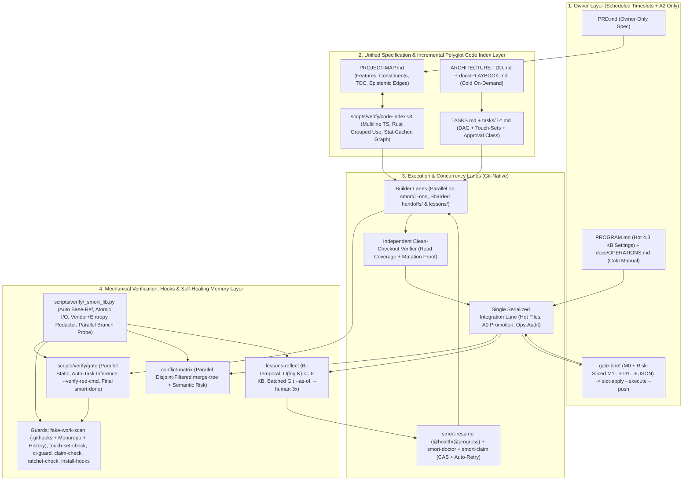
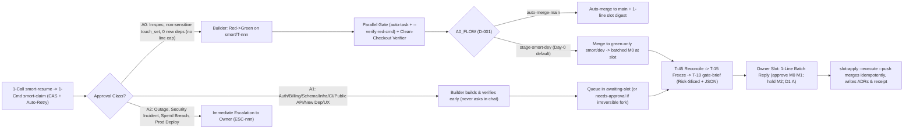

# smort

> **Single-file, zero-dependency operating system for autonomous, gated multi-agent software engineering — built to give developers their lives back.**

`smort v8` · Repo template version `2026-11-25.v12` · **34 self-extracted artifacts** (12 templates, 19 scripts/lib, 3 starter configs) · **0 third-party runtime dependencies** (Python 3 stdlib + POSIX Bash + `git`) · **No per-ticket 400-line cap** · Verified by 18-suite CI (`ubuntu-latest` + `macos-latest`) · LLM-agnostic & IDE-agnostic

Instead of babysitting coding agents all day typing *"Yes, continue development"*, agents read only `§0–§6` (**`35.7 KB` / `8.3%`** — skipping **`91.7%`** of `smort.md` on Turn 1), auto-bootstrap with safe `ASSUMPTION:` defaults onto protected staging (`smort/dev`), verify repo health in **1 command** (`smort-doctor`), resume every session in **1 command** (`smort-resume` with live `@health` & `@progress`), claim tasks atomically with CAS race rollback & retry in **1 command** (`smort-claim`), index polyglot/monorepo code incrementally (schema v4: multiline TS/JS imports/exports, arrow symbols, Rust grouped `use`, comment stripping), build red→green with automatic `smort/T-nnn` task-scope enforcement, detached-worktree red proof & commit-history/vendor/entropy secret defense, grade quality across 8 engineering domains, maintain bi-temporal self-healing work memory, and **continuously advance toward project completion** — leaving `main` 100% untouched and surfacing `M0` (`smort/dev → main`) + Risk-Sliced `A1` PRs at your **scheduled daily approval timeslots** for deterministic, idempotent 1-line execution via `slot-apply --execute --push`.

---

## Explainer Video (`04:31` · 1080p Narrated Walkthrough)

[](https://github.com/smolboon/smort/blob/main/assets/smort_explainer.mp4)

**[Watch / Open `assets/smort_explainer.mp4`](./assets/smort_explainer.mp4)** · **[Direct Download (`17.67 MiB`, 1080p H.264 + AAC)](https://github.com/smolboon/smort/raw/main/assets/smort_explainer.mp4)** · **[Subtitles (`SRT`)](./assets/smort_explainer.srt)**

> *Note: The explainer video walks through the core `smort` architecture (`v5` 26-artifact layout). `smort v8` (`2026-11-25.v12`) expands this to **34 artifacts** with a slimmed `35.7 KB` (`8.3%`) Turn-1 `STOP-READING` manual (`91.7%` skipped), Hot/Cold splits for both `AGENTS.md` (`docs/PLAYBOOK.md`) and `PROGRAM.md` (`docs/OPERATIONS.md`), 1-call `smort-resume` (with `@health` & `@progress`), 1-command atomic `smort-claim` (CAS rollback + retry), 1-command `smort-doctor` diagnostics, idempotent `slot-apply --push`, opt-in `.githooks` (`install-hooks`), automatic `smort/T-nnn` task inference in parallel `gate` + `--verify-red-cmd`, auto-loaded `DO_NOT_TOUCH`/`A1_SENSITIVE_PATHS`, `.githooks/` & nested monorepo config protection, expanded vendor + entropy + history secret scanning, `code-index` schema v4 (multiline TS/JS + Rust grouped `use` + comment stripping), no 400-line per-ticket cap, and an 18-suite cross-platform CI harness (`tests/verify_smort.py`).*

<details>
<summary><strong>Chapter Index (10 Chapters)</strong></summary>

| Timestamp | Chapter | Topic |
|---|---|---|
| `00:00` | **01 · Overview** | Stop Babysitting Your Coding Agents |
| `00:17` | **02 · The Problem** | Babysitting Trap vs. Unchecked Autonomy Collapse |
| `00:41` | **03 · What It Offers** | One Portable File → Zero-Dependency Repo Control Plane |
| `01:05` | **04 · Architecture** | 4-Layer Git-Native Control Plane, Source-of-Truth Precedence & Anti-Circularity |
| `01:34` | **05 · Autonomy & Slots** | `A0` / `A1` / `A2` Routing, Scheduled Owner Slots & 1-Line Batch Replies |
| `02:07` | **06 · Code & Map Index** | Unified `PROJECT-MAP` + Native Zero-Dep `code-index`, Hub Bypass & `not_shown` |
| `02:38` | **07 · Verification Gates** | Red→Green, Mechanical Shields, 3-Part Provenance Split & Clean-Checkout Verifier |
| `03:10` | **08 · Grading & Memory** | 8-Domain `T0–T3` + `k/n` Grading & Bi-Temporal Self-Healing `lessons-reflect` |
| `03:41` | **09 · Scale & Sanity** | Hot-Set & Perf Sanity Budgets, Linked Git Worktrees, `conflict-matrix` & Counted ROI |
| `04:07` | **10 · Get Started** | One-Prompt Agent Setup, `< 0.2 s` Local Self-Extractor & `github.com/smolboon/smort` |

</details>

---

## Table of Contents

- [Explainer Video (`04:31` · 1080p Narrated Walkthrough)](#explainer-video-0431--1080p-narrated-walkthrough)
1. [What Problem `smort` Solves](#1-what-problem-smort-solves)
2. [What `smort` Offers](#2-what-smort-offers)
   - [Inside `smort.md`: Complete File Map](#inside-smortmd-complete-file-map)
   - [Self-Extracted Repository Payload (34 Artifacts)](#self-extracted-repository-payload-34-artifacts)
3. [How `smort` Is Architected](#3-how-smort-is-architected)
   - [System Architecture Overview](#system-architecture-overview)
   - [Continuous `A0` / `A1` / `A2` Delivery & Timeslot Topology](#continuous-a0--a1--a2-delivery--timeslot-topology)
   - [Tiered Context Architecture (Turn-1 Guard + Dual Hot/Cold Split)](#tiered-context-architecture-turn-1-guard--dual-hotcold-split)
   - [Source-of-Truth & Rule Precedence](#source-of-truth--rule-precedence)
   - [Multi-Agent Concurrency, Solo Fast-Path & Worktree Isolation](#multi-agent-concurrency-solo-fast-path--worktree-isolation)
   - [Standardized CLI, Output & Exit-Code Contract](#standardized-cli-output--exit-code-contract)
4. [Why `smort` Is Architected the Way It Is](#4-why-smort-is-architected-the-way-it-is)
5. [How `smort` Works (End-to-End Lifecycle)](#5-how-smort-works-end-to-end-lifecycle)
6. [Features & Capabilities](#6-features--capabilities)
   - [6.1 Unified Project, Feature & Native Polyglot Code Graph Indexing](#61-unified-project-feature--native-polyglot-code-graph-indexing)
   - [6.2 Continuous Autonomy, Timeslot Governance & Attention Protection](#62-continuous-autonomy-timeslot-governance--attention-protection)
   - [6.3 Automated Task Creation, Delegation & Overlap Protection](#63-automated-task-creation-delegation--overlap-protection)
   - [6.4 Multi-Dimensional, Multi-Domain Grading (`AUDIT.md`)](#64-multi-dimensional-multi-domain-grading-auditmd)
   - [6.5 Epistemic Verification, Security, Hooks & Anti-Slop Gates](#65-epistemic-verification-security-hooks--anti-slop-gates)
   - [6.6 Hot-Set Context-Tax & Performance Budgets](#66-hot-set-context-tax--performance-budgets)
   - [6.7 Bi-Temporal Self-Healing Experiential Memory](#67-bi-temporal-self-healing-experiential-memory)
   - [6.8 Shipped Scripts & Configs Reference](#68-shipped-scripts--configs-reference)
7. [How to Use `smort`](#7-how-to-use-smort)
   - [Prerequisites](#prerequisites)
   - [Quickstart: Hand `smort.md` to Any Agent](#quickstart-hand-smortmd-to-any-agent)
   - [Quickstart: Self-Extract Locally (< 0.2 s)](#quickstart-self-extract-locally--02-s)
   - [Install Paths (New Repo, Spike Branch, Existing Repo, Upgrade)](#install-paths-new-repo-spike-branch-existing-repo-upgrade)
   - [Owner Settings & Thresholds](#owner-settings--thresholds)
   - [Always-On Assistant Rules Snippet](#always-on-assistant-rules-snippet)
   - [Day-to-Day CLI Cheat Sheet](#day-to-day-cli-cheat-sheet)
   - [Owner Batch Reply Syntax](#owner-batch-reply-syntax)
   - [Running the Verification Suite Locally](#running-the-verification-suite-locally)
   - [When NOT to Use `smort`](#when-not-to-use-smort)

---

## 1. What Problem `smort` Solves

Modern AI coding agents can write thousands of lines of code per hour, yet developers routinely end up **trapped in one of two broken failure modes**:

1. **The Babysitting Loop:** Constantly answering *"Should I proceed?"*, *"Yes, continue development"*, manually resolving merge conflicts between parallel sessions, artificially chopping cohesive features into awkward 400-line fragments, repeating architecture constraints after every context compaction, and reviewing sprawling unverified diffs on ad-hoc interrupts all day.
2. **Unchecked Autonomy Collapse:** Letting agents merge freely without structural guardrails leads to silent security regressions, secrets buried in intermediate branch commits, verifier-script or `.githooks/` tampering, unguarded nested monorepo manifest edits, circular dependencies, stale documentation, "green test theater" (tests that never failed before the fix or mock out the real code path), silent `200 OK` no-op stubs, runaway CI bills from hung workflows, bloated instruction files that exhaust startup context budgets, and LLM self-grading jitter.

| Failure Mode in Ad-Hoc Agent Workflows | How `smort` Eliminates It |
|---|---|
| Constant interrupts (*"Yes, continue?"*) | **Zero-Question Install + Approval Classes (`A0` / `A1` / `A2`) + Scheduled Timeslots + Idempotent `slot-apply --push`:** `A0` flows continuously onto `smort/dev` from Day 0 (`main` untouched); `A1` is pre-built & verified into `awaiting-slot` and batched alongside `M0` (`smort/dev → main`) for 1-line replies executed deterministically by `slot-apply`; `A2` interrupts only for real incidents. |
| Arbitrary line-count caps splitting cohesive features (or unreadable huge PRs) | **Scope-Bounded, Unbounded-Line Tickets (`MAX_PR_LINES = 0`) + Risk-Sliced Review Maps:** Tickets are bounded by single cohesive scope and minimal `touch_set` rather than a 400-line ceiling; `gate-brief --max-prs 5` always admits ≥ 1 `A1` PR and slices large PRs into `sensitive`, `contracts/api`, `core`, `tests/docs`, and top 3 hotspots. |
| Agents guessing codebase structure or burning tokens re-indexing | **Unified Project Map + Incremental Polyglot Code Graph (`PROJECT-MAP.md` + `code-index` schema v4):** Deterministic Feature → Requirement → Constituent → Code TOC tree plus `(mtime_ns, size)` stat-cached, parallel-extracted AST/symbol/manifest graph across 9+ languages, comment-stripped parsing, multiline TS/JS imports/exports & arrow functions, Rust grouped `use` expansion, `tsconfig.json` `paths` & barrels, and scoped `affected`. |
| Multi-agent claim races, forgotten `--task` flags & slow merge matrices | **1-Command Atomic `smort-claim` (Git CAS + `--claim-check` + auto-rollback/retry)**, canonical `smort/T-nnn` auto-task inference in `gate`, parallel `ThreadPoolExecutor` + `git cat-file --batch` live branch overlay, single serialized **Integration Lane** (with **Solo Fast-Path**), sharded builder files, linked worktree safety, and parallel disjoint-filtered textual + semantic `conflict-matrix`. |
| Same-session self-approval, gate/hook tampering & fake red commits | **Strict `BASE..HEAD` Red→Green SHA + optional detached-worktree `--verify-red-cmd`**, negative-control/mutation proof, 3-part **Provenance Split**, immutable `scripts/verify/*`, `.githooks/*` & `verify/*.json`, opt-in `.githooks` (`install-hooks`), clean-checkout **Verifier**, and **Anti-Circularity** rules. |
| Turn-1 context cliffs & Week-2 instruction-file bloat | **Slimmed `35.7 KB` Turn-1 `STOP-READING` Manual (`91.7%` skipped!) + Dual Hot/Cold Split (`AGENTS.md` `19.96 KB` + `PROGRAM.md` `4.29 KB` + Cold `docs/PLAYBOOK.md` & `docs/OPERATIONS.md`) + 1-call `smort-resume` + `smort-doctor`:** Day-1 Hot Set is **`26.5 KB` (`~6.6K` tok)**; Week-2 worst case is **`36.5 KB / 64 KB` (`44.2%` permanent headroom)**. |
| Secrets leaked in intermediate commits, nested manifests & hung CI | **Parallel static `gate`** + `fake-work-scan` (full `BASE..HEAD` commit-history + Shannon-entropy + expanded vendor secrets `npm_`/`pypi-`/`hf_`/SendGrid/Twilio/Slack + nested monorepo manifest guard at any depth + `.githooks/` guard + Python `except: pass` + Go/Java/Py/TS/Rust test deletions), auto-loaded `DO_NOT_TOUCH`/`A1_SENSITIVE_PATHS` in `touch-set-check`, `claim-check`, block-scalar `ci-guard`, and comment-aware `code-index bypass`. |
| Stale lessons & repeated agent mistakes | **Bi-temporal self-healing memory (`lessons-reflect`):** SHA-256 deduplication, 30-day decay, `≥ 2` corroboration, `human: true` 3× overrides, SHA-256 staleness retirement, `O(log K)` `8 KB` budget compaction, and batched `git cat-file --batch` `--as-of` history. |
| Heavy orchestrator lock-in, binaries & telemetry | **1 single file ([`smort.md`](./smort.md))**, zero external runtime dependencies, zero databases, zero daemons, zero telemetry/phone-home — everything lives as plain Git-tracked Markdown, JSON, Python stdlib (`sys.dont_write_bytecode = True`), and POSIX Bash inside your repo. |

---

## 2. What `smort` Offers

`smort` packs an entire software-engineering control plane into a single portable file: **[`smort.md`](./smort.md)**.

### Inside `smort.md`: Complete File Map

| Section in [`smort.md`](./smort.md) | Purpose |
|---|---|
| **Overview, Token Guard & Core Terms** | `STOP-READING` Turn-1 directive (read only `§0–§6` **`35.7 KB`**, **`8.3%`**; skip `§7–§8` **`396.4 KB`**, **`91.7%`** payload), Autonomous-First Execution Law, approval classes (`A0`/`A1`/`A2`, no per-ticket line cap), roles, trusted authors, epistemic vocabulary. |
| **§1 START HERE: Resume Protocol** | State detection (install / upgrade / resume), **1-call `smort-resume` startup fast-path**, **1-command `smort-claim` atomic claimer**, **1-command `smort-doctor` diagnostic**, Hot Set vs. Cold on-demand reads, Source-of-Truth Precedence, Anti-Circularity, pre-commit `--staged` scan & crash-safe handoff. |
| **§2 Core Invariants (Quick Map)** | Single-table index of all non-negotiable rules pointing to canonical clauses in `AGENTS.md`, `docs/PLAYBOOK.md`, and `docs/OPERATIONS.md`. |
| **§3 Owner Settings & Thresholds** | Zero-question auto-detect configuration table (`ASSUMPTION:` defaults for timeslots, `stage-smort-dev`, sensitive paths, maturity target, roster, caps) and aligned thresholds (`MAX_OPEN_PRS`, `MAX_SLOT_PRS`, `AUDIT_MAX_MIN`, `80%` coverage, `5%` perf budget). |
| **§4 Install, Upgrade, and Spikes** | Self-extracting Python bootstrapper (§4.1, **34 blocks**) + `smort-doctor` + opt-in `install-hooks` + harness allowlist, immediate `--self-test` verification, `v3–v11 → v12` upgrade guide (§4.2), zero-wait Path A + non-mergeable `spike/<slug>` (§4.3), non-destructive zero-wait Path B (§4.4). |
| **§5 The Loop** | Role separation, Solo/Single-Agent Fast-Path (§5.1), continuous `A0`/`A1` flow + `smort-claim` + `slot-apply --push` (§5.2), Parallel Fast Gate (`≤ 15 min`, auto-task inference) vs. Deep Gate (§5.3), scheduling, usage/freeze/completion stop conditions (§5.4). |
| **§6 Multi-Dimensional, Multi-Domain Grading** | 3 Completion & Autonomy dimensions × 8 Engineering Quality domains graded by discrete Maturity Tier (`T0–T3`) + deterministic checklist ratio (`k/n`) with objective merge blocks. |
| **§7 Repo Templates (`§7.1–§7.12`)** | All 12 ready-to-extract governance, settings, playbook, operations, architecture, task, audit, and handoff templates (fenced with `~~~~`). |
| **§8 Shipped Starter Scripts & Configs (`§8.1–§8.22`)** | Shared `_smort_lib.py`, 18 executable zero-dependency verification/coordination scripts, and 3 declarative starter JSON configs (fenced with `~~~~`). |

### Self-Extracted Repository Payload (34 Artifacts)

Running the §4.1 extractor materializes the complete control plane directly into your repository without ever overwriting existing files (collisions write to `<file>.smort-new`):

| Category | Extracted Path | Role |
|---|---|---|
| **Governance & Cold Manuals (5)** | `AGENTS.md` | **Hot Ruleset (`19,958 B` / 156 lines):** project facts, stale-prior table, hard rules `1.0–1.14`, active budgets, daily commands, security & trust boundaries, pointers to cold manuals, permanent Known Mistakes (`M1–M15`). |
| | `PROGRAM.md` | **Hot Settings Sheet (`4,293 B` / 49 lines, gated ≤ 5 KB):** `§0` availability slots, `A0` flow, roster/solo fast-path, freezes, caps, trusted authors + `§1` compact `A0`/`A1`/`A2` matrix. |
| | `docs/PLAYBOOK.md` | **Cold Engineering Playbook (`17,977 B`, on-demand via `project-map --section`):** stack presets, working method (hybrid human, Reference-Coding + License Wall), full verifiability & Provenance Split PoW, QA bar, slop list, DoD, PR checklist. |
| | `docs/OPERATIONS.md` | **Cold Operations Manual (`18,360 B`, on-demand via `project-map --section`):** loop diagram, daily rhythm, nightly audit pass, reconciliation, `A0` promotion, rollback, `A2` hotfix, completion mode, 3-Outcome Triage, slot brief & `slot-apply` reply syntax, decision queue format. |
| | `DEVELOPMENT-WORKFLOW.md` | One-page canonical map of where every artifact lives and how work flows from idea to completion. |
| **Specs, Maps & Tasks (4)** | `PRD.md` | 100% owner-owned product requirements, personas, JTBD, success/guardrail metrics, FR/NFR, MoSCoW, non-goals, compliance. |
| | `PROJECT-MAP.md` | Unified project index: Feature Index (`F-nnn`), Constituent Registry (`S*.C*`), auto-generated visual TOC tree, Epistemic Dependencies (`EXTRACTED`/`INFERRED`/`AMBIGUOUS`), External Deps/Licenses, auto-generated Build Order & Critical Path. |
| | `ARCHITECTURE-TDD.md` | Topology, durable vs. invocation state, API/boundary contracts (verified by `code-index verify-docs`), Auth & Hub Bypass boundaries, STRIDE, Zero-Trust Release Verification, testing, measured budgets, ADRs, task derivation. |
| | `TASKS.md` | Task schema (`approval: A0/A1`, `lane`, `estimate: S|M|L`, `touch_set`), atomic `smort-claim` protocol, full §5 delegation algorithm, 5 continuous task-creation triggers + 3-Outcome Triage, shrink-guarded generated index. |
| **Grading & Continuity (3)** | `AUDIT.md` | Executive completion dashboard, 8-domain scorecard (`T0–T3` + `k/n`), open findings, binary tier checklists. |
| | `AUDIT-LOG.md` | Append-only historical log of nightly multi-dimensional audits. |
| | `HANDOFF.md` | Compact crash-safe resume rollup strictly bounded to `≤ 4 KB / ≤ 60 lines` (paired with per-agent `handoffs/<agent-slug>.md`, also budget-checked). |
| **Shared Library & Scripts (19)** | `scripts/verify/_smort_lib.py` | Shared zero-dep core: auto-resolving Git base ref (`for_new_task` aware), atomic file writes (`atomic_write_text`), canonical vendor+entropy secret redactor (`npm_`/`pypi-`/`hf_`/SendGrid/Twilio/Slack/PEM/JWT/etc.), `batch_git_cat_files` & `batch_git_cat_bytes`, shared `load_do_not_touch` & `load_a1_sensitive_paths`, parallel `inspect_live_task_branches`, parsers, glob matcher, token estimator. |
| | `scripts/verify/smort-resume` | **1-call role-tailored startup packet** (`--lane`, `--agent`, `--topic`, `--compact`, `--json`, `--offline`, `--max-chars`) with `ROLE_LANES` awareness and live `@health` (`dirty`, `dev_ahead`, `hooks`, `code_index`) & `@progress` (`features`, `awaiting_slot_local`) telemetry, secret redaction & explicit `not_shown`. |
| | `scripts/verify/smort-claim` | **1-command atomic task claimer** (`[T-nnn]`, `--lane`, `--approval`, `--agent`, `--base`, `--retries 3`, `--dry-run`, `--offline`, `--compact`, `--json`): checks clean tree, fetches, branches off integration base, updates task YAML (`status: claimed`, `claim`, `claimed_at`), pushes via Git CAS, runs `--claim-check`, and auto-rolls back + retries next candidate on CAS/overlap race loss. |
| | `scripts/verify/smort-doctor` | **1-command read-only health & env diagnostic** (`--strict`, `--compact`, `--json`): verifies Python/Git/Bash/optional `gh` & `gitleaks`, all 19 scripts & 3 JSON configs, leftover `*.smort-new` files, `.gitignore` hygiene, `project-checks.sh` wiring, `.githooks`, hot-set budgets, `Template version` parity, and `code-index` freshness. |
| | `scripts/verify/gate` | Parallel read-only static phase (`--fast`, `--full`, `--dry-run` w/ `dirty_files` & `sensitive_touched`, `--fail-fast`, `--sequential`, `--emit-pow`, `SMORT_ALLOWED_IDENT`, **auto-infers `--task T-nnn` on `smort/T-nnn`** with `--no-task` opt-out, unlimited per-ticket default + opt-in `--max-lines N`, strict `BASE..HEAD` `--red-sha` + detached-worktree `--verify-red-cmd`, smart fast-vs-full `gitleaks` policy, guaranteed final-line `smort-done`). |
| | `scripts/verify/touch-set-check` | Auto-resolves base; auto-loads owner `DO_NOT_TOUCH` & `A1_SENSITIVE_PATHS` from `AGENTS.md`/`PROGRAM.md`; enforces task `touch_set` and mechanical `A0 SENSITIVE-PATH ESCALATION` blocking. |
| | `scripts/verify/fake-work-scan` | Pre-commit `--staged` or branch diff + **full `BASE..HEAD` commit-history & Shannon-entropy + expanded vendor secret scan**: `.env` (case-insensitive), immutable `scripts/verify/*`, `.githooks/*` & `verify/*.json` guard, `A1`-aware CI & **nested monorepo manifest/config guard at any depth**, Python `except: pass`, slop, debug prints, TS `any`, JS/TS/Py/Rust/Go/Java test deletions, plus `--redact`. |
| | `scripts/verify/ratchet-check` | Monotonic quality ratchets + `--verify-config` schema/NaN check + hot-set budgets (incl. `PROGRAM.md ≤ 5 KB` & sharded `handoffs/*.md`) + perf ceilings/sanity floors + exit-4 ADR gate. |
| | `scripts/verify/tasks-index` | Validates task frontmatter & DAG, parallel `inspect_live_task_branches` overlay (`git cat-file --batch`), auto-loaded `DO_NOT_TOUCH`, full §5 ranking, `--claim-check`, `--compact`, `--json`, exit-4 shrink-guard. |
| | `scripts/verify/project-map` | Validates Feature/Constituent/Edge tables (banning confidence `0.5`, excluding `type-only` cycles), generates TOC & build order, live secret-redacted `--section` reader (covering `docs/PLAYBOOK.md` & `docs/OPERATIONS.md` automatically), `--impact`, `--dry-run`. |
| | `scripts/verify/code-index` | **Schema v4** fast incremental polyglot/monorepo AST/symbol/manifest graph (`(mtime_ns, size)` no-op cache skip, atomic compact JSON, parallel extraction for `≥ 32` dirty files, **comment-stripped parsing**, **multiline TS/JS `import`/`export ... from` & arrow functions**, **Rust grouped `use crate::foo::{a, b};`**, `tsconfig.json` `paths` & barrels, depth-3 manifests): `build`, `query`, scoped `affected`, `hubs`, `--cycles`, `--check-map`, comment-aware `bypass`, `verify-docs`, `--worktree shared\|isolated`. |
| | `scripts/verify/conflict-matrix` | Parallel disjoint-filtered `git merge-tree` textual conflicts (handling spaces & rename/delete) + semantic (constituent/edge/hub) risk across open branches (`--worktree shared\|isolated`, `--all-pairs`, second-precision reports). |
| | `scripts/verify/gate-brief` | Generates secret-redacted 1-screen human-prose owner slot brief using parallel `inspect_live_task_branches` & auto-loaded `A1_SENSITIVE_PATHS` with batched **`M0` (`smort/dev → main`)**, `--max-prs 5` slot cap (never starving large PRs), **Risk-Sliced Review Maps** (`--slice-lines 300`), `--json` / `--json-out` manifest export, accurate `smort/dev` ROI, and `_not_shown_`. |
| | `scripts/verify/slot-apply` | **Deterministic, idempotent owner batch-reply parser & executor** (`--manifest`, `--reply`, `--dry-run`, `--execute`, **`--push`** with `SMORT_ALLOW_MAIN_PUSH=1` for `.githooks` interop, `--json`): blocks unverified merges, skips already-merged refs cleanly, executes `M0`/`M1..` in order, atomically writes `docs/decisions/D-nnn-*.md` ADRs, toggles freeze/lifecycle in `PROGRAM.md`, and saves `verify/logs/slot-receipt-*.md`. |
| | `scripts/verify/install-hooks` | **Opt-in Git hooks installer** (`--check`, `--uninstall`): configures `.githooks/pre-commit` (`fake-work-scan --staged`) and `.githooks/pre-push` (blocks accidental direct/force pushes to `main`/`master` unless `SMORT_ALLOW_MAIN_PUSH=1`). |
| | `scripts/verify/lessons-reflect` | Bi-temporal experiential memory: sharded logging, SHA-256 dedup, 30-day decay, corroboration, `--human` 3× overrides, SHA-256 staleness retirement, `O(log K)` `--max-bytes 8192` compaction, and single-pipe batched `git cat-file --batch` `--as-of YYYY-MM-DD` time travel. |
| | `scripts/verify/ci-guard` | Validates `.github/workflows/*.{yml,yaml}` job-level `timeout-minutes` (`1..60`), supporting 2/4-space YAML, block scalars (`|`/`>`), expression timeouts (`--allow-expr-timeout`), reusable `uses:` exemptions, and `--self-test`. |
| | `scripts/verify/claim-check` | CommonMark-fence-aware declarative doc-claim linter reading `verify/claims.json`, with built-in `--self-test`. |
| | `scripts/verify/project-checks.sh` | Repo-specific lint/type/test/build hook (exits `2` `UNVERIFIABLE` on Day 1 until wired to real project commands). |
| **Starter Configs (3)** | `verify/ratchet.json` | Monotonic quality floors (`test_count`, `coverage_pct`, `mutation_pct`). |
| | `verify/claims.json` | Declarative doc-truth lint rules (`SMORT-NO-LOCAL-EVIDENCE`, `SMORT-NO-FALSE-CI-GREEN`). |
| | `verify/budgets.json` | Agent hot-set context-tax ceilings (`PROGRAM.md ≤ 5 KB`, `HANDOFF.md` & `handoffs/*.md ≤ 4 KB`, `LESSONS.md ≤ 8 KB`, combined bytes & est tokens) and performance/sanity budgets. |

---

## 3. How `smort` Is Architected

### System Architecture Overview

`smort` is structured as a **Git-native 4-layer control plane**. Every coordination primitive — health diagnostics, session resume, atomic task claims, code orientation, quality gates, memory, conflict detection, and deterministic owner slot execution — operates directly on version-controlled files and Git refs with zero external services.



### Continuous `A0` / `A1` / `A2` Delivery & Timeslot Topology

`smort` decouples **engineering throughput** from **human calendar availability** by routing tasks strictly by risk class — without imposing an arbitrary line-count cap per ticket:



### Tiered Context Architecture (Turn-1 Guard + Dual Hot/Cold Split)

Every agent session — from Turn-1 bootstrap through post-compaction and crash restarts — avoids reading unnecessary bulk, loads a slim mechanically budgeted **Hot Set**, and pulls deep playbook, operations, architecture, and code context strictly on demand:

| Tier | Loaded When | Files / Commands | Measured Budget & Guard |
|---|---|---|---|
| **Tier 0: Turn-1 Stop-Read Guard** | Initial read of `smort.md` only | Top-of-file directive + `<!-- SMORT-STOP-READING-HERE -->` right before `§7` | Agents read only `§0–§6` (**`35,692 B`**, `~8.9K` est tok, **`8.3%`** — **`-34.1%` vs v7**) and skip the `§7–§8` payload (**`396,425 B`**, `~99.1K` est tok — **`91.7%` skipped on Turn 1**), materializing all 34 files via the §4.1 extractor. |
| **Tier 1: Hot Set** | Every session start & post-compaction resume (or 1-call `smort-resume --compact`) | `AGENTS.md` (Hot Ruleset: **`19,958 B`** / 156 lines), `PROGRAM.md` (Hot Settings Sheet: **`4,293 B`** / 49 lines, gated `≤ 5,120 B`), `HANDOFF.md` (**`2,211 B`** / 39 lines) + `handoffs/<agent>.md`, `verify/LESSONS.md` (auto-compacted `≤ 8,192 B`), `AUDIT.md §1`, newest `AUDIT-LOG.md`, `tasks-index --live --next --compact` | Enforced by `ratchet-check --verify-config --budgets verify/budgets.json --check-hot-set` (`PROGRAM.md ≤ 5,120 B`; `HANDOFF.md` & `handoffs/*.md ≤ 4,096 B` / 60 lines; `LESSONS.md ≤ 8,192 B`; combined `≤ 65,536 B` / `18,000` est tok). **Measured Day-1: `26,462 B` (`~6,616` est tok — `-36.2%` vs v6, `-54.3%` vs v5); Week-2 worst case: `36,539 B / 65,536 B` (`~9,135` est tok — `28,997 B` / `44.2%` permanent headroom).** |
| **Tier 2: Cold Playbook, Operations & Spec Sections** | Only for active task or integration/slot event | `project-map --section "<heading>"` (automatically searches `docs/PLAYBOOK.md`, `docs/OPERATIONS.md`, `ARCHITECTURE-TDD.md`, `PROJECT-MAP.md`, `PRD.md`, etc.; live disk read, secret-redacted, non-truncatable `not_shown` footer) and `project-map --impact <S*.C*> --compact` | Keeps `docs/PLAYBOOK.md` (`17,977 B`), `docs/OPERATIONS.md` (`18,360 B`), `ARCHITECTURE-TDD.md`, `PRD.md`, and `tasks/archive/` completely out of startup context. |
| **Tier 3: Native Code Orientation** | Before broad grep or editing | `code-index query "<question>" --compact` and `code-index affected <file-or-symbol> --compact` | Schema v4 `(mtime_ns, size)` stat-cached polyglot graph with comment-stripped parsing, multiline TS/JS imports/exports & arrow functions, Rust grouped `use` expansion, `tsconfig.json` `paths` + barrel resolution, parallel extraction (`≥ 32` dirty files), and scoped `direct_import_callers` vs `name_only_callers`. |

### Source-of-Truth & Rule Precedence

When instructions or documents disagree, agents resolve conflicts deterministically without stalling or guessing:

- **Rule Precedence:** `Owner Hard Rules (AGENTS.md §1.0)` **>** `AGENTS.md §1` **>** `smort.md` **>** `task prompt`
- **Fact Precedence:** `live code & observed test output` **>** `PROJECT-MAP.md` **>** `ARCHITECTURE-TDD.md` **>** `PRD.md` **>** `HANDOFF.md` **>** `verify/LESSONS.md`
- **Anti-Circularity Invariant:** An agent may **never** cite `PROJECT-MAP.md`, `TASKS.md §9`, `verify/code-index.json`, `verify/LESSONS.md`, or `HANDOFF.md` as verification evidence when auditing or modifying that artifact, the verification gate, or freshly edited code. Verification must always inspect live source files and execute real tests directly.

### Multi-Agent Concurrency, Solo Fast-Path & Worktree Isolation

`smort` scales cleanly from a single developer + one coding agent up to parallel multi-agent fleets with zero external servers:

1. **Solo / Single-Agent Fast-Path (`smort.md §5.1`):** When only one agent operates the repo (`{{AGENT_ROSTER}} = solo`), it runs Builder and Integration steps sequentially (passing `--lane integration` only on integration/audit PRs, never to bypass builder guards) and invokes a **fresh clean-context session** for independent verification labelled `verified (fresh-session, same-model)`.
2. **1-Command Atomic Git CAS Claiming (`smort-claim`):** Builders run `scripts/verify/smort-claim --lane <lane> --agent <slug> --compact`, which checks for a clean working tree, fetches `origin`, resolves the integration base (`origin/smort/dev` in `stage-smort-dev`, even when HEAD is on `smort/dev`), creates canonical branch `smort/T-nnn`, updates task YAML frontmatter (`status: claimed`, `claim`, `claimed_at`), commits, pushes via Git CAS, runs double-checked `--claim-check` (via parallel `inspect_live_task_branches` + `git cat-file --batch`), and **automatically rolls back & retries the next candidate** on any CAS push or overlap race loss.
3. **Canonical Auto-Task Enforcement:** Whenever `scripts/verify/gate` runs on `smort/T-nnn`, it automatically infers `--task T-nnn` (when `tasks/T-nnn*.md` exists, opt-out `--no-task`) so builders cannot accidentally bypass `touch-set-check` or `DO_NOT_TOUCH`/`A1_SENSITIVE_PATHS` enforcement.
4. **Hot-File Serialization + Sharded Writes:** Only the serialized **Integration Lane** edits root hot files (`PROJECT-MAP.md`, `TASKS.md §9`, `AUDIT.md`, `AUDIT-LOG.md`, `HANDOFF.md`, `verify/LESSONS.md`, `verify/*.json`, `scripts/verify/*`, `.githooks/*`). Parallel builders write only to task-scoped or agent-scoped files (`tasks/T-nnn-*.md`, `changes/T-nnn.md`, `handoffs/<agent-slug>.md`, `verify/lessons/T-nnn.jsonl`).
5. **Linked Git Worktrees, Atomic I/O, Committer Guard & Zero `__pycache__` Pollution:** `code-index`, `conflict-matrix`, and `lessons-reflect` support `--worktree shared|isolated` via `_smort_lib.py` with atomic sibling-tempfile writes (`atomic_write_text`); `gate` enforces `SMORT_ALLOWED_IDENT` (via `git var`); and all Python scripts set `sys.dont_write_bytecode = True` (plus `PYTHONDONTWRITEBYTECODE=1` in `gate`) so running `smort` tooling never pollutes non-Python repositories with untracked `scripts/verify/__pycache__/` files.

### Standardized CLI, Output & Exit-Code Contract

All shipped `smort` scripts adhere to a unified machine-and-human protocol:

| Exit Code | Meaning | Used By |
|---|---|---|
| **`0`** | Pass / clean / succeeded | All scripts |
| **`1`** | Gate failure, drift, security/bypass violation, unverified `slot-apply` merge attempt, dirty tree / exhausted `smort-claim` retries, `smort-doctor` errors, or config corruption | `gate`, `touch-set-check`, `fake-work-scan`, `ci-guard`, `claim-check`, `ratchet-check`, `project-map --check`, `code-index`, `conflict-matrix`, `slot-apply`, `install-hooks --check`, `smort-claim`, `smort-doctor` |
| **`2`** | Usage error, unknown `slot-apply` code, invalid explicit `--base`, `smort-doctor --strict` warnings, or `UNVERIFIABLE` (missing external secret scanner in `--full`/`--require-gitleaks`, or unwired `project-checks.sh`) | `_smort_lib.py`, `gate` (`reason=unverifiable` / `invalid-base`), `slot-apply`, `smort-claim`, `smort-doctor --strict`, CLI arg parsing |
| **`3`** | Ambiguous match (multiple headings/symbols match query) | `project-map --section`, `code-index` |
| **`4`** | Not found, empty claim queue, **or** `NEEDS_DECISION` non-TTY confirmation gate | `gate --dry-run` (over opt-in `--max-lines`), `ratchet-check --allow-lower` without `--decision D-nnn`, write-mode shrink-guards (`tasks-index`, `project-map`, `code-index`), `smort-claim` (no ready candidates / task not found), missing target lookup |

- **Machine-vs-Human Output Discipline:** `--compact` emits terse `@ok` / `@no` / `@edge` / `@health` / `@progress` / `@not_shown` lines strictly for agent-to-tool exchanges; every human-facing artifact (`gate-brief`, PR bodies, `PRD.md`, `HANDOFF.md`) is plain human prose.
- **Non-Truncatable `not_shown` Accounting:** Whenever output is capped, compacted, or filtered (`--budget`, `--max-chars`, `--max-bytes`, `--max-prs`, `--lane`, deduplication, staleness retirement, generic call stopword skipping), scripts emit an explicit `not_shown` summary **outside** the truncation budget.
- **Guaranteed Final-Line Terminal Summary:** `scripts/verify/gate` ALWAYS outputs one control-character-sanitized machine-parseable summary as its **very last line** (even with `--emit-pow`):
  ```text
  smort-done ok=1 exit=0 reason=pass mode=fast branch=smort/T-001 sha=a1b2c3d task=T-001 fails=0 unverifiable=0 wall=2s
  ```

---

## 4. Why `smort` Is Architected the Way It Is

Every major design choice in `smort` counters a specific, recurring failure mode observed in real autonomous agent workflows:

1. **Why one self-extracting Markdown file with a `35.7 KB` Turn-1 `STOP-READING` Manual and zero third-party dependencies?**
   External orchestrator frameworks break on Python/Node version drift, require MCP daemons or vector databases, fail in air-gapped CI, or phone home. Compiling all 12 templates, 19 stdlib scripts/lib, and 3 starter configs into one auditable [`smort.md`](./smort.md) file (verified `0` non-stdlib imports across all 17 Python files in CI) lets any repo bootstrap in `< 0.2 s` — while the trimmed `§0–§6` manual and `<!-- SMORT-STOP-READING-HERE -->` guard ensure agents read only **`35.7 KB` (`8.3%`, `-34.1%` vs v7)** and skip **`396.4 KB` (`91.7%`)** of extraction payload on Turn 1.
2. **Why split BOTH `AGENTS.md` (`docs/PLAYBOOK.md`) AND `PROGRAM.md` (`docs/OPERATIONS.md`), plus 1-call `smort-resume`, `smort-claim`, and `smort-doctor`?**
   In earlier versions, session startup required ~7 sequential tool calls and consumed `41.5 KB` Day 1 (`51.6 KB` Week 2), and claiming a task required 6 manual Git/YAML commands that agents routinely fumbled under concurrent races. Moving operational runbooks into Cold `docs/OPERATIONS.md` keeps `PROGRAM.md` at **`4.3 KB`** (`≤ 5 KB` gated), slashes Day-1 Hot Set to **`26.5 KB`** (`44.2%` permanent Week-2 headroom), `smort-resume` collapses startup (plus live `@health` & `@progress`) into **1 call**, `smort-claim` collapses atomic claiming + CAS race rollback/retry into **1 command**, and `smort-doctor` verifies environment/repo health in **1 read-only command**.
3. **Why remove the 400-line per-ticket cap AND add Risk-Sliced Review Maps + idempotent `slot-apply --push`?**
   Hard line caps force agents to split cohesive features into half-wired intermediate PRs and arbitrarily escalate safe internal refactors into human review slots. Bounding tickets by single cohesive scope + minimal `touch_set`, pacing slots by PR count (`--max-prs 5`, always admitting `≥ 1`), slicing large `A1` PRs by risk (`sensitive`, `contracts/api`, `core`, `tests/docs`, top 3 hotspots), and executing the owner's 1-line batch reply deterministically and idempotently via `slot-apply --execute --push` keeps large cohesive PRs fast and reviewable without human bottlenecks.
4. **Why close silent enforcement gaps (auto-task `gate`, auto-loaded `DO_NOT_TOUCH`/`A1_SENSITIVE_PATHS`, `.githooks/` & monorepo config guards, expanded vendor + entropy + history secret scanning)?**
   Omitted `--task` flags on `smort/T-nnn` previously bypassed `touch-set-check`, owner-configured `DO_NOT_TOUCH`/`A1_SENSITIVE_PATHS` were ignored unless re-passed on the CLI, nested monorepo manifests (`packages/web/package.json`) bypassed root-prefix checks, `.githooks/` lacked immutability, and squashed diffs missed intermediate-commit secret leaks. Closing all five holes mechanically — alongside smart fast-vs-full `gitleaks` policy and opt-in `.githooks` — eliminates silent security regressions without causing alarm fatigue.
5. **Why upgrade `code-index` to schema v4 and parallelize `gate`, `conflict-matrix`, `tasks-index`, `gate-brief`, and `lessons-reflect` using pure stdlib?**
   Line-by-line regex scanning missed Prettier-style multiline TS/JS `import`/`export { ... } from '...'`, arrow functions, and Rust grouped `use crate::foo::{a, b};`, while block comments injected phantom edges. Schema v4 adds comment-stripped parsing, multiline TS/JS + arrow symbols, Rust grouped `use` expansion, `(mtime_ns, size)` stat no-op caching, atomic JSON writes, and parallel extraction (`≥ 32` dirty files) — paired with Bash 3.2-safe parallel read-only `gate`, parallel disjoint-path pre-filtered `conflict-matrix`, shared parallel `inspect_live_task_branches`, batched `git cat-file --batch` `--as-of` history, and `O(log K)` compaction with zero third-party packages.
6. **Why immutable `scripts/verify/*` + `.githooks/*` + `sys.dont_write_bytecode = True` + `A1`-aware monorepo config guards?**
   Locking `scripts/verify/*`, `.githooks/*`, and `verify/*.json` exclusively to `--lane integration` prevents builders from weakening their own gate or hooks; permitting authorized `A1` builders to edit `.github/workflows/` and root/nested manifests explicitly listed in their `touch_set` avoids needless friction; and disabling Python bytecode writes ensures running `smort` scripts never dirties non-Python repos with `scripts/verify/__pycache__/`.
7. **Why discrete Maturity Tiers (`T0–T3`) + checklist ratios (`k/n`) instead of `0–10` LLM scores?**
   Asking an LLM to score code `8.3/10` produces non-reproducible jitter across runs and models. Binary pass/fail criteria grouped into discrete tiers (`T0–T3`) with exact ratios (`k/n` passing toward the next tier) make quality regression blocks deterministic and incremental progress visible.
8. **Why strict `BASE..HEAD` Red→Green SHAs + optional detached-worktree `--verify-red-cmd`, Provenance Splits, and Clean-Checkout Verifiers?**
   Passing `--red-sha HEAD` or `--red-sha <merge-base>` would satisfy a naive ancestry check without proving a failing test preceded the fix. Requiring `--red-sha` strictly inside `BASE..HEAD`, offering mechanical `--verify-red-cmd` (checking out `red-sha` in a clean detached worktree to prove non-zero exit), and pairing it with negative-control proof, 3-part Provenance Split (`Verified` / `Assumed + Falsifier` / `Not run`), and full read-coverage logging closes "green test theater".
9. **Why bi-temporal, auto-compacting, Git-backed experiential memory (`lessons-reflect`)?**
   Append-only agent notes bloat until they overflow startup budgets or give stale advice after refactors. SHA-256 content-addressed IDs prevent duplicate inflation; 30-day decay + `≥ 2` corroboration filters noise; `--human` gives owner overrides 3× authority; SHA-256 file fingerprints auto-retire stale notes (verified historically in a single batched `git cat-file --batch` pipe during `--as-of YYYY-MM-DD` audits); and `O(log K)` `--max-bytes 8192` compaction guarantees `verify/LESSONS.md` never breaches hot-set budgets.

---

## 5. How `smort` Works (End-to-End Lifecycle)

```mermaid
sequenceDiagram
    participant Owner as Human Owner
    participant Builder as Builder Agent(s)
    participant Gate as scripts/verify/gate
    participant Verifier as Clean-Checkout Verifier
    participant Integ as Integration Lane

    Note over Owner,Integ: Phase 1 — Turn-1 STOP-READING, Zero-Question Install & smort/dev Staging
    Builder->>Integ: Read §0-§6 only (8.3%), extract 34 files (§4.1), smort-doctor, optional install-hooks, open smort/install + branch smort/dev
    Integ-->>Owner: Queue async Spec Slot (D-001 & ASSUMPTION overrides) — zero wait!

    Note over Builder,Integ: Phase 2 — Continuous Autonomous Execution (1-Call Resume, 1-Cmd Claim, No Line Cap)
    loop While ready tasks exist
        Builder->>Builder: smort-resume --lane <lane> --compact -> smort-claim --agent <slug> (CAS + auto-retry)
        Builder->>Builder: Orient via code-index v4 query/affected & project-map --section
        Builder->>Builder: Commit failing check (Red SHA in BASE..HEAD) -> cohesive build in touch_set
        Builder->>Gate: pre-commit fake-work-scan -> parallel gate --fast --red-sha <sha> --verify-red-cmd ... --emit-pow (auto-infers T-nnn)
        Gate-->>Builder: Provenance Split PoW + final-line smort-done ok=1 exit=0 task=T-nnn
        Builder->>Verifier: Open PR (in-review) & immediately claim next task
        Verifier->>Gate: Clean checkout + full read-coverage + negative-control check
        Verifier-->>Integ: Label PR verified
        alt Task is A0 (Autonomous)
            Integ->>Integ: Rebase + parallel fast gate + integrate onto smort/dev Day 0 (or main per D-001)
        else Task is A1 (Sensitive / Judgment)
            Integ->>Integ: Pre-built & verified -> queue in awaiting-slot for next Owner Timeslot
        end
    end

    Note over Owner,Integ: Phase 3 — Scheduled Owner Availability Slot & Deterministic slot-apply --push
    Integ->>Integ: T-45 parallel conflict-matrix -> T-15 freeze -> T-10 gate-brief --json-out slot.json
    Integ->>Owner: Send 1-screen brief (M0 smort/dev + Risk-Sliced M1..Mk + D1..Dn + Counted ROI)
    Owner->>Integ: Single batch reply ("approve M0 M1 M2; hold M3; D1 A")
    Integ->>Integ: slot-apply --manifest slot.json --reply "..." --execute --push (idempotent merges, ADRs, toggles, receipt)

    Note over Owner,Integ: Phase 4 — Bounded Nightly Pass (<= AUDIT_MAX_MIN)
    Integ->>Integ: Deep gate + 8-domain AUDIT + O(log K) lessons-reflect build (<= 8 KB) -> smort/ops-audit PR
```

1. **Zero-Question Install & Immediate Staging (`smort/install` → `smort/dev`):** Agents stop at `<!-- SMORT-STOP-READING-HERE -->` (skipping `91.7%` of `smort.md` on Turn 1), auto-detect settings (`ASSUMPTION:` defaults), extract all **34 artifacts** via `§4.1`, optionally activate `scripts/verify/install-hooks`, run `scripts/verify/smort-doctor` + `--self-test` + hot-set budgets, draft or reverse-engineer `PRD.md`, `PROJECT-MAP.md`, and `ARCHITECTURE-TDD.md`, open `smort/install`, queue async `D-001` for the first slot, and **immediately branch `smort/dev`** (`main` stays 100% untouched) to start building without waiting in chat.
2. **1-Call Resume & 1-Command Atomic Claim:** Agents start every session or post-compaction resume with `scripts/verify/smort-resume --lane <lane> --compact` (returning live `@health`, `@progress`, `HANDOFF`, `PROGRAM` settings, top lessons, audit header, and top ready tasks in 1 call), then run `scripts/verify/smort-claim --lane <lane> --agent <slug> --compact` to atomically create `smort/T-nnn`, update task YAML, push via Git CAS, verify `--claim-check`, and auto-rollback/retry on any race loss.
3. **Orient & Build Red→Green:** Builders orient via schema-v4 stat-cached, alias-aware `code-index query`/`affected` and `project-map --section` (covering `docs/PLAYBOOK.md`, `docs/OPERATIONS.md`, and design docs), apply Reference-Coding & License Wall (`docs/PLAYBOOK.md §2.9`), commit failing checks first (`Red` SHA strictly inside `BASE..HEAD`), implement cohesively inside `touch_set` (no 400-line cap), pass `fake-work-scan --staged` pre-commit (automatically when `install-hooks` is active), prove negative-control failure, and log discoveries via `lessons-reflect log`.
4. **Parallel Mechanical Gate + Independent Verification:** `scripts/verify/gate --fast --red-sha <sha> --verify-red-cmd "<test-cmd>" --emit-pow` auto-resolves the base ref, **auto-infers `--task T-nnn`** on `smort/T-nnn`, checks clean tree, runs read-only static checks in parallel (including auto-loaded `DO_NOT_TOUCH`/`A1_SENSITIVE_PATHS` and full `BASE..HEAD` commit-history + vendor + Shannon-entropy secret scan), mechanically proves `red-sha` failed in a detached worktree, emits a 3-part Provenance Split PoW block, and finishes with `smort-done ok=1 exit=0 task=T-nnn`. A clean-checkout **Verifier** verifies full read coverage and grants `verified`.
5. **Zero-Stall Promotion:** Verified `A0` PRs integrate immediately onto green-only `smort/dev` (or directly to `main` once `D-001` authorizes `auto-merge-main`); verified `A1` PRs wait cleanly in `awaiting-slot` while builders immediately claim the next task via `smort-claim`.
6. **Scheduled Timeslot Approval & Deterministic `slot-apply --push`:** At `T-45`, Integration Lane reconciles and runs parallel `conflict-matrix`; at `T-15`, pushes freeze; at `T-10`, `gate-brief --json-out verify/logs/slot.json` emits a 1-screen plain-prose brief featuring **`M0`** (`smort/dev → main` batched promotion), up to `--max-prs 5` **Risk-Sliced `A1` PRs** (never starving large cohesive PRs), `D1..` decisions, and counted ROI. You reply once, and `slot-apply --manifest verify/logs/slot.json --reply "<reply>" --execute --push` deterministically and idempotently executes approved merges, pushes `main` through `.githooks/pre-push` (`SMORT_ALLOW_MAIN_PUSH=1`), writes ADRs, toggles settings, and logs a slot receipt.
7. **Nightly Deep Audit & Project Completion:** A timeboxed nightly pass (`≤ {{AUDIT_MAX_MIN}}` min) runs `gate --full --lane integration` (strict external secret scanner), compacts `verify/LESSONS.md` (`≤ 8 KB` in `O(log K)`), updates `AUDIT.md` + `AUDIT-LOG.md`, archives merged tasks, and updates `smort/ops-audit`. Once 100% of `Must` features are verified and all 8 domains meet `{{MATURITY_TARGET}}`, the repo automatically switches to quiet **`maintenance` mode**.

---

## 6. Features & Capabilities

### 6.1 Unified Project, Feature & Native Polyglot Code Graph Indexing
- **Single Structural Map (`PROJECT-MAP.md` + `project-map`):** Connects Features (`F-nnn`) ↔ Requirements (`FR-nnn`) ↔ Constituents (`S*.C*`) ↔ Source/Test Paths ↔ Epistemic Dependencies (`EXTRACTED`, `INFERRED (conf)` with `0.5` banned, `AMBIGUOUS`) ↔ External Deps & Licenses. Auto-generates the visual Table of Contents tree, topological build order, and critical path while excluding `type-only`/`deferred` edges from cycle errors.
- **Fast Incremental Polyglot/Monorepo Code Graph (`code-index`, schema v4):** Zero-dependency indexer supporting **Python (`ast`), TypeScript/JavaScript, Rust, Go, Java/Kotlin, C/C++, C#, Terraform/HCL, SQL**, user `scripts/` (excluding only `scripts/verify/*`), **comment-stripped parsing**, **multiline TS/JS `import [type] { ... } from '...'`, multiline `export [type] { ... } from '...'` & arrow-function symbol extraction**, **Rust grouped `use crate::foo::{a, b};` expansion**, **`tsconfig.json` / `jsconfig.json` `paths` + `baseUrl` aliases & `index.ts`/barrel exports**, and **nested monorepo workspace manifests** (`pyproject.toml`, `package.json`, `Cargo.toml`, `go.mod` up to depth 3):
  - `(mtime_ns, size)` stat fast-path + zero-read/zero-write no-op cache skip + parallel `ThreadPoolExecutor` extraction (`≥ 32` dirty files) + atomic compact single-line JSON cache
  - `query "<question>"` (exact full-identifier priority ranking, `--vocab` constrained vocabulary, `--hops`, `--budget`, `--compact`)
  - `affected <file-or-symbol>` (scoped reverse blast-radius separating `direct_import_callers` from `name_only_callers` with generic call-name stopword filtering and explicit `name_only_generic_skipped` accounting in `not_shown`, mapped back to Constituents and Features)
  - `hubs` (god-node in-degree ranking excluding test-only edges)
  - `--check-map --cycles` (detects real runtime import cycles, undeclared cross-constituent edges, and unlisted manifest dependencies)
  - `bypass <hub-file> --pattern <regex>` (**comment-aware** executable security scan stripping `//`, `#`, `--`, and `/* */` comments so comment mentions never cause false positives while real bypass calls are caught with exact line numbers)
  - `verify-docs --strict` (verifies backticked symbols and paths documented in `PROJECT-MAP.md` and `ARCHITECTURE-TDD.md` exist in live code)
  - `--worktree shared|isolated` + `built_at_utc` / `--no-rebuild` / `--max-age-days` staleness warnings.
- **Live Section Reader (`project-map --section`):** CommonMark-fence-aware Markdown reader automatically searching `docs/PLAYBOOK.md`, `docs/OPERATIONS.md`, and all repo docs from disk, rejecting `../` path traversal, redacting accidental secret literals, and appending a non-truncatable `not_shown` footer.

### 6.2 Continuous Autonomy, Timeslot Governance & Attention Protection
- **3-Tier Approval Model (`A0` / `A1` / `A2`):** Mechanically enforces `A1` escalation whenever an `A0` branch touches sensitive paths (`auth,billing,payment,migration,schema,infra,terraform,.github,security` — auto-loaded from `AGENTS.md`/`PROGRAM.md` `A1_SENSITIVE_PATHS` without CLI flags). No arbitrary line-count threshold triggers `A1`.
- **Batched `M0` Promotion, Risk-Sliced Review Maps & PR-Count Slot Pacing:** `gate-brief` automatically detects commits staged on `smort/dev` ahead of `main` and surfaces **`M0: smort/dev -> main`** alongside up to `--max-prs 5` `A1` PRs (always admitting `≥ 1` `A1` PR regardless of size so large cohesive features never starve). Large PRs (`≥ --slice-lines 300` lines) automatically receive a **Risk-Sliced Review Map** breaking changes into `sensitive`, `contracts/api`, `core`, `tests/docs`, and top 3 hotspot files.
- **Deterministic, Idempotent Slot Execution (`slot-apply --push`):** `gate-brief --json-out verify/logs/slot.json` exports a structured slot manifest consumed by `scripts/verify/slot-apply --manifest ... --reply "<owner reply>" --execute --push`, which validates every code (`exit 2` on typos), refuses unverified merges (`exit 1`), skips already-merged refs idempotently, merges `M0`/`M1..` in topological order, pushes merged targets cleanly through `.githooks/pre-push` (`SMORT_ALLOW_MAIN_PUSH=1`), atomically writes `docs/decisions/D-nnn-*.md` ADRs, toggles freeze/lifecycle in `PROGRAM.md`, and saves `verify/logs/slot-receipt-*.md`.
- **3-Outcome Attention-Protection Triage:** Every candidate issue must resolve to (1) reproducible defect → one deduplicated task, (2) patched & verified fail→pass → one PR, or (3) unrun suspicion / cosmetic sweep → create nothing and never disturb the owner.
- **Counted Autonomous ROI:** Every slot brief reports real commits integrated/staged on `smort/dev`, real `gate-*.log` failures caught pre-slot, semantic overlap alerts, dead-end/contested lessons, and live hot-set budget utilization.

### 6.3 Automated Task Creation, Delegation & Overlap Protection
- **1-Call Startup Packet (`smort-resume`):** Replaces ~7 startup tool calls with a single secret-redacted command (`scripts/verify/smort-resume --lane <lane> --agent <slug> --compact`) assembling live `@health` (`dirty`, `dev_ahead`, `hooks`, `code_index`), `@progress` (`features`, `awaiting_slot_local`), Hot `PROGRAM.md` settings, `HANDOFF.md` + per-agent shard, top relevant lessons (`--topic`), `AUDIT.md §1` scorecard, and top ready tasks from `tasks-index --live --next` (with `ROLE_LANES` awareness so `--lane integration` sees all lanes), with `--json`, `--offline`, `--max-chars`, and explicit `not_shown`.
- **1-Command Atomic Task Claimer (`smort-claim`):** Collapses branch creation, YAML frontmatter claim (`status: claimed`, `claim`, `claimed_at`), Git CAS push, `--claim-check`, and automatic race-loss rollback + next-candidate retry into a single command (`scripts/verify/smort-claim --lane <lane> --agent <slug> --compact`), branching off `origin/smort/dev` even when HEAD is currently on `smort/dev`.
- **1-Command Health Diagnostic (`smort-doctor`):** Read-only diagnostic (`--strict`, `--compact`, `--json`) validating Python/Git/Bash/optional `gh` & `gitleaks`, all 19 scripts & 3 JSON configs, leftover `*.smort-new` upgrade files, `.gitignore` cache hygiene, `project-checks.sh` wiring, `.githooks`, hot-set budgets, `Template version` parity, and `code-index` freshness.
- **5 Continuous Task-Creation Triggers:** Unbuilt approved features, below-target audit findings, regressions/reverts, CVEs/license drift, and stale feature flags — all filtered through 3-Outcome Triage.
- **Full `§5` Delegation (`tasks-index --live --next`):** Overlays live remote `origin/smort/T-*` branches onto the auto-resolved integration base via parallel `inspect_live_task_branches` + batched `git cat-file --batch`, checks `PROGRAM.md` lifecycle/release-freeze, enforces required `PROJECT-MAP.md §2.1` constituent dependencies and auto-loaded `DO_NOT_TOUCH` exclusions, and ranks candidates by `(priority, approval, PROJECT-MAP §3 build order, -dependents_unblocked, estimate S<M<L, ID)` with explicit `not_shown` counts.
- **Parallel Predictive Textual + Semantic Conflict Matrix (`conflict-matrix`):** Runs parallel `ThreadPoolExecutor` `git merge-tree --write-tree` dry merges (accurately parsing paths containing spaces and rename/delete conflicts) with a sound disjoint-path & disjoint-parent-directory pre-filter (`disjoint_pairs_skipped`, override via `--all-pairs`), loads `--worktree shared|isolated` `code-index` caches for `SEMANTIC-RISK` overlap detection, and writes second-precision reports (`YYYY-MM-DD-HHMMSS.md`).
- **Shrink-Guards Everywhere:** `tasks-index`, `project-map`, and `code-index` refuse silent deletions (exiting `4` `NEEDS_DECISION` on writes unless archived/forced).

### 6.4 Multi-Dimensional, Multi-Domain Grading (`AUDIT.md`)
Tracks **3 Completion & Autonomy Dimensions** (Feature Completion `Must`/`Should`, Verification Confidence `%`, Autonomy Health) alongside **8 Orthogonal Quality Domains**, each scored by **Maturity Tier (`T0–T3`) + deterministic checklist ratio (`k/n`)**:

| # | Domain | What It Grades |
|---|---|---|
| 1 | **Correctness & Soundness** | Red→green + `--verify-red-cmd` / negative-control tests, durable vs. invocation state, deterministic tie-breaking, `NEVER_MOCK` boundaries, E2E journeys, flake rate |
| 2 | **Architecture & Dependencies** | `PROJECT-MAP.md` TOC/leaf-ownership/cycles/layers/epistemic edges, `code-index` v4 `--check-map` & `verify-docs` (incl. multiline TS/JS, Rust grouped `use`, TS aliases/barrels), contracts, Reference-Coding license wall, unused deps |
| 3 | **Security & Safety** | Immutable `scripts/verify/*` & `.githooks/*`, nested monorepo config guard, `--staged` & `BASE..HEAD` commit-history + vendor + Shannon-entropy secret scans, opt-in `.githooks`, auto-loaded `DO_NOT_TOUCH`/`A1_SENSITIVE_PATHS`, authz allow+deny & authz-before-existence, credential-origin separation, async spawn guard audit, comment-aware `code-index bypass`, fail-closed stubs, CVEs, STRIDE, `<untrusted_source>` framing |
| 4 | **Performance & Footprint** | `verify/budgets.json` ceilings + paired correctness sanity floors, hot-set context-tax budget (`PROGRAM.md ≤ 5 KB`, sharded `handoffs/`, auto-compacted `LESSONS.md`), RAM/heap/leak soak, bundle/binary size, cold start |
| 5 | **Code Quality & Anti-Slop** | Lint, strict types, format, clones/dead code, `fake-work-scan` (incl. Python `except: pass`), prose-for-humans copy discipline, doc & symbol accuracy |
| 6 | **Verifiability & Rigor** | Strict `BASE..HEAD` Red SHA + mechanical `--verify-red-cmd`, auto-task `gate`, Provenance Split PoW + Evidence Table + mutation proof, `claim-check`, `ci-guard`, independent verifier w/ full read coverage & anti-circularity, ratchets (`--verify-config`), telemetry correctness |
| 7 | **Operational Readiness & UX** | Clean-clone `smoke.sh`, `smort-doctor --strict`, Zero-Trust Release Verification (declared matrix, non-zero on skip), operational recipe negative controls, exit-4 confirmations, observability, timeouts/fuzzing, UI states & WCAG 2.2 AA |
| 8 | **Delivery & Coordination** | Cohesive single-scope PRs (no arbitrary line cap) + Risk-Sliced Review Maps + idempotent `slot-apply --push`, touch-set compliance, atomic `smort-claim` (CAS + retry), linked worktree safety (`--worktree`, `SMORT_ALLOWED_IDENT`, atomic writes, zero `__pycache__` pollution), 3-Outcome Triage, parallel textual + semantic conflict rate, bi-temporal `LESSONS.md`, bounded `HANDOFF.md` |

### 6.5 Epistemic Verification, Security, Hooks & Anti-Slop Gates
- **Prompt-Injection Trust Boundary:** External PR comments, issues, and web fetches outside `{{TRUSTED_AUTHORS}}` are strictly untrusted data wrapped in `<untrusted_source sha256=...>` blocks with sentinel neutralization; bot messages never count as owner approval.
- **Parallel Gate, Auto-Task Inference & Mechanical Red Proof (`gate`):** Automatically infers `--task T-nnn` from canonical `smort/T-nnn` branches (opt-out `--no-task`), enriches `--dry-run` with `dirty_files` & `sensitive_touched`, runs read-only static checks concurrently in a Bash 3.2-safe (Linux + macOS) parallel worker pool (`--sequential`, `--fail-fast`), supports optional detached-worktree `--verify-red-cmd "<cmd>"` (proving `red-sha` genuinely exits non-zero before the fix), applies a smart `gitleaks` policy (`--fast` logs `[INFO]` covered by built-in history+vendor+entropy scan when `gitleaks` is absent; `--full` and `--require-gitleaks` enforce exit `2`), and guarantees a final-line `smort-done` summary including `task=<id>`.
- **Hardened Commit-History, Vendor & Entropy Secret, Tamper & Slop Defense (`fake-work-scan`):** Supports `--staged` (pre-commit) and branch diff + **full `BASE..HEAD` commit-history** scans (`--no-history` opt-out); blocks case-insensitive `.env` commits (even if later deleted in the same branch), expanded vendor API keys (GitHub, OpenAI, Anthropic, AWS, Stripe, Google, Slack tokens & incoming webhooks, `npm_`, `pypi-`, `hf_`, SendGrid, Twilio), PEM keys, JWTs, credentialed URLs, high-Shannon-entropy secret assignments, immutable `scripts/verify/*`, `.githooks/*` & `verify/*.json` edits outside `--lane integration`, unauthorized CI/linter/manifest edits **at any monorepo subdirectory depth** (permitting authorized `A1` builder tasks when listed in `touch_set`), empty JS/TS `catch {}` and single/multi-line Python `except: pass`, debug prints, slop placeholders, TypeScript `any`, and net test deletions across Python, JS/TS, Rust, Go, and Java/Kotlin. Includes `--redact` stream filter.
- **Opt-In Mechanical Git Hooks (`install-hooks`):** Configures `git config core.hooksPath .githooks` with `.githooks/pre-commit` (auto-detecting `smort/T-nnn` task ID and `smort/install`/`smort/ops-audit` lane for `fake-work-scan --staged`) and `.githooks/pre-push` (blocking accidental direct or force pushes to `main`/`master` unless `SMORT_ALLOW_MAIN_PUSH=1`, and blocking force-pushes or deletion of `smort/dev`).
- **Executable Doc-Claim Guard (`claim-check`):** Verifies prose against declarative rules in `verify/claims.json` (ignoring fenced code blocks), blocking machine-local paths (`/tmp/`, `/Users/`, `C:\`) cited as evidence and fabricated passing-CI claims when CI did not execute.
- **Hardened CI Hung-Job Guard (`ci-guard`):** Guarantees every non-reusable job in `.github/workflows/*.{yml,yaml}` declares `timeout-minutes` within `1..60`, supporting 2-space and 4-space YAML, block scalars (`|`/`>` heredocs), and optional `--allow-expr-timeout` for `${{ ... }}` expressions.

### 6.6 Hot-Set Context-Tax & Performance Budgets
- `ratchet-check --verify-config --budgets verify/budgets.json --check-hot-set` validates `verify/ratchet.json` and `verify/budgets.json` schemas and gates exact UTF-8 byte sizes, line counts, and estimated token budgets for `PROGRAM.md` (`≤ 5,120 B`), `HANDOFF.md`, **every sharded `handoffs/*.md` file**, `verify/LESSONS.md`, combined hot-set files, and an optional `tool_catalog_path`.
- `ratchet-check --budgets verify/budgets.json --measure key=val --baseline base.json` enforces upper ceilings (`max_*`), lower correctness sanity floors (`min_*`), and max percentage regressions (`max_regression_pct`).
- Lowering any ratchet baseline via `--allow-lower` without an explicit ADR (`--decision D-nnn`) exits **`4` (`NEEDS_DECISION`)**.

### 6.7 Bi-Temporal Self-Healing Experiential Memory
- **Sharded Capture (`lessons-reflect log`):** Builders append secret-redacted observations (`useful` / `dead_end` / `corrected`) to `verify/lessons/T-nnn.jsonl` with SHA-256 content-addressed IDs and SHA-256 fingerprints of referenced files.
- **Deterministic Synthesis & `O(log K)` Auto-Compaction (`lessons-reflect build`):** Collapses exact duplicates (`duplicates_collapsed`), applies 30-day exponential decay, requires `≥ 2` corroborating observations for `preferred` promotion, grants `--human` owner entries 3× override authority (`human_override:<outcome>`), retires entries whose fingerprinted files changed (`retired_stale`), and compacts output to `--max-bytes 8192` via `O(log K)` binary search (`trimmed_for_budget` recorded in `not_shown`).
- **Batched Git-Backed Two-Clock Time Travel (`--as-of YYYY-MM-DD`):** Records `created_at`, `valid_from`, and `valid_until` without deleting history, pre-fetching historical file blobs at `--as-of` in a single `git cat-file --batch` pipe (`batch_git_cat_bytes`) instead of N separate `git show` calls.

### 6.8 Shipped Scripts & Configs Reference

| Script / Config | Key Subcommands & Flags | Primary Purpose |
|---|---|---|
| `scripts/verify/_smort_lib.py` | `--resolve-base [ref]`, `--resolve-main`, `--a1-sensitive` | Shared zero-dep core: base-ref auto-resolution (`for_new_task` aware), atomic file I/O, vendor+entropy secret redactor, `batch_git_cat_files`/`bytes`, `load_do_not_touch`/`load_a1_sensitive_paths`, parallel `inspect_live_task_branches`, parsers, glob matcher |
| `scripts/verify/smort-resume` | `--lane`, `--agent`, `--topic`, `--max-chars`, `--compact`, `--json`, `--offline` | 1-call role-tailored startup & post-compaction packet (`ROLE_LANES` aware) with live `@health` & `@progress`, secret redaction & `not_shown` |
| `scripts/verify/smort-claim` | `[T-nnn]`, `--lane`, `--approval`, `--agent`, `--base`, `--retries 3`, `--dry-run`, `--offline`, `--compact`, `--json` | 1-command atomic task claimer: clean-tree check, fetch, branch, YAML update, Git CAS push, `--claim-check`, auto-rollback + retry on race loss |
| `scripts/verify/smort-doctor` | `--strict`, `--compact`, `--json` | 1-command read-only health & env diagnostic: toolchain, 19 scripts + 3 configs, leftover `*.smort-new`, `.gitignore`, `project-checks.sh`, `.githooks`, hot-set budgets, `Template version` parity, `code-index` freshness |
| `scripts/verify/gate` | `--fast`, `--full`, `--dry-run`, `--fail-fast`, `--sequential`, `--task T-nnn`, `--no-task`, `--red-sha <sha>`, `--verify-red-cmd "<cmd>"`, `--require-gitleaks`, `--max-lines N` (opt-in), `--allow-large`, `--emit-pow`, `--base <ref>` | Parallel static gate (auto-infers `TASK` on `smort/T-nnn`, unbounded per ticket by default), untracked clean-tree, strict `BASE..HEAD` Red SHA + detached-worktree red proof, smart `gitleaks`, Provenance Split PoW & final-line `smort-done` |
| `scripts/verify/touch-set-check` | `<T-nnn>`, `--base`, `--do-not-touch`, `--sensitive` | Touch-set boundary + auto-loaded `DO_NOT_TOUCH` and `A0` sensitive-path escalation check |
| `scripts/verify/fake-work-scan` | `--staged`, `--base`, `--lane`, `--task`, `--no-history`, `--redact` | Pre-commit, diff & full `BASE..HEAD` commit-history + vendor + Shannon-entropy scan: secrets, `.env`, immutable `scripts/verify/*` & `.githooks/*`, `A1`-aware CI & nested monorepo manifests, Python `except: pass`, slop, Go/Java/Py/TS/Rust test counts, redaction |
| `scripts/verify/ratchet-check` | `--verify-config`, `--budgets`, `--check-hot-set`, `--measure k=v`, `--baseline`, `--update`, `--allow-lower --decision D-nnn`, `--json` | Config integrity, monotonic ratchets, hot-set (`PROGRAM.md ≤ 5 KB` + sharded `handoffs/*.md`) budgets, perf + sanity floors |
| `scripts/verify/tasks-index` | `--live`, `--next`, `--lane`, `--approval`, `--do-not-touch`, `--ignore-lifecycle`, `--claim-check T-nnn`, `--validate`, `--check`, `--compact`, `--json`, `--force` | Task validation, parallel `inspect_live_task_branches` overlay, auto-loaded `DO_NOT_TOUCH`, full §5 ranking, shrink-guarded index |
| `scripts/verify/project-map` | `--check`, `--dry-run`, `--impact <ID>`, `--section "<h>" --file <f> --max-chars N`, `--compact`, `--force` | Map validation, TOC/build-order generation, blast radius, live redacted section reader (incl. `docs/PLAYBOOK.md` & `docs/OPERATIONS.md`) |
| `scripts/verify/code-index` | `build`, `query`, `affected`, `hubs`, `bypass`, `verify-docs`, `--check-map`, `--cycles`, `--worktree shared\|isolated`, `--no-rebuild`, `--max-age-days`, `--compact`, `--json` | Schema v4 stat-cached polyglot/monorepo AST/symbol/manifest graph (comment stripping, multiline TS/JS & arrows, Rust grouped `use`, `tsconfig.json` aliases/barrels, parallel build, scoped `affected`, comment-safe `bypass`) |
| `scripts/verify/conflict-matrix` | `--base`, `--branches`, `--worktree shared\|isolated`, `--all-pairs`, `--report-only`, `--fail-on-semantic` | Parallel disjoint-filtered `git merge-tree` textual (space/rename-safe) + constituent/edge/hub semantic matrix |
| `scripts/verify/gate-brief` | `--slot`, `--base`, `--max-prs 5`, `--max-lines 0`, `--slice-lines 300`, `--json`, `--json-out <file>` | Secret-redacted plain-prose slot brief with `M0` (`smort/dev → main`), Risk-Sliced Review Maps (auto-loaded `A1_SENSITIVE_PATHS`), JSON manifest export, and counted ROI |
| `scripts/verify/slot-apply` | `--manifest <file>`, `--reply "<str>"`, `--dry-run`, `--execute`, `--push`, `--merge-mode auto\|git\|gh`, `--receipt <file>`, `--json` | Deterministic, idempotent owner batch-reply parser & executor: blocks unverified merges, merges `M0`/`M1..` in order, optionally pushes via `SMORT_ALLOW_MAIN_PUSH=1`, atomically writes ADRs, toggles `PROGRAM.md`, logs receipt |
| `scripts/verify/install-hooks` | `--protected main,master`, `--check`, `--uninstall`, `--remove-files` | Opt-in `.githooks/pre-commit` (branch/task-aware `fake-work-scan --staged`) & `.githooks/pre-push` (`main`/`master` & `smort/dev` guard) |
| `scripts/verify/lessons-reflect` | `log (--human --files --ts)`, `build (--now --as-of --max-bytes 8192 --json)`, `--check`, `--worktree shared\|isolated` | Bi-temporal, `O(log K)` auto-compacting, batched Git-backed historical experiential memory |
| `scripts/verify/ci-guard` | `--max-timeout N`, `--allow-expr-timeout`, `--require-workflows`, `--self-test` | GitHub Actions job-level `timeout-minutes` linter (2/4-space + block scalars + expressions) |
| `scripts/verify/claim-check` | `[files...]`, `--rules`, `--self-test`, `--json` | Fence-aware declarative documentation claim truth linter |
| `scripts/verify/project-checks.sh` | `--fast`, `--full` | Project-specific lint/type/unit/integration/build hook (wired in Task 1) |
| `verify/ratchet.json` | — | Monotonic baseline counts |
| `verify/claims.json` | — | Declarative claim lint rules (`SMORT-NO-LOCAL-EVIDENCE`, `SMORT-NO-FALSE-CI-GREEN`) |
| `verify/budgets.json` | — | Hot-set byte/line/token ceilings (`PROGRAM.md ≤ 5 KB`, `HANDOFF` ≤ 4 KB, `LESSONS` ≤ 8 KB) and performance/sanity budgets |

---

## 7. How to Use `smort`

### Prerequisites
- **Required:** Python `3.10+` (stdlib only), POSIX `bash` (`3.2+` — verified on both Linux and macOS), `git` (`2.38+` recommended for `git merge-tree --write-tree` in `conflict-matrix`).
- **Recommended (optional):** [`gh`](https://cli.github.com/) (PR discovery & `slot-apply` GitHub merges) and [`gitleaks`](https://github.com/gitleaks/gitleaks) (external secret scanning; `--fast` relies on built-in `BASE..HEAD` commit-history + vendor + Shannon-entropy scanning without exit-2 alarm fatigue, while `--full` and `--require-gitleaks` require `gitleaks`).

### Quickstart: Hand `smort.md` to Any Agent

Copy [`smort.md`](./smort.md) into your repository root (or reference its path) and prompt any coding agent (Claude Code, Codex, Cursor, Windsurf, Antigravity, Gemini CLI, etc.) with:

```text
Follow smort.md for this repository.
```

The agent stops reading at `<!-- SMORT-STOP-READING-HERE -->` (reading only `§0–§6` = `35.7 KB`, skipping `91.7%` of the file on Turn 1), starts at **`smort.md §1`**, detects whether the repository needs a fresh install, an upgrade, or a clean resume, **auto-detects settings with labeled `ASSUMPTION:` defaults (zero Turn-1 questionnaire)**, extracts all **34 files** via `§4.1`, verifies health via `scripts/verify/smort-doctor`, opens `smort/install`, queues `D-001` asynchronously for your first slot, **immediately branches green-only `smort/dev`** (`main` stays 100% untouched), and starts executing ready tasks via `smort-claim` without asking in chat to continue.

### Quickstart: Self-Extract Locally (< 0.2 s)

You can also bootstrap any repository yourself directly from the terminal:

```bash
# 1. Fetch smort.md into your repo root (or copy from this repo)
curl -fsSLO https://raw.githubusercontent.com/smolboon/smort/main/smort.md

# 2. Run the zero-dependency §4.1 self-extractor (never overwrites existing files)
SMORT_FILE="${SMORT_FILE:-smort.md}" python3 - <<'PY'
import os, re, stat
from pathlib import Path
src = Path(os.environ["SMORT_FILE"]).read_text(encoding="utf-8")
for d in ("tasks/archive", "changes", "docs/decisions", "handoffs", "verify/conflicts", "verify/logs", "verify/lessons", "scripts/verify"):
    Path(d).mkdir(parents=True, exist_ok=True)
fence = chr(126) * 4
pat = re.compile(rf"^### [78]\.\d+ `([^`]+)`[^\n]*\n\n{fence}[a-z]*\n(.*?)\n{fence}", re.M | re.S)
count = 0
for m in pat.finditer(src):
    target = Path(m.group(1))
    out = target if not target.exists() else Path(f"{target}.smort-new")
    out.parent.mkdir(parents=True, exist_ok=True)
    out.write_text(m.group(2) + "\n", encoding="utf-8")
    if out.as_posix().startswith("scripts/verify/"):
        out.chmod(out.stat().st_mode | stat.S_IXUSR | stat.S_IXGRP | stat.S_IXOTH)
    count += 1
    print(f"wrote {out}")
assert count == 34, f"expected 34 blocks, wrote {count}"
print(f"OK: extracted {count} smort v8 files.")
PY

# 3. Verify the bootstrap & environment health immediately (must exit 0)
scripts/verify/ci-guard --self-test \
  && scripts/verify/claim-check --self-test \
  && scripts/verify/smort-doctor

# 4. Optional: activate mechanical .githooks (pre-commit secret scan + pre-push main guard)
scripts/verify/install-hooks
```

Expected output: `self-test: PASS` from both `ci-guard` and `claim-check`, plus `smort-doctor: HEALTHY (errors=0, ...)`, exit `0`.

Add ephemeral local caches to `.gitignore`:

```gitignore
verify/logs/
verify/code-index*.json
```

### Install Paths (New Repo, Spike Branch, Existing Repo, Upgrade)

- **Path A — New Project (`smort.md §4.3`, zero-wait):** Auto-detect §3 settings (`ASSUMPTION:` defaults), extract all **34 files** onto `smort/install` (optionally run `scripts/verify/install-hooks`), verify `smort-doctor`, fill `PRD.md`, `PROJECT-MAP.md`, and `ARCHITECTURE-TDD.md`, derive initial cohesive tasks (`scripts/verify/project-checks.sh` + `smoke.sh` + contracts as `A0`; `.github/workflows/` CI pre-built as `A1` into `awaiting-slot`), open `smort/install` + queue async `D-001` for the first slot, and **immediately branch `smort/dev`** to start executing (`main` stays 100% untouched).
- **Spike Escape Hatch (`spike/<slug>`):** When product feel or technical feasibility is uncertain, open a timeboxed, **strictly non-mergeable** `spike/<slug>` branch exempt from `PROJECT-MAP.md` and ratchets. Prove or falsify the assumption, record lessons via `lessons-reflect log`, delete the spike branch, and start Path A cleanly.
- **Path B — Existing Codebase (`smort.md §4.4`, zero-wait, non-destructive):** Auto-detect §3 settings, extract onto `smort/install` (existing files are preserved verbatim and collisions write to `*.smort-new` for merging), run `code-index build && code-index hubs --cycles` immediately to map real imports/hubs/manifests/cycles with zero LLM tokens, reverse-engineer `PROJECT-MAP.md` and `ARCHITECTURE-TDD.md` read-only, open `smort/install`, queue async `D-001`, and **immediately branch `smort/dev`** to execute initial ready tasks.
- **Upgrade (`v3–v11 → v12`, `smort.md §4.2`):** Re-run the §4.1 extractor, merge `*.smort-new` updates (including Hot/Cold `AGENTS.md` + `PROGRAM.md` splits, `code-index` schema v4, auto-task `gate`, hardened `fake-work-scan`, idempotent `slot-apply --push`, and new `smort-claim` & `smort-doctor`) while keeping all historical `AUDIT-LOG.md`, `tasks/`, `verify/lessons/*.jsonl`, and ADRs intact, remove `*.smort-new` files, verify `scripts/verify/smort-doctor --strict`, bump `Template version: 2026-11-25.v12`, and resume immediately without waiting for chat approval.

### Owner Settings & Thresholds

Auto-detected at install into `AGENTS.md §0` and `PROGRAM.md §0` (inferred values tagged `ASSUMPTION:` and ratifiable/overridable at your first slot):

| Setting | Default | Purpose |
|---|---|---|
| `{{AVAILABILITY_SLOTS}}` | `Morning 08:30–08:45`, `Evening 18:30–18:45` (weekends async-only) | Your scheduled review windows; zero non-`A2` pings outside these slots |
| `{{A0_FLOW}}` | `stage-smort-dev` (active Day 0; `auto-merge-main` optional once `T2` trust earned) | Stages verified `A0` PRs onto green-only `smort/dev` from Day 0 while keeping `main` untouched until slots |
| `{{A1_SENSITIVE_PATHS}}` | `auth,billing,payment,migration,schema,infra,terraform,.github,security` | Path patterns auto-loaded from `AGENTS.md`/`PROGRAM.md` and mechanically forced to `A1` by `touch-set-check` (pre-built into `awaiting-slot`; never auto-merged to `main`) |
| `{{MATURITY_TARGET}}` | `production` (`mvp` / `production` / `hardened`) | Target tier (`T1` / `T2` / `T3`) across all 8 domains in `AUDIT.md` |
| `{{TRUSTED_AUTHORS}}` | Auto-detected owner handle + configured agent handles | Allowlist for trusted PR comments; all other external text is `<untrusted_source>` |
| `{{MAX_OPEN_PRS}}` / `{{MAX_SLOT_PRS}}` | `5` concurrent `A1` PRs / `5` `A1` PRs per slot (always admits `≥ 1`) | Anti-rubber-stamp slot batch pacing with **no per-ticket line-count cap** (opt-in `--max-lines N` available) + Risk-Sliced Review Maps (`--slice-lines 300`) |
| `{{USAGE_CAP}}` | `70%` | Automatically scales back to morning slot only and pauses nightly audit near plan limits |

### Always-On Assistant Rules Snippet

Paste into `CLAUDE.md`, `.cursor/rules`, `.gemini/GEMINI.md`, or your agent's session-start hook so agents never relapse into chat-confirmation loops and resume cleanly in 1 call after context compaction:

```markdown
## smort orientation & autonomous-first law (always-on)
- Start every session AND post-compaction resume with 1 call: `scripts/verify/smort-resume --lane <lane> --compact` (plus `AGENTS.md` if not yet in context), and claim work atomically in 1 call: `scripts/verify/smort-claim --lane <lane> --agent <slug> --compact`.
- Autonomous-first: NEVER stop in chat to ask settings questions, *"Should I proceed?"*, or *"Approve to continue?"*. Auto-detect defaults (`ASSUMPTION:`), stage verified work on `smort/dev` (keeping `main` untouched), pre-build & verify `A1` PRs into `awaiting-slot`, and queue `D-001`/`A1` merges asynchronously for scheduled timeslots. Interrupt only for `A2` incidents.
- Before raw grepping docs or code, run `scripts/verify/project-map --section "<heading>"` (searches `docs/PLAYBOOK.md`, `docs/OPERATIONS.md`, and design docs), `scripts/verify/code-index query "<question>" --compact`, or `scripts/verify/code-index affected <file-or-symbol> --compact`.
- Anti-circularity: never cite an index, map, lessons summary, or code graph as verification proof for the code or gate you just changed—inspect live files and run `scripts/verify/gate`.
- Precedence on conflict: live code & tests > `PROJECT-MAP.md` > `ARCHITECTURE-TDD.md` > `PRD.md` > `HANDOFF.md` > `verify/LESSONS.md`.
```

**Optional agent-harness tool allowlist (stop IDE/CLI shell popups without weakening `main` protection):**
If your host harness (Claude Code, Cursor, Codex, Antigravity, etc.) prompts to approve every shell command, allowlist these safe non-destructive, branch-scoped commands while keeping `git push origin main`, `--force`, `gh pr merge`, and deploys gated:
- `scripts/verify/*`, `python3 scripts/verify/*`
- `git status*`, `git diff*`, `git log*`, `git fetch*`, `git branch*`, `git rev-parse*`, `git cat-file*`, `git merge-tree*`, `gh pr list*`, `gh pr view*`, `gh pr checks*`
- `git checkout -b smort/*`, `git switch -c smort/*`, `git add*`, `git commit*`, `git push -u origin smort/*`, `git push origin smort/*`, `gh pr create*`

### Day-to-Day CLI Cheat Sheet

```bash
# 1-call session startup, health diagnostic & atomic task claim
scripts/verify/smort-resume --lane backend --agent codex --compact
scripts/verify/smort-doctor --strict
scripts/verify/smort-claim --lane backend --agent codex --compact

# Queue inspection & cold doc/code orientation (auto-resolves origin/smort/dev vs origin/main/master/local)
scripts/verify/tasks-index --live --next --lane backend --compact
scripts/verify/project-map --section "3. Work verifiability"           # reads docs/PLAYBOOK.md live
scripts/verify/project-map --section "2. Daily Rhythm"                 # reads docs/OPERATIONS.md live
scripts/verify/code-index query "verify_token" --compact
scripts/verify/code-index affected src/auth/guard.py --compact

# Mechanical Git hooks (opt-in) & parallel verification gates (auto-infers T-nnn on smort/T-nnn; no line cap)
scripts/verify/install-hooks
scripts/verify/fake-work-scan --staged
scripts/verify/gate --dry-run
scripts/verify/gate --fast --red-sha <red-sha> --verify-red-cmd "pytest tests/test_auth.py" --emit-pow
scripts/verify/gate --full

# Static architecture, security, doc-claim & budget checks
scripts/verify/code-index --check-map --cycles
scripts/verify/code-index verify-docs --strict
scripts/verify/code-index bypass src/auth/guard.py --pattern "jwt\.decode"
scripts/verify/claim-check
scripts/verify/ci-guard
scripts/verify/ratchet-check --verify-config --budgets verify/budgets.json --check-hot-set

# Experiential memory (agent & human override + O(log K) auto-compaction + batched Git --as-of)
scripts/verify/lessons-reflect log --task T-014 --topic auth.guard --outcome useful --note "Check authz before existence lookup" --files src/auth/guard.py
scripts/verify/lessons-reflect log --task T-014 --topic retry.policy --outcome useful --human --note "Use jittered exponential backoff"
scripts/verify/lessons-reflect build --max-bytes 8192
scripts/verify/lessons-reflect build --as-of 2026-11-01 --json

# Pre-slot reconciliation, Risk-Sliced brief + JSON manifest, and deterministic idempotent slot-apply
scripts/verify/conflict-matrix --worktree isolated
scripts/verify/gate-brief --slot "Evening 18:30" --max-prs 5 --json-out verify/logs/slot.json
scripts/verify/slot-apply --manifest verify/logs/slot.json --reply "approve M0 M1; hold M2 (load test); D1 A" --dry-run --push
scripts/verify/slot-apply --manifest verify/logs/slot.json --reply "approve M0 M1; hold M2 (load test); D1 A" --execute --push
```

### Owner Batch Reply Syntax

During your scheduled availability slot, answer the entire 1-screen `gate-brief` in a single line:

```text
approve M0 M1 M2; hold M3 (needs load test); D1 A; D2 defer
```

The Integration Lane runs `scripts/verify/slot-apply --manifest verify/logs/slot.json --reply "<reply>" --execute --push` to deterministically verify every code and `verified` label, idempotently promote `smort/dev → main` (`M0`), merge every approved `A1` PR in order, push `main` through active `.githooks/pre-push` (`SMORT_ALLOW_MAIN_PUSH=1`), atomically write `docs/decisions/D*.md` ADRs, apply any `freeze`/`unfreeze`/`pause`/`resume` toggles to `PROGRAM.md`, save `verify/logs/slot-receipt-*.md`, and resume autonomous execution until your next slot.

### Running the Verification Suite Locally

This repository ships a zero-dependency **18-suite** end-to-end test harness ([`tests/verify_smort.py`](./tests/verify_smort.py)) that extracts all **34 artifacts** into isolated temporary Git repositories and tests every script, negative control, Turn-1 & Hot/Cold context budgets, parallel auto-task `gate`, auto-loaded `DO_NOT_TOUCH`/`A1_SENSITIVE_PATHS`, commit-history + vendor + Shannon-entropy + `.githooks/` + nested monorepo manifest scans, `code-index` schema v4, `smort-resume`, `smort-claim`, `smort-doctor`, idempotent `slot-apply --push`, `install-hooks`, and full end-to-end v8 lifecycle:

```bash
python3 tests/verify_smort.py
```

The same suite — plus dogfooding extracted `ci-guard` on [`.github/workflows/ci.yml`](./.github/workflows/ci.yml) and `claim-check` on this `README.md` — runs automatically on every push and pull request across `ubuntu-latest` and `macos-latest`.

### When NOT to Use `smort`

`smort` is engineered for real software repositories that evolve over days, weeks, or months with multiple features, quality standards, and autonomous or hybrid contributors. **Do not install `smort`** for:
- One-off throwaway scripts or quick exploratory prototypes (use a non-mergeable `spike/<slug>` branch if experimenting inside an existing `smort` repo).
- Single-commit hotfixes on repos you do not maintain long-term.

---

### Repository Contents

- [`smort.md`](./smort.md) — The complete self-extracting `smort v8` (`2026-11-25.v12`) specification with `35.7 KB` Turn-1 `STOP-READING` manual (`91.7%` skipped), 12 repo templates (Hot `AGENTS.md` + Cold `docs/PLAYBOOK.md`, Hot `PROGRAM.md` + Cold `docs/OPERATIONS.md`), 19 zero-dependency scripts/lib (`_smort_lib.py` + 18 tools including `smort-resume`, `smort-claim`, `smort-doctor`, `slot-apply`, and `install-hooks`), and 3 starter configs.
- [`README.md`](./README.md) — This architectural, capability, and usage guide.
- [`tests/verify_smort.py`](./tests/verify_smort.py) — Zero-dependency 18-suite end-to-end verification harness testing all 34 self-extracted artifacts.
- [`.github/workflows/ci.yml`](./.github/workflows/ci.yml) — Cross-platform GitHub Actions CI (`ubuntu-latest` + `macos-latest`, `actions/checkout@v7` + `actions/setup-python@v7`, `timeout-minutes: 10`).
- [`assets/smort_explainer.mp4`](./assets/smort_explainer.mp4) — 1080p Full HD (`04:31`, `17.67 MiB`) narrated motion-graphics explainer video covering the `smort` architecture.
- [`assets/smort_explainer.srt`](./assets/smort_explainer.srt) — Standalone English subtitle track for the explainer video.
- [`assets/smort_explainer_poster.jpg`](./assets/smort_explainer_poster.jpg) — Video preview poster rendered in this README.
