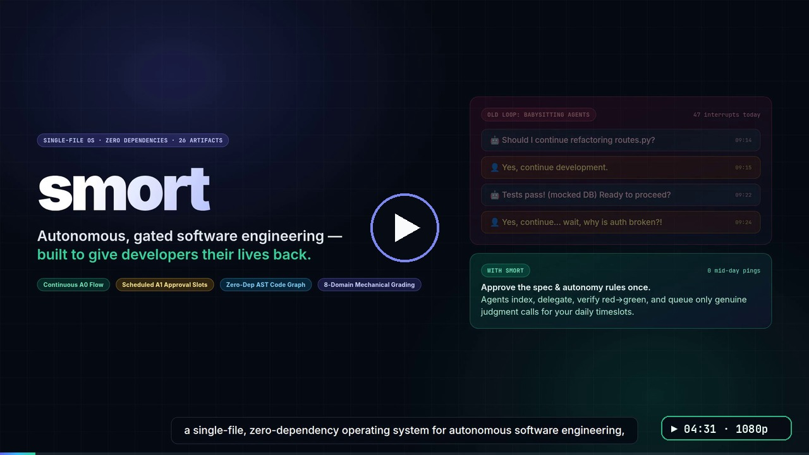
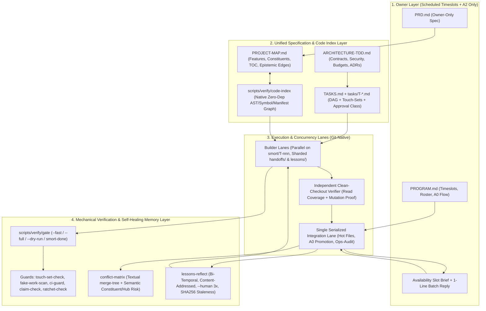
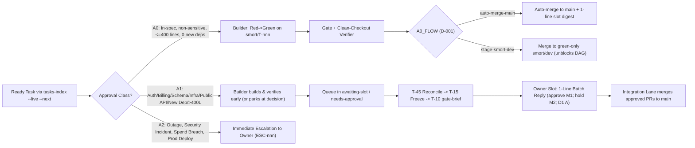

# smort

> **Single-file, zero-dependency operating system for autonomous, gated multi-agent software engineering — built to give developers their lives back.**

`smort v5` · Repo template version `2026-11-24.v8` · **26 self-extracted artifacts** (10 templates, 13 verification/coordination scripts, 3 starter configs) · **0 third-party runtime dependencies** (Python 3 stdlib + POSIX Bash + `git`) · LLM-agnostic & IDE-agnostic

Instead of babysitting coding agents all day typing *"Yes, continue development"*, you approve the product spec, architecture map, and autonomy boundaries once. From there, agents index the codebase, derive and delegate tasks, build red→green with negative-control proof, grade quality across 8 engineering domains, maintain bi-temporal self-healing work memory, and **continuously advance toward project completion** — surfacing only genuine judgment calls at your **scheduled daily approval timeslots**.

---

## Explainer Video (`04:31` · 1080p Narrated Walkthrough)

[](https://github.com/smolboon/smort/blob/main/assets/smort_explainer.mp4)

**[Watch / Open `assets/smort_explainer.mp4`](./assets/smort_explainer.mp4)** · **[Direct Download (`17.67 MiB`, 1080p H.264 + AAC)](https://github.com/smolboon/smort/raw/main/assets/smort_explainer.mp4)** · **[Subtitles (`SRT`)](./assets/smort_explainer.srt)**

<details>
<summary><strong>Chapter Index (10 Chapters)</strong></summary>

| Timestamp | Chapter | Topic |
|---|---|---|
| `00:00` | **01 · Overview** | Stop Babysitting Your Coding Agents |
| `00:17` | **02 · The Problem** | Babysitting Trap vs. Unchecked Autonomy Collapse |
| `00:41` | **03 · What It Offers** | One Portable File → 26 Zero-Dependency Artifacts (`10` templates, `13` scripts, `3` configs) |
| `01:05` | **04 · Architecture** | 4-Layer Git-Native Control Plane, Source-of-Truth Precedence & Anti-Circularity |
| `01:34` | **05 · Autonomy & Slots** | `A0` / `A1` / `A2` Routing, Scheduled Owner Slots & 1-Line Batch Replies |
| `02:07` | **06 · Code & Map Index** | Unified `PROJECT-MAP` + Native Zero-Dep `code-index`, Hub Bypass & `not_shown` |
| `02:38` | **07 · Verification Gates** | Red→Green, 5 Mechanical Shields, 3-Part Provenance Split & Clean-Checkout Verifier |
| `03:10` | **08 · Grading & Memory** | 8-Domain `T0–T3` + `k/n` Grading & Bi-Temporal Self-Healing `lessons-reflect` |
| `03:41` | **09 · Scale & Sanity** | Hot-Set & Perf Sanity Budgets, Linked Git Worktrees, `conflict-matrix` & Counted ROI |
| `04:07` | **10 · Get Started** | One-Prompt Agent Setup, `< 0.2 s` Local Self-Extractor & `github.com/smolboon/smort` |

</details>

---

## Table of Contents

- [Explainer Video (`04:31` · 1080p Narrated Walkthrough)](#explainer-video-0431--1080p-narrated-walkthrough)
1. [What Problem `smort` Solves](#1-what-problem-smort-solves)
2. [What `smort` Offers](#2-what-smort-offers)
   - [Inside `smort.md`: Complete File Map](#inside-smortmd-complete-file-map)
   - [Self-Extracted Repository Payload (26 Artifacts)](#self-extracted-repository-payload-26-artifacts)
3. [How `smort` Is Architected](#3-how-smort-is-architected)
   - [System Architecture Overview](#system-architecture-overview)
   - [Continuous `A0` / `A1` / `A2` Delivery & Timeslot Topology](#continuous-a0--a1--a2-delivery--timeslot-topology)
   - [Tiered Context Architecture (Hot Set vs. On-Demand)](#tiered-context-architecture-hot-set-vs-on-demand)
   - [Source-of-Truth & Rule Precedence](#source-of-truth--rule-precedence)
   - [Multi-Agent Concurrency, Locking & Worktree Isolation](#multi-agent-concurrency-locking--worktree-isolation)
   - [Standardized CLI, Output & Exit-Code Contract](#standardized-cli-output--exit-code-contract)
4. [Why `smort` Is Architected the Way It Is](#4-why-smort-is-architected-the-way-it-is)
5. [How `smort` Works (End-to-End Lifecycle)](#5-how-smort-works-end-to-end-lifecycle)
6. [Features & Capabilities](#6-features--capabilities)
   - [Unified Project, Feature & Native Code Graph Indexing](#61-unified-project-feature--native-code-graph-indexing)
   - [Continuous Autonomy, Timeslot Governance & Attention Protection](#62-continuous-autonomy-timeslot-governance--attention-protection)
   - [Automated Task Creation, Delegation & Overlap Protection](#63-automated-task-creation-delegation--overlap-protection)
   - [Multi-Dimensional, Multi-Domain Grading (`AUDIT.md`)](#64-multi-dimensional-multi-domain-grading-auditmd)
   - [Epistemic Verification, Security & Anti-Slop Gates](#65-epistemic-verification-security--anti-slop-gates)
   - [Hot-Set Context-Tax & Performance Budgets](#66-hot-set-context-tax--performance-budgets)
   - [Bi-Temporal Self-Healing Experiential Memory](#67-bi-temporal-self-healing-experiential-memory)
   - [Shipped Scripts & Configs Reference](#68-shipped-scripts--configs-reference)
7. [How to Use `smort`](#7-how-to-use-smort)
   - [Prerequisites](#prerequisites)
   - [Quickstart: Hand `smort.md` to Any Agent](#quickstart-hand-smortmd-to-any-agent)
   - [Quickstart: Self-Extract Locally (< 0.2 s)](#quickstart-self-extract-locally--02-s)
   - [Install Paths (New Repo, Spike Branch, Existing Repo, Upgrade)](#install-paths-new-repo-spike-branch-existing-repo-upgrade)
   - [Owner Settings & Thresholds](#owner-settings--thresholds)
   - [Always-On Assistant Rules Snippet](#always-on-assistant-rules-snippet)
   - [Day-to-Day CLI Cheat Sheet](#day-to-day-cli-cheat-sheet)
   - [Owner Batch Reply Syntax](#owner-batch-reply-syntax)
   - [When NOT to Use `smort`](#when-not-to-use-smort)

---

## 1. What Problem `smort` Solves

Modern AI coding agents can write thousands of lines of code per hour, yet developers routinely end up **trapped in one of two broken failure modes**:

1. **The Babysitting Loop:** Constantly answering *"Should I proceed?"*, *"Yes, continue development"*, manually resolving merge conflicts between parallel sessions, repeating architecture constraints after every context compaction, and reviewing sprawling unverified diffs on ad-hoc interrupts all day.
2. **Unchecked Autonomy Collapse:** Letting agents merge freely without structural guardrails leads to silent security regressions, circular dependencies, stale documentation, "green test theater" (tests that never failed before the fix or mock out the real code path), silent `200 OK` no-op stubs, runaway CI bills from hung workflows, bloated instruction files that burn the context window, and LLM self-grading jitter.

| Failure Mode in Ad-Hoc Agent Workflows | How `smort` Eliminates It |
|---|---|
| Constant interrupts (*"Yes, continue?"*) | **Approval Classes (`A0` / `A1` / `A2`) + Scheduled Timeslots:** `A0` flows continuously; `A1` queues neatly for `Morning`/`Evening` slots with 1-line batch approvals; `A2` interrupts immediately only for true incidents. |
| Agents guessing codebase structure or grepping blindly | **Unified Project Map + Native Code Graph (`PROJECT-MAP.md` + `code-index`):** Deterministic Feature → Requirement → Constituent → Code TOC tree plus zero-dependency AST/symbol/manifest blast-radius and hub analysis. |
| Multi-agent race conditions & merge hell | **Atomic Git CAS branch claims (`smort/T-nnn`)**, single serialized **Integration Lane** for hot files, sharded builder files (`handoffs/`, `verify/lessons/`, `changes/`), linked worktree support, and textual + semantic `conflict-matrix`. |
| Same-session self-approval & fake green tests | **Red→Green SHA ancestry**, negative-control/mutation proof, 3-part **Provenance Split**, independent clean-checkout **Verifier** with logged read coverage, and explicit **Anti-Circularity** rules. |
| Context amnesia & instruction-file bloat | **Tiered Hot Set** enforced by `ratchet-check --check-hot-set` (`HANDOFF.md` ≤ 4 KB / 60 lines; combined hot set ≤ 64 KB / 18k est tokens), live `--section` doc reader, and `--compact` tool output. |
| Unverified doc claims, silent stubs & hung CI jobs | Mechanical Day-1 gates: `claim-check` (`verify/claims.json`), `ci-guard` (job-level `timeout-minutes`), `fake-work-scan` (secrets/slop/config-tamper), and `code-index bypass` (centralized security hub enforcement). |
| Stale lessons & repeated agent mistakes | **Bi-temporal self-healing memory (`lessons-reflect`):** SHA-256 content-addressed deduplication, 30-day decay, `≥ 2` corroboration, `human: true` 3× owner override authority, SHA-256 file-fingerprint retirement, and `--as-of` history. |
| Heavy orchestrator lock-in, binaries & telemetry | **1 single file ([`smort.md`](./smort.md))**, zero external runtime dependencies, zero databases, zero daemons, zero telemetry/phone-home — everything lives as plain Git-tracked Markdown, JSON, Python stdlib, and Bash inside your repo. |

---

## 2. What `smort` Offers

`smort` packs an entire software-engineering control plane into a single portable file: **[`smort.md`](./smort.md)**.

### Inside `smort.md`: Complete File Map

| Section in [`smort.md`](./smort.md) | Purpose |
|---|---|
| **Overview & Core Terms** | Autonomy model (`A0`/`A1`/`A2`), roles (Owner, Builder, Integration Lane, Verifier, Merger), trusted authors, epistemic vocabulary (`ASSUMPTION:`, `unknown`, `unverifiable`). |
| **§1 START HERE: Resume Protocol** | State detection (install / upgrade / resume), tiered Hot Set vs. on-demand reads, Source-of-Truth Precedence, Anti-Circularity rule, atomic claim & continuous loop, crash-safe handoff. |
| **§2 Core Invariants (Quick Map)** | Single-table index of all non-negotiable rules pointing to canonical clauses in `AGENTS.md`. |
| **§3 Owner Settings & Thresholds** | One-shot install-time configuration table (timeslots, `A0_FLOW`, sensitive paths, maturity target, roster, caps) and configurable thresholds (`400` lines/PR, `800` lines/slot, `80%` coverage, `5%` perf budget). |
| **§4 Install, Upgrade, and Spikes** | Self-extracting Python bootstrapper (§4.1), immediate `--self-test` verification, `v3–v7 → v8` upgrade guide (§4.2), Path A greenfield + non-mergeable `spike/<slug>` escape hatch (§4.3), non-destructive Path B existing-repo adoption (§4.4). |
| **§5 The Loop** | Role separation, continuous `A0`/`A1` promotion flow, Fast Gate (`≤ 15 min`) vs. Deep Gate (nightly/pre-release), cron/manual scheduling, usage/freeze/completion stop conditions. |
| **§6 Multi-Dimensional, Multi-Domain Grading** | 3 Completion & Autonomy dimensions × 8 Engineering Quality domains graded by discrete Maturity Tier (`T0–T3`) + deterministic checklist ratio (`k/n`) with objective merge blocks. |
| **§7 Repo Templates (`§7.1–§7.10`)** | All 10 ready-to-extract governance, architecture, task, audit, and handoff templates (fenced with `~~~~`). |
| **§8 Shipped Starter Scripts & Configs (`§8.1–§8.16`)** | All 13 executable zero-dependency verification/coordination scripts and 3 declarative starter JSON configs (fenced with `~~~~`). |

### Self-Extracted Repository Payload (26 Artifacts)

Running the §4.1 extractor materializes the complete control plane directly into your repository without ever overwriting existing files (collisions write to `<file>.smort-new`):

| Category | Extracted Path | Role |
|---|---|---|
| **Governance & Workflow (3)** | `AGENTS.md` | Canonical hard rules, stale-prior table, `A0`/`A1`/`A2`, security & trust boundaries, Reference-Coding + License Wall, Provenance Split PoW, QA bar, slop list, permanent Known Mistakes (`M1–M14`). |
| | `PROGRAM.md` | Owner availability timeslots, `A0` promotion policy, agent roster, daily rhythm, reconciliation, 3-Outcome Triage, slot brief format, 1-line batch reply syntax, hotfix & project completion protocol. |
| | `DEVELOPMENT-WORKFLOW.md` | One-page canonical map of where every artifact lives and how work flows from idea to completion. |
| **Specs, Maps & Tasks (4)** | `PRD.md` | 100% owner-owned product requirements, personas, JTBD, success/guardrail metrics, FR/NFR, MoSCoW, non-goals, compliance. |
| | `PROJECT-MAP.md` | Unified project index: Feature Index (`F-nnn`), Constituent Registry (`S*.C*`), auto-generated visual TOC tree, Epistemic Dependencies (`EXTRACTED`/`INFERRED`/`AMBIGUOUS`), External Deps/Licenses, auto-generated Build Order & Critical Path. |
| | `ARCHITECTURE-TDD.md` | Topology, durable vs. invocation state, API/boundary contracts (verified by `code-index verify-docs`), Auth & Hub Bypass boundaries, STRIDE, Zero-Trust Release Verification, testing, measured budgets, ADRs, task derivation. |
| | `TASKS.md` | Task schema (`approval: A0/A1`, `lane`, `touch_set`), atomic Git CAS claim protocol, next-task ranking algorithm, 5 continuous task-creation triggers + 3-Outcome Triage, shrink-guarded generated index. |
| **Grading & Continuity (3)** | `AUDIT.md` | Executive completion dashboard, 8-domain scorecard (`T0–T3` + `k/n`), open findings, binary tier checklists. |
| | `AUDIT-LOG.md` | Append-only historical log of nightly multi-dimensional audits. |
| | `HANDOFF.md` | Compact crash-safe resume rollup strictly bounded to `≤ 4 KB / ≤ 60 lines` (paired with per-agent `handoffs/<agent-slug>.md`). |
| **Verification & Coordination Scripts (13)** | `scripts/verify/gate` | Master Fast/Deep verification runner (`--fast`, `--full`, `--dry-run`, `--emit-pow`, `SMORT_ALLOWED_IDENT`, `smort-done`). |
| | `scripts/verify/touch-set-check` | Enforces task `touch_set`, `DO_NOT_TOUCH`, and mechanical `A0 SENSITIVE-PATH ESCALATION` blocking. |
| | `scripts/verify/fake-work-scan` | Scans for `.env` leaks, vendor/PEM/JWT/URL secret literals, protected config tampering, slop markers, debug prints, TS `any`, plus `--redact` stream filter. |
| | `scripts/verify/ratchet-check` | Enforces monotonic quality ratchets, hot-set context-tax ceilings, perf ceilings + paired sanity floors, baseline regressions, and exit-4 ADR confirmation gates. |
| | `scripts/verify/tasks-index` | Validates task frontmatter, overlays live `origin/smort/T-*` branches (`--live --next`), resolves claim races (`--claim-check`), emits `--compact` + `not_shown`, enforces exit-4 shrink-guard. |
| | `scripts/verify/project-map` | Validates Feature/Constituent/Edge tables (including confidence `0.5` ban & `type-only` cycle exclusion), generates TOC & topological build order, live secret-redacted `--section` reader, `--impact`, `--dry-run`. |
| | `scripts/verify/code-index` | Native zero-dep multi-language AST/symbol/manifest code graph: `build`, `query`, `affected`, `hubs`, `--cycles`, `--check-map`, `bypass`, `verify-docs`, linked `--worktree shared\|isolated`, staleness warnings. |
| | `scripts/verify/conflict-matrix` | Predictive textual (`git merge-tree`) + semantic (shared constituent, adjacent edge, shared hub) overlap analysis across open branches. |
| | `scripts/verify/gate-brief` | Generates 1-screen plain-human-prose owner slot brief with short reply codes (`M1`, `D1`), `MAX_GATE_LINES` A1 overflow deferral, secret redaction, and **counted autonomous ROI**. |
| | `scripts/verify/lessons-reflect` | Bi-temporal experiential memory engine: sharded logging, SHA-256 dedup, 30-day decay, corroboration, `--human` 3× overrides, SHA-256 file-fingerprint retirement, `--as-of YYYY-MM-DD` time travel. |
| | `scripts/verify/ci-guard` | Validates `.github/workflows/*.{yml,yaml}` job-level `timeout-minutes` (`1..60`), exempting reusable `uses:` jobs, with built-in `--self-test`. |
| | `scripts/verify/claim-check` | CommonMark-fence-aware declarative doc-claim linter reading `verify/claims.json`, with built-in `--self-test`. |
| | `scripts/verify/project-checks.sh` | Repo-specific lint/type/test/build hook (exits `2` `UNVERIFIABLE` on Day 1 until wired to real project commands). |
| **Starter Configs (3)** | `verify/ratchet.json` | Monotonic baseline counts (tests, warnings, `TODO`s, skipped tests). |
| | `verify/claims.json` | Declarative doc-truth lint rules (ships with `SMORT-NO-LOCAL-EVIDENCE` and `SMORT-NO-FALSE-CI-GREEN`). |
| | `verify/budgets.json` | Agent hot-set context-tax ceilings (`HANDOFF.md`, `LESSONS.md`, combined bytes & est tokens) and performance/sanity budgets. |

---

## 3. How `smort` Is Architected

### System Architecture Overview

`smort` is structured as a **Git-native 4-layer control plane**. Every coordination primitive — task claims, code orientation, quality gates, memory, conflict detection, and owner approvals — operates directly on version-controlled files and Git refs with zero external services.



### Continuous `A0` / `A1` / `A2` Delivery & Timeslot Topology

`smort` decouples **engineering throughput** from **human calendar availability** by routing tasks strictly by risk class:



### Tiered Context Architecture (Hot Set vs. On-Demand)

Every agent session — including immediately after context compaction or crash restarts — loads a small, mechanically budgeted **Hot Set**, then pulls deep context strictly on demand:

| Tier | Loaded When | Files / Commands | Budget Guard |
|---|---|---|---|
| **Tier 1: Hot Set** | Every session start & post-compaction resume | `AGENTS.md` (§0/§1/§10), `PROGRAM.md` (§0), `HANDOFF.md` + `handoffs/<agent>.md`, `verify/LESSONS.md`, `AUDIT.md §1`, newest `AUDIT-LOG.md` entry, `tasks-index --live --next --compact` | `ratchet-check --budgets verify/budgets.json --check-hot-set` (`HANDOFF.md` ≤ 4 KB / 60 lines; `LESSONS.md` ≤ 8 KB; combined hot set ≤ 64 KB / 18,000 est tokens — measured Day-1 baseline: **55,957 B / 13,991 est tokens**) |
| **Tier 2: Targeted Doc Sections** | Only for active or top candidate task | `project-map --section "<heading>" --file <doc>` (live disk read, secret-redacted, non-truncatable `not_shown` footer) and `project-map --impact <S*.C*> --compact` | Never loads full `ARCHITECTURE-TDD.md`, `PRD.md`, or `tasks/archive/` |
| **Tier 3: Native Code Orientation** | Before broad grep or editing | `code-index query "<question>" --compact` and `code-index affected <file-or-symbol> --compact` | Exact `file:line` callers, inheritance, hubs, blast radius in milliseconds, with explicit `not_shown` counts outside `--budget` |

### Source-of-Truth & Rule Precedence

When instructions or documents disagree, agents resolve conflicts deterministically without stalling or guessing:

- **Rule Precedence:** `Owner Hard Rules (AGENTS.md §1.0)` **>** `AGENTS.md §1` **>** `smort.md` **>** `task prompt`
- **Fact Precedence:** `live code & observed test output` **>** `PROJECT-MAP.md` **>** `ARCHITECTURE-TDD.md` **>** `PRD.md` **>** `HANDOFF.md` **>** `verify/LESSONS.md`
- **Anti-Circularity Invariant:** An agent may **never** cite `PROJECT-MAP.md`, `TASKS.md §9`, `verify/code-index.json`, `verify/LESSONS.md`, or `HANDOFF.md` as verification evidence when auditing or modifying that artifact, the verification gate, or freshly edited code. Verification must always inspect live source files and execute real tests directly.

### Multi-Agent Concurrency, Locking & Worktree Isolation

`smort` supports multi-agent parallel fleets (multiple LLMs, terminals, CI workers, or human+agent hybrids) without a central server:

1. **Atomic Git CAS Claiming:** Builders branch off the integration base using the exact canonical branch name `smort/T-nnn` (no custom suffix). Pushing `git push -u origin smort/T-nnn` causes simultaneous duplicate claims to collide atomically at the Git remote.
2. **Double-Checked Overlap Lock:** Immediately after pushing, the builder runs `git fetch origin && scripts/verify/tasks-index --live --claim-check T-nnn`. If a higher-precedence overlapping task (`P0 < P1 < P2 < P3`, then lower `T-nnn`) won a same-second race, the loser deletes its remote claim and re-picks.
3. **Hot-File Serialization + Sharded Writes:** Only the single serialized **Integration Lane** edits root hot files (`PROJECT-MAP.md`, `TASKS.md §9`, `AUDIT.md`, `AUDIT-LOG.md`, `HANDOFF.md`, `verify/LESSONS.md`, `verify/*.json`). Parallel builders write only to task-scoped or agent-scoped files (`tasks/T-nnn-*.md`, `changes/T-nnn.md`, `handoffs/<agent-slug>.md`, `verify/lessons/T-nnn.jsonl`).
4. **Linked Git Worktrees & Committer Identity Guard:** Both `code-index` and `lessons-reflect` support `--worktree shared|isolated` (detecting linked worktrees via `git rev-parse --git-common-dir`), and `gate` supports `SMORT_ALLOWED_IDENT` (via `git var`) to prevent cross-agent commit identity contamination across shared machines.

### Standardized CLI, Output & Exit-Code Contract

All shipped `smort` scripts adhere to a unified machine-and-human protocol:

| Exit Code | Meaning | Used By |
|---|---|---|
| **`0`** | Pass / clean / succeeded | All scripts |
| **`1`** | Gate failure, drift, security/bypass violation, or CI check mismatch | `gate`, `touch-set-check`, `fake-work-scan`, `ci-guard`, `claim-check`, `ratchet-check`, `project-map --check`, `code-index` |
| **`2`** | Usage error or `UNVERIFIABLE` (e.g., missing secret scanner or unwired `project-checks.sh`) | `gate` (`reason=unverifiable`), CLI arg parsing |
| **`3`** | Ambiguous match (multiple headings/symbols match query) | `project-map --section`, `code-index` |
| **`4`** | Not found **or** `NEEDS_DECISION` non-TTY confirmation gate | `gate --dry-run` (over cap, zero log writes), `ratchet-check --allow-lower` without `--decision D-nnn`, write-mode shrink-guards (`tasks-index`, `project-map`, `code-index`), missing target lookup |

- **Machine-vs-Human Output Discipline:** `--compact` emits terse, token-efficient `@ok` / `@no` / `@edge` / `@not_shown` lines strictly for agent-to-tool exchanges; every human-facing artifact (`gate-brief`, PR bodies, `PRD.md`, `HANDOFF.md`) must be written in plain human prose.
- **Non-Truncatable `not_shown` Accounting:** Whenever output is capped or filtered (`--budget`, `--max-chars`, `--top`, `--lane`, `--max-lines`, deduplication, staleness retirement), scripts emit an explicit `not_shown` summary **outside** the truncation budget so agents never mistake clipped output for complete absence.
- **Sanitized Terminal Summary:** `scripts/verify/gate` always concludes with one control-character-sanitized machine-parseable line:
  ```text
  smort-done ok=1 exit=0 reason=pass fails=0 unverifiable=0 wall=3s
  ```

---

## 4. Why `smort` Is Architected the Way It Is

Every major design choice in `smort` exists to counter a specific, recurring failure mode observed in real autonomous agent workflows:

1. **Why one self-extracting Markdown file with zero third-party runtime dependencies?**
   External orchestrator frameworks break on Python/Node version drift, require MCP daemons or vector databases, fail in air-gapped CI, or silently phone home. By compiling all 10 templates, 13 stdlib scripts, and 3 starter configs into one auditable [`smort.md`](./smort.md) file (verified `0` non-stdlib imports across all 11 Python scripts), any team can bootstrap a repository in `< 0.2 s` on any Linux/macOS/CI environment with zero supply-chain surface.
2. **Why `A0` / `A1` / `A2` with scheduled owner timeslots instead of per-turn approval or full autonomy?**
   Per-turn approval turns the human into a click-bot and triggers rubber-stamping; full autonomy eventually drops a broken migration or leaks an auth bypass into `main`. Separating low-risk in-spec `A0` work from mechanically guarded `A1` sensitive paths (`touch-set-check`) lets agents make continuous forward progress all day while keeping human attention focused on two bounded 15-minute review slots capped at `MAX_GATE_LINES` (`800` lines).
3. **Why a single serialized Integration Lane paired with sharded builder files?**
   Without serialization, 4 parallel agents editing `TASKS.md`, `HANDOFF.md`, `PROJECT-MAP.md`, and `LESSONS.md` spend half their turns rebasing lockfile-like merge conflicts. Sharding builder outputs into per-task/per-agent files and giving one Integration Lane sole ownership of rollup files yields lock-free parallelism using only Git.
4. **Why discrete Maturity Tiers (`T0–T3`) + checklist ratios (`k/n`) instead of `0–10` LLM quality scores?**
   Asking an LLM to score code `8.3/10` produces non-reproducible score jitter across runs and models. Binary pass/fail criteria grouped into discrete tiers (`T0–T3`) with exact ratios (`k/n` passing toward the next tier) make quality regression blocks deterministic and incremental progress visible.
5. **Why build a native stdlib AST/symbol/manifest code graph (`code-index`) — and then pair it with an Anti-Circularity Rule?**
   Agents waste massive token budgets grepping large repos and still miss indirect callers, inheritance chains, or cross-constituent import cycles. A stdlib multi-language parser (Python `ast` + TypeScript/JS/Rust/Go/manifest extractors) delivers sub-second blast-radius, hub, cycle, map-drift, doc-symbol sync, and security Hub Bypass checks with zero external packages. Pairing it with the Anti-Circularity Rule prevents the classic trap of trusting a stale or self-edited index as proof that code actually works.
6. **Why require Red→Green SHAs, negative-control/mutation proof, 3-part Provenance Split, and an independent Verifier?**
   Agents routinely write tautological tests that pass even if the implementation is deleted, summarize checks they never actually ran, or silently read only the first 100 lines of a 500-line diff. Mechanical `--red-sha` ancestry, explicit mutation/negative-control evidence, mandatory separation of `Verified` vs. `Assumed — NOT tested [falsifier]` vs. `Not run / N/A [reason]`, and logged read coverage (`lines_read/total_lines`) on a clean-checkout Verifier close those loopholes.
7. **Why bi-temporal, content-addressed, time-decayed, file-fingerprinted, human-overridable memory (`lessons-reflect`)?**
   Append-only "agent memory" files inevitably rot into contradictory 50 KB walls of obsolete advice. Content-addressed SHA-256 IDs stop duplicate logging from inflating confidence; 30-day exponential decay + `≥ 2` corroboration filters one-off noise; SHA-256 file fingerprints automatically retire lessons whose referenced source files changed; `--human` gives owner corrections 3× overriding authority (`human_override:<outcome>`); and two-clock bi-temporal records (`created_at`, `valid_from`, `valid_until`) never erase history, enabling read-only `--as-of YYYY-MM-DD` audits.
8. **Why enforce hot-set context-tax budgets (`verify/budgets.json`) and paired performance sanity floors?**
   Instruction files grow monotonically until they silently crowd out working memory, and performance benchmarks can be trivially "gamed" by returning fast-but-wrong empty results. `ratchet-check` mechanically caps both hot-set footprint (`bytes`, `lines`, `est_tokens`) and performance regressions while pairing `max_*` latency ceilings with `min_*` correctness sanity floors (e.g., minimum hit-rate/recall/output completeness).
9. **Why 3-Outcome Attention-Protection Triage and counted autonomous ROI?**
   Unconstrained autonomous agents invent speculative cleanup tickets to look busy, flooding the developer's review queue. The 3-Outcome Triage rule permits auto-creating tasks only from reproducible/evidenced gaps and forces `A0` / `A1` / `Defer` overflow discipline, while `gate-brief` reports objective **counted autonomous ROI** (real commits integrated, real `gate-*.log` failures caught pre-slot, hot-set budget headroom).
10. **Why executable doc-claim linting (`claim-check`) and CI timeout guarding (`ci-guard`)?**
    Prose rules like *"never report passing CI when CI did not execute"*, *"never cite `/tmp/...` paths as evidence"*, and *"always put `timeout-minutes` on CI jobs"* fail under agent fatigue. Compiling those invariants into deterministic zero-dep checks inside `scripts/verify/gate` enforces them on every push.

---

## 5. How `smort` Works (End-to-End Lifecycle)

```mermaid
sequenceDiagram
    participant Owner as Human Owner
    participant Builder as Builder Agent(s)
    participant Gate as scripts/verify/gate
    participant Verifier as Clean-Checkout Verifier
    participant Integ as Integration Lane

    Note over Owner,Integ: Phase 1 — One-Time Install & Spec Slot
    Builder->>Owner: Extract 26 files (§4.1), draft PRD/PROJECT-MAP/ARCHITECTURE-TDD/Tasks
    Owner->>Integ: Approve Spec & A0_FLOW policy (D-001)

    Note over Builder,Integ: Phase 2 — Continuous Autonomous Execution (All Day)
    loop While ready tasks exist
        Builder->>Builder: tasks-index --live --next --compact -> atomic claim smort/T-nnn
        Builder->>Builder: Orient via code-index affected/query & project-map --section
        Builder->>Builder: Commit failing check (Red SHA) -> implement inside touch_set
        Builder->>Gate: gate --fast --task T-nnn --red-sha <sha> --emit-pow
        Gate-->>Builder: smort-done ok=1 exit=0 + Provenance Split PoW
        Builder->>Verifier: Open PR (in-review) & immediately claim next task
        Verifier->>Gate: Clean checkout + full read-coverage + negative-control check
        Verifier-->>Integ: Label PR verified
        alt Task is A0 (Autonomous)
            Integ->>Integ: Rebase + fast gate + auto-merge to main (or smort/dev)
        else Task is A1 (Sensitive / Judgment)
            Integ->>Integ: Queue in awaiting-slot for next Owner Timeslot
        end
    end

    Note over Owner,Integ: Phase 3 — Scheduled Owner Availability Slot
    Integ->>Integ: T-45 reconcile + conflict-matrix -> T-15 freeze -> T-10 gate-brief
    Integ->>Owner: Send 1-screen human-prose brief (M1..Mk, D1..Dn, Counted ROI)
    Owner->>Integ: Single batch reply ("approve M1 M2; hold M3; D1 A")
    Integ->>Integ: Execute approved merges/ADRs & unfreeze

    Note over Owner,Integ: Phase 4 — Bounded Nightly Pass (<= 45 min)
    Integ->>Integ: Deep gate + 8-domain AUDIT + lessons-reflect build -> smort/ops-audit PR
```

1. **Install & Spec Slot (`smort/install`):** Extract the 26 artifacts, verify `--self-test` & hot-set budgets, draft or reverse-engineer `PRD.md`, `PROJECT-MAP.md`, and `ARCHITECTURE-TDD.md`, wire `scripts/verify/project-checks.sh`, and approve `D-001` once.
2. **Orient & Claim:** Builders run `tasks-index --live --next --lane <lane> --compact`, claim the highest-priority unblocked task via canonical branch `smort/T-nnn`, and confirm no claim-race conflict via `--claim-check`.
3. **Research & Build Red→Green:** Before implementing non-trivial code, builders orient with `code-index query`/`affected` and `project-map --section`, apply the **Reference-Coding & License Wall** protocol (`AGENTS.md §5.9`), commit failing tests first (`Red` SHA), implement strictly inside `touch_set`, prove negative control/mutation failure, and log non-obvious discoveries via `lessons-reflect log`.
4. **Mechanical Gate + Independent Verification:** `scripts/verify/gate --fast --task T-nnn --red-sha <sha> --emit-pow` runs all mechanical checks and generates a 3-part Provenance Split proof-of-work block. A clean-checkout **Verifier** (different model preferred; fresh clean-context session explicitly labelled if single-model) verifies full read coverage and grants `verified`.
5. **Zero-Stall Promotion:** Verified `A0` PRs are integrated immediately (auto-merged to `main` under `D-001`, or merged onto green-only `smort/dev`) to unblock downstream DAG tasks; `A1` PRs wait cleanly in `awaiting-slot` while builders move on to the next task.
6. **Scheduled Timeslot Approval:** At `T-45`, the Integration Lane reconciles branches and runs `conflict-matrix` (textual + semantic); at `T-15`, pushes freeze; at `T-10`, `gate-brief` sends a 1-screen plain-prose brief with short codes (`M1`, `D1`), overflow deferral, and counted ROI. You reply in one line, and the loop continues.
7. **Nightly Deep Audit & Project Completion:** A timeboxed nightly pass (`≤ 45 min`) runs deep verification (`ci-guard`, `code-index verify-docs`, `code-index bypass`, flake/mutation/fuzz/soak/CVE checks), updates `AUDIT.md` + `AUDIT-LOG.md` + `verify/LESSONS.md`, archives merged tasks, and opens/updates the single rolling `smort/ops-audit` PR. Once all `Must` features are verified and all 8 domains meet `{{MATURITY_TARGET}}`, the repo automatically enters quiet **`maintenance` mode**.

---

## 6. Features & Capabilities

### 6.1 Unified Project, Feature & Native Code Graph Indexing
- **Single Structural Map (`PROJECT-MAP.md` + `project-map`):** Connects Features (`F-nnn`) ↔ Requirements (`FR-nnn`) ↔ Constituents (`S*.C*`) ↔ Source/Test Paths ↔ Epistemic Dependencies (`EXTRACTED`, `INFERRED (conf)` with `0.5` banned, `AMBIGUOUS`) ↔ External Deps & Licenses. Auto-generates the visual Table of Contents tree, topological build order, and critical path while excluding `type-only`/`deferred` edges from cycle errors.
- **Native Multi-Language Code Graph (`code-index`):** Zero-dependency Python AST + TypeScript/JavaScript/Rust/Go/manifest (`pyproject.toml`, `package.json`, `Cargo.toml`, `go.mod`) indexer storing a directed JSON graph (`verify/code-index.json`) with:
  - `query "<question>"` (exact full-identifier priority ranking, `--vocab` constrained vocabulary, `--hops`, `--budget`, `--compact`)
  - `affected <file-or-symbol>` (reverse blast-radius through imports, calls, and inheritance chains mapped back to Constituents and Features)
  - `hubs` (god-node in-degree ranking excluding test-only edges)
  - `--check-map --cycles` (detects real runtime import cycles, undeclared cross-constituent edges, and unlisted manifest dependencies)
  - `bypass <hub-file> --pattern <regex>` (executable security scan proving no file bypasses a centralized auth/crypto/validation hub)
  - `verify-docs --strict` (verifies that backticked symbols and paths documented in `PROJECT-MAP.md` and `ARCHITECTURE-TDD.md` actually exist in live source code)
  - `--worktree shared|isolated` + `built_at_utc` / `--no-rebuild` / `--max-age-days` staleness warnings.
- **Live Section Reader (`project-map --section`):** CommonMark-fence-aware Markdown section extractor reading live from disk (never stale line ranges), rejecting `../` path traversal, redacting accidental secret literals, and appending a non-truncatable `not_shown` footer.

### 6.2 Continuous Autonomy, Timeslot Governance & Attention Protection
- **3-Tier Approval Model (`A0` / `A1` / `A2`):** Mechanically enforces `A1` escalation whenever an `A0` branch touches sensitive paths (`auth,billing,payment,migration,schema,infra,terraform,.github,security` — configurable via `A1_SENSITIVE_PATHS`).
- **3-Outcome Attention-Protection Triage:** Every candidate issue or improvement must resolve to (1) autonomous `A0` fix if clearly in-spec, (2) justified `A1` slot item with concrete evidence, or (3) deferred/dropped — banning speculative cleanup sweeps and low-signal notifications.
- **Anti-Rubber-Stamp Cap (`MAX_GATE_LINES`):** `gate-brief --max-lines 800` caps combined `A1` diff size per owner slot and automatically defers overflow PRs to the next slot with an explicit `_not_shown_` count.
- **Counted Autonomous ROI:** Every slot brief reports verifiable autonomous work performed since the previous slot: commits integrated, real `gate-*.log` failures caught and fixed pre-slot, active semantic overlap alerts, dead-end/contested lessons, and live hot-set budget utilization.

### 6.3 Automated Task Creation, Delegation & Overlap Protection
- **5 Continuous Task-Creation Triggers:** Specs/ADR gaps, below-target audit findings, failing regressions, CVEs/license violations, and stale feature flags — all filtered through 3-Outcome Triage.
- **Smart Delegation (`tasks-index --live --next`):** Overlays live remote `origin/smort/T-*` branches onto the base branch in one command, ranking ready candidates by priority, DAG unblocking, lane match, touch-set disjointness, and approval class, while surfacing stale claims and explicit `not_shown` filter counts.
- **Predictive Textual + Semantic Conflict Matrix (`conflict-matrix`):** Runs real `git merge-tree` dry merges across all active `origin/smort/T-*` branches **and** flags `SEMANTIC-RISK` whenever two textually clean branches edit the same constituent, adjacent mapped edges, or callers of a shared `code-index` hub.
- **Shrink-Guards Everywhere:** `tasks-index`, `project-map`, and `code-index` refuse silent deletions of tasks, features, constituents, or graph coverage (exiting `4` `NEEDS_DECISION` on writes unless archived/forced).

### 6.4 Multi-Dimensional, Multi-Domain Grading (`AUDIT.md`)
Tracks **3 Completion & Autonomy Dimensions** (Feature Completion `Must`/`Should`, Verification Confidence `%`, Autonomy Health) alongside **8 Orthogonal Quality Domains**, each scored by **Maturity Tier (`T0–T3`) + deterministic checklist ratio (`k/n`)**:

| # | Domain | What It Grades |
|---|---|---|
| 1 | **Correctness & Soundness** | Red→green + negative-control tests, durable vs. invocation state, deterministic tie-breaking, `NEVER_MOCK` boundaries, E2E journeys, flake rate |
| 2 | **Architecture & Dependencies** | `PROJECT-MAP.md` TOC/leaf-ownership/cycles/layers/epistemic edges, `code-index --check-map` & `verify-docs`, contracts, Reference-Coding license wall, unused deps |
| 3 | **Security & Safety** | Authz allow+deny & authz-before-existence, credential-origin separation, async spawn guard audit, `code-index bypass`, fail-closed unimplemented surfaces, secret redaction, CVEs, STRIDE, `<untrusted_source>` framing |
| 4 | **Performance & Footprint** | `verify/budgets.json` ceilings + paired correctness sanity floors, hot-set context-tax budget, RAM/heap/leak soak, bundle/binary size, cold start |
| 5 | **Code Quality & Anti-Slop** | Lint, strict types, format, clones/dead code, `fake-work-scan`, prose-for-humans copy discipline, doc & symbol accuracy |
| 6 | **Verifiability & Rigor** | Provenance Split PoW + Evidence Table + mutation proof, `claim-check`, `ci-guard`, independent verifier w/ full read coverage & anti-circularity, ratchets, telemetry correctness |
| 7 | **Operational Readiness & UX** | Clean-clone `smoke.sh`, Zero-Trust Release Verification (declared matrix, non-zero on skip), operational recipe negative controls, exit-4 confirmations, observability, timeouts/fuzzing, UI states & WCAG 2.2 AA |
| 8 | **Delivery & Coordination** | Touch-set compliance, atomic claims, linked worktree safety (`--worktree`, `SMORT_ALLOWED_IDENT`), 3-Outcome Triage, textual + semantic conflict rate, PR size, bi-temporal `LESSONS.md`, bounded `HANDOFF.md` |

### 6.5 Epistemic Verification, Security & Anti-Slop Gates
- **Prompt-Injection Trust Boundary:** External PR comments, issues, and web fetches outside `{{TRUSTED_AUTHORS}}` are strictly untrusted data wrapped in `<untrusted_source sha256=...>` blocks with sentinel neutralization; bot messages never count as owner approval.
- **Hardened Secret & Slop Defense (`fake-work-scan`):** Blocks `.env` commits, vendor API keys (`sk-ant-`, `ghp_`, `AKIA...`), PEM private keys, JWTs, credentialed database URLs (without false-positiving on hyphenated prose like `sk-learn-compatible-model`), protected config tampering (`verify/ratchet.json`, `verify/claims.json`, `verify/budgets.json`), debug prints, slop placeholders, and TypeScript `any`. Includes `--redact` for sanitizing logs, lessons, and briefs.
- **Executable Doc-Claim Guard (`claim-check`):** Verifies prose against declarative rules in `verify/claims.json` (ignoring fenced code blocks), blocking machine-local paths (`/tmp/`, `/Users/`, `C:\`) cited as evidence and fabricated passing-CI claims when CI did not execute.
- **CI Hung-Job Guard (`ci-guard`):** Guarantees every non-reusable job in `.github/workflows/*.{yml,yaml}` declares `timeout-minutes` within `1..60`.
- **Deep Engineering Doctrine Baked into Templates:** 3-profile build matrix (`quick` / `ci-test` / `release`), authz-before-existence, credential-origin separation, async spawn guard audit, Reference-Coding & License Wall (`AGENTS.md §5.9`), `NEVER_MOCK` critical boundaries, fail-closed refusal for unimplemented features (never silent `200`/`201` stubs), and Zero-Trust Release Verification.

### 6.6 Hot-Set Context-Tax & Performance Budgets
- `ratchet-check --budgets verify/budgets.json --check-hot-set` gates exact UTF-8 byte sizes, line counts, and estimated token budgets for `HANDOFF.md`, `verify/LESSONS.md`, combined hot-set files, and an optional `tool_catalog_path`.
- `ratchet-check --budgets verify/budgets.json --measure key=val --baseline base.json` enforces both upper ceilings (`max_*`), lower correctness sanity floors (`min_*`), and max percentage regressions (`max_regression_pct`).
- Lowering any ratchet baseline via `--allow-lower` without an explicit ADR (`--decision D-nnn`) exits **`4` (`NEEDS_DECISION`)**.

### 6.7 Bi-Temporal Self-Healing Experiential Memory
- **Sharded Capture (`lessons-reflect log`):** Builders append secret-redacted observations (`useful` / `dead_end` / `corrected`) to `verify/lessons/T-nnn.jsonl` with SHA-256 content-addressed IDs and SHA-256 fingerprints of referenced files.
- **Deterministic Synthesis (`lessons-reflect build`):** Collapses exact duplicates (`duplicates_collapsed`), applies 30-day exponential decay, requires `≥ 2` distinct corroborating observations for `preferred` promotion, grants `--human` owner entries 3× override authority (`human_override:<outcome>`), automatically retires entries whose fingerprinted files changed (`retired_stale`), and writes compact `verify/LESSONS.md`.
- **Two-Clock Time Travel (`--as-of YYYY-MM-DD`):** Records `created_at`, `valid_from`, and `valid_until` without deleting history, allowing read-only historical reconstruction of what the team knew on any past date.

### 6.8 Shipped Scripts & Configs Reference

| Script / Config | Key Subcommands & Flags | Primary Purpose |
|---|---|---|
| `scripts/verify/gate` | `--fast`, `--full`, `--dry-run`, `--task T-nnn`, `--red-sha <sha>`, `--max-lines N`, `--allow-large`, `--emit-pow`, `--base <ref>` | End-to-end verification gate + Provenance Split PoW + `smort-done` line |
| `scripts/verify/touch-set-check` | `<T-nnn>`, `--base`, `--do-not-touch`, `--sensitive` | Touch-set boundary, `DO_NOT_TOUCH`, and `A0` sensitive-path escalation check |
| `scripts/verify/fake-work-scan` | `--base`, `--lane`, `--redact` | Secret literals, `.env`, protected config tamper, slop, debug prints, stream redaction |
| `scripts/verify/ratchet-check` | `--budgets`, `--check-hot-set`, `--measure k=v`, `--baseline`, `--update`, `--allow-lower --decision D-nnn`, `--json` | Monotonic ratchets, hot-set context budgets, perf + sanity floors |
| `scripts/verify/tasks-index` | `--live`, `--next`, `--lane`, `--claim-check T-nnn`, `--validate`, `--check`, `--compact`, `--json`, `--force` | Task validation, live remote claim overlay, next-task ranking, shrink-guarded index |
| `scripts/verify/project-map` | `--check`, `--dry-run`, `--impact <ID>`, `--section "<h>" --file <f> --max-chars N`, `--compact`, `--force` | Map validation, TOC/build-order generation, blast radius, live redacted section reader |
| `scripts/verify/code-index` | `build`, `query`, `affected`, `hubs`, `bypass`, `verify-docs`, `--check-map`, `--cycles`, `--worktree shared\|isolated`, `--no-rebuild`, `--max-age-days`, `--compact`, `--json` | Zero-dep multi-language AST/symbol/manifest code graph & static security/doc checks |
| `scripts/verify/conflict-matrix` | `--base` | Predictive `git merge-tree` textual + constituent/edge/hub semantic overlap matrix |
| `scripts/verify/gate-brief` | `--slot`, `--base`, `--max-lines` | Secret-redacted human-prose owner slot brief with counted ROI & A1 overflow deferral |
| `scripts/verify/lessons-reflect` | `log (--human --files --ts)`, `build (--now --as-of --json)`, `--check`, `--worktree shared\|isolated` | Bi-temporal, content-addressed, decayed, file-fingerprinted experiential memory |
| `scripts/verify/ci-guard` | `--max-timeout N`, `--self-test` | GitHub Actions job-level `timeout-minutes` linter |
| `scripts/verify/claim-check` | `[files...]`, `--rules`, `--self-test` | Fence-aware declarative documentation claim truth linter |
| `scripts/verify/project-checks.sh` | `--fast`, `--full` | Project-specific lint/type/unit/integration/build hook (wired in Task 1) |
| `verify/ratchet.json` | — | Monotonic baseline counts |
| `verify/claims.json` | — | Declarative claim lint rules (`SMORT-NO-LOCAL-EVIDENCE`, `SMORT-NO-FALSE-CI-GREEN`) |
| `verify/budgets.json` | — | Hot-set byte/line/token ceilings and performance/sanity budgets |

---

## 7. How to Use `smort`

### Prerequisites
- **Required:** Python `3.10+` (stdlib only), POSIX `bash`, `git` (`2.38+` recommended for `git merge-tree --write-tree` in `conflict-matrix`).
- **Recommended (optional):** [`gh`](https://cli.github.com/) (PR discovery & batch merges) and [`gitleaks`](https://github.com/gitleaks/gitleaks) (external secret scanning; `gate` still runs `fake-work-scan` without it and honestly reports `UNVERIFIABLE` for the external scanner).

### Quickstart: Hand `smort.md` to Any Agent

Copy [`smort.md`](./smort.md) into your repository root (or reference its path) and prompt any coding agent (Claude Code, Codex, Cursor, Windsurf, Antigravity, Gemini CLI, etc.) with:

```text
Follow smort.md for this repository.
```

The agent starts at **`smort.md §1`**, detects whether the repository needs a fresh install, an upgrade, or a clean resume, asks you the one-shot owner settings questions (or applies labeled `ASSUMPTION:` defaults), extracts all 26 files via `§4.1`, and opens the `smort/install` PR for your one-time Spec Slot approval.

### Quickstart: Self-Extract Locally (< 0.2 s)

You can also bootstrap any repository yourself directly from the terminal:

```bash
# 1. Fetch smort.md into your repo root (or copy from this repo)
curl -fsSLO https://raw.githubusercontent.com/smolboon/smort/main/smort.md

# 2. Run the zero-dependency §4.1 self-extractor (never overwrites existing files)
SMORT_FILE="smort.md" python3 - <<'PY'
import os, re, stat
from pathlib import Path
src = Path(os.environ["SMORT_FILE"]).read_text(encoding="utf-8")
for d in ("tasks/archive", "changes", "docs/decisions", "handoffs", "verify/conflicts", "verify/logs", "verify/lessons", "scripts/verify"):
    Path(d).mkdir(parents=True, exist_ok=True)
fence = chr(126) * 4
pat = re.compile(rf"^### [78]\.\d+ `([^`]+)`[^\n]*\n\n{fence}[a-z]*\n(.*?)\n{fence}", re.M | re.S)
count = 0
for m in pat.finditer(src):
    target = Path(m.group(1))
    out = target if not target.exists() else Path(f"{target}.smort-new")
    out.parent.mkdir(parents=True, exist_ok=True)
    out.write_text(m.group(2) + "\n", encoding="utf-8")
    if out.as_posix().startswith("scripts/verify/"):
        out.chmod(out.stat().st_mode | stat.S_IXUSR | stat.S_IXGRP | stat.S_IXOTH)
    count += 1
    print(f"wrote {out}")
assert count == 26, f"expected 26 blocks, wrote {count}"
print(f"OK: extracted {count} smort v5 files.")
PY

# 3. Verify the bootstrap immediately (must exit 0)
scripts/verify/ci-guard --self-test \
  && scripts/verify/claim-check --self-test \
  && scripts/verify/ratchet-check --budgets verify/budgets.json --check-hot-set
```

Expected output: `self-test: PASS` from both `ci-guard` and `claim-check`, plus `OK: hot-set context budgets held (...)`, exit `0`.

Add ephemeral local caches to `.gitignore`:

```gitignore
verify/logs/
verify/code-index*.json
```

### Install Paths (New Repo, Spike Branch, Existing Repo, Upgrade)

- **Path A — New Project (`smort.md §4.3`):** Extract onto branch `smort/install`, fill `PRD.md`, `PROJECT-MAP.md`, and `ARCHITECTURE-TDD.md`, derive initial tasks in topological order (Task 1 wires `scripts/verify/project-checks.sh` + CI; Task 2 builds lowest-layer contracts), run `project-map` and `tasks-index`, and approve `D-001` at the Spec Slot.
- **Spike Escape Hatch (`spike/<slug>`):** When product feel or technical feasibility is uncertain, open a timeboxed, **strictly non-mergeable** `spike/<slug>` branch exempt from `PROJECT-MAP.md` and ratchets. Prove or falsify the assumption, record lessons via `lessons-reflect log`, delete the spike branch, and start Path A cleanly.
- **Path B — Existing Codebase (`smort.md §4.4`):** Extract onto `smort/install` (existing files are preserved verbatim and collisions write to `*.smort-new` for careful merging). Run `scripts/verify/code-index build && scripts/verify/code-index hubs --cycles` immediately to map real imports, god-node hubs, manifests, and pre-existing cycles in seconds with zero LLM tokens. Reverse-engineer `PROJECT-MAP.md` and `ARCHITECTURE-TDD.md` read-only, wire `scripts/verify/project-checks.sh` to existing repo commands, and log a Day-0 `AUDIT-LOG.md` baseline.
- **Upgrade (`v3–v7 → v8`, `smort.md §4.2`):** Re-run the §4.1 extractor, merge `*.smort-new` updates while keeping all historical `AUDIT-LOG.md`, `tasks/`, `verify/lessons/*.jsonl`, and ADRs intact, verify `--self-test` + `--check-hot-set`, bump `Template version: 2026-11-24.v8`, and remove `*.smort-new` files.

### Owner Settings & Thresholds

Configured once at install in `AGENTS.md §0` and `PROGRAM.md §0`:

| Setting | Default | Purpose |
|---|---|---|
| `{{AVAILABILITY_SLOTS}}` | `Morning 08:30–08:45`, `Evening 18:30–18:45` (weekends async-only) | Your scheduled review windows; zero non-`A2` pings outside these slots |
| `{{A0_FLOW}}` | `stage-smort-dev` (`auto-merge-main` recommended once `T2` trust earned) | Whether verified `A0` PRs auto-merge to `main` or integrate onto green-only `smort/dev` |
| `{{A1_SENSITIVE_PATHS}}` | `auth,billing,payment,migration,schema,infra,terraform,.github,security` | Path patterns mechanically forced to `A1` by `touch-set-check` |
| `{{MATURITY_TARGET}}` | `production` (`mvp` / `production` / `hardened`) | Target tier (`T1` / `T2` / `T3`) across all 8 domains in `AUDIT.md` |
| `{{TRUSTED_AUTHORS}}` | Owner handle + configured agent handles | Allowlist for trusted PR comments; all other external text is `<untrusted_source>` |
| `{{400}}` / `{{800}}` | 400 code lines per PR / 800 combined `A1` lines per slot | Hard PR size cap & anti-rubber-stamp slot cap |
| `{{USAGE_CAP}}` | `70%` | Automatically scales back to morning slot only and pauses nightly audit near plan limits |

### Always-On Assistant Rules Snippet

Paste into `CLAUDE.md`, `.cursor/rules`, `.gemini/GEMINI.md`, or your agent's session-start hook so agents stay oriented even after context compaction:

```markdown
## smort orientation (always-on)
- Start every session AND post-compaction resume with the Hot Set (`AGENTS.md §0/§1/§10`, `verify/LESSONS.md`, `HANDOFF.md`, `scripts/verify/tasks-index --live --next --compact`).
- Before raw grepping docs or code, run `scripts/verify/project-map --section "<heading>"`, `scripts/verify/code-index query "<question>" --compact`, or `scripts/verify/code-index affected <file-or-symbol> --compact`.
- Anti-circularity: never cite an index, map, lessons summary, or code graph as verification proof for the code or gate you just changed—inspect live files and run `scripts/verify/gate`.
- Precedence on conflict: live code & tests > `PROJECT-MAP.md` > `ARCHITECTURE-TDD.md` > `PRD.md` > `HANDOFF.md` > `verify/LESSONS.md`.
```

### Day-to-Day CLI Cheat Sheet

```bash
# Orientation & task claiming
scripts/verify/tasks-index --live --next --lane backend --compact
scripts/verify/tasks-index --live --claim-check T-014
scripts/verify/project-map --section "6. API & boundary contracts" --file ARCHITECTURE-TDD.md
scripts/verify/code-index query "verify_token" --compact
scripts/verify/code-index affected src/auth/guard.py --compact

# Verification gates (Fast, Dry-Run, Deep)
scripts/verify/gate --dry-run --max-lines 400
scripts/verify/gate --fast --task T-014 --red-sha <red-sha> --emit-pow
scripts/verify/gate --full --task T-014

# Static architecture, security, doc-claim & budget checks
scripts/verify/code-index --check-map --cycles
scripts/verify/code-index verify-docs --strict
scripts/verify/code-index bypass src/auth/guard.py --pattern "jwt\.decode"
scripts/verify/claim-check
scripts/verify/ci-guard
scripts/verify/ratchet-check --budgets verify/budgets.json --check-hot-set

# Experiential memory (agent & human override + bi-temporal audit)
scripts/verify/lessons-reflect log --task T-014 --topic auth.guard --outcome useful --note "Check authz before existence lookup" --files src/auth/guard.py
scripts/verify/lessons-reflect log --task T-014 --topic retry.policy --outcome useful --human --note "Use jittered exponential backoff"
scripts/verify/lessons-reflect build
scripts/verify/lessons-reflect build --as-of 2026-11-01 --json

# Pre-slot reconciliation & owner brief (Integration Lane)
scripts/verify/conflict-matrix --base origin/main
scripts/verify/gate-brief --slot "Evening 18:30" --max-lines 800
```

### Owner Batch Reply Syntax

During your scheduled availability slot, answer the entire 1-screen `gate-brief` in a single line:

```text
approve M1 M2; hold M3 (needs load test); D1 A; D2 defer
```

The Integration Lane executes every approved merge and ADR, records holds/deferrals, unfreezes pushes, and resumes autonomous execution until your next slot.

### When NOT to Use `smort`

`smort` is engineered for real software repositories that evolve over days, weeks, or months with multiple features, quality standards, and autonomous or hybrid contributors. **Do not install `smort`** for:
- One-off throwaway scripts or quick exploratory prototypes (use a non-mergeable `spike/<slug>` branch if experimenting inside an existing `smort` repo).
- Single-commit hotfixes on repos you do not maintain long-term.

---

### Repository Contents

- [`smort.md`](./smort.md) — The complete self-extracting `smort v5` (`2026-11-24.v8`) specification, 10 repo templates, 13 zero-dependency verification/coordination scripts, and 3 starter configs.
- [`README.md`](./README.md) — This architectural, capability, and usage guide.
- [`assets/smort_explainer.mp4`](./assets/smort_explainer.mp4) — 1080p Full HD (`04:31`, `17.67 MiB`) narrated motion-graphics explainer video covering `smort.md` / `README.md`.
- [`assets/smort_explainer.srt`](./assets/smort_explainer.srt) — Standalone English subtitle track for the explainer video.
- [`assets/smort_explainer_poster.jpg`](./assets/smort_explainer_poster.jpg) — Video preview poster rendered in this README.
